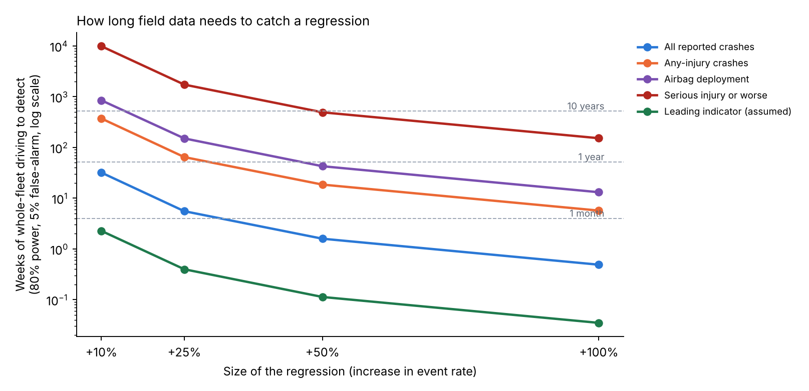

# Can field data catch a safety regression?

[](https://doi.org/10.5281/zenodo.23858361)

Test coverage, sequential monitoring and automated risk reporting for automated-driving software releases.

After each software release, an ADS safety team needs to know two things: whether pre-release testing was enough, and how fast field data would reveal a release that made driving less safe. This repository answers both quantitatively. It uses event rates per mile derived from public NHTSA crash reports for Waymo's rider-only fleet (271.3 million miles through June 2026; [companion analysis](https://github.com/mohalbati/av-safety-bayesian-analysis), DOI [10.5281/zenodo.23732384](https://doi.org/10.5281/zenodo.23732384)).

- **Technical report (28 pages):** [`docs/technical_report.pdf`](docs/technical_report.pdf) ([Word](docs/technical_report.docx)): background, data, every method and equation, results, verification, limitations, equation and assumption registers.
- **Short note (8 pages):** [`docs/technical_note.pdf`](docs/technical_note.pdf) ([Word](docs/technical_note.docx))



## Key results

| Question | Answer |
|---|---|
| Fleet weeks to detect a +25% rise in all reported crashes | about 6 |
| ... in any-injury crashes | about 65 |
| ... in serious-injury-or-worse crashes | about 1,730 (33 years) |
| ... in a frequent leading indicator (assumed 100 per million miles) | under 1 |
| Failure-free scenario runs to show P(failure) < 1% at 95% confidence | 299 |
| Expected baseline events needed to detect +25%, for any metric | about 117 |
| Weeks to detect +25% in all crashes on a 10% canary release | about 55 |
| Chance of at least one false alarm in 2 years across 5 CUSUM charts, each with one false alarm per 5 years | 85–86% |
| Weeks between false alarms on a frequent metric whose weekly rate varies by 10% (Poisson-designed chart) | about 11 |
| Largest gap between simulated and Markov-chain run lengths (25 comparisons) | 2.2% |

**Implication:** field outcomes protect against regressions in frequent events only. For severe outcomes, release gating must rely on risk-weighted scenario testing and on leading indicators.

## What the code does

| Part | File | Output |
|---|---|---|
| Exposure needed to detect a regression (exact Poisson; release-vs-release approximation) | `src/avmon/power.py` | `results/table1_detectability.csv`, Figure 1 |
| Scenario runs needed (zero-failure demonstration) | `src/avmon/power.py` | `results/table2_test_coverage.csv` |
| Poisson CUSUM, calibrated by simulation to a target false-alarm interval; Bayesian check | `src/avmon/monitor.py` | `results/table3_cusum_design.csv` |
| Two simulated years of 4-weekly releases with a regression at week 60 | `scripts/run_all.py` | `results/fig2_release_timeline.png` |
| Risk register scored with uncertainty (ISO 31000 lifecycle) | `data/risk_register.csv` | `results/table4_risk_register_scored.csv`, Figure 3 |
| One-page release health report, generated automatically | `scripts/run_all.py` | [`results/release_health_report.html`](results/release_health_report.html) |
| Supplementary studies: staged rollout, power curves, baseline uncertainty, test plans and OC curves, Markov-chain verification, CUSUM vs Shewhart, false-alarm budget, overdispersion, leading-indicator coupling, Bayesian check, ranking probabilities | `scripts/supplementary.py` | `results/table5`–`table12`, `fig5`–`fig11` |
| Monitoring animation | `scripts/make_monitoring_video.py` | MP4 of the simulated history |

Every rate is labeled PUBLISHED-DERIVED or ASSUMED in `src/avmon/rates.py`. No company-internal data is used; the simulated release history is synthetic.

## Reproduce

Requires Python 3.10 or newer.

```bash
pip install -r requirements.txt
python tests/test_core.py        # 11 tests
python scripts/run_all.py        # main tables, figures and the release health report (about 30 s)
python scripts/supplementary.py  # supplementary studies (about 2 minutes)
python scripts/workflow_figure.py
python scripts/explainer_figures.py    # worked examples and figures for Section 5 of the report
python scripts/make_monitoring_video.py results/monitoring.mp4 results/monitoring_last_frame.png   # needs FFmpeg
python scripts/build_docs.py     # optional: rebuild the report and note (needs pandoc; see requirements-docs.txt)
```

## Limitations

- Rates come from public, self-reported crash data.
- Releases are assumed to run on the whole fleet at constant mileage; staged rollouts lengthen detection times.
- Weekly counts are assumed Poisson in the main design; the supplementary study shows the effect of overdispersion and how to recalibrate.
- The leading-indicator rate is assumed, and the risk register is illustrative.

## Related work

- [av-safety-bayesian-analysis](https://github.com/mohalbati/av-safety-bayesian-analysis): Bayesian rare-event analysis of robotaxi crash data (source of the rates).
- [av-counterfactual-uq](https://github.com/mohalbati/av-counterfactual-uq): uncertainty quantification of counterfactual crash simulation, with browser and CARLA simulators.

## Cite

Albati, M. (2026). *Can Field Data Catch a Safety Regression? Test coverage, sequential monitoring and automated risk reporting for automated-driving software releases* (v1.0). Zenodo. https://doi.org/10.5281/zenodo.23858361

## Author

Mohammad Albati, Ph.D. · [GitHub](https://github.com/mohalbati)

MIT License.
