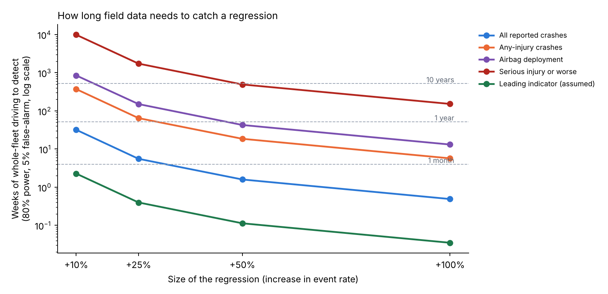
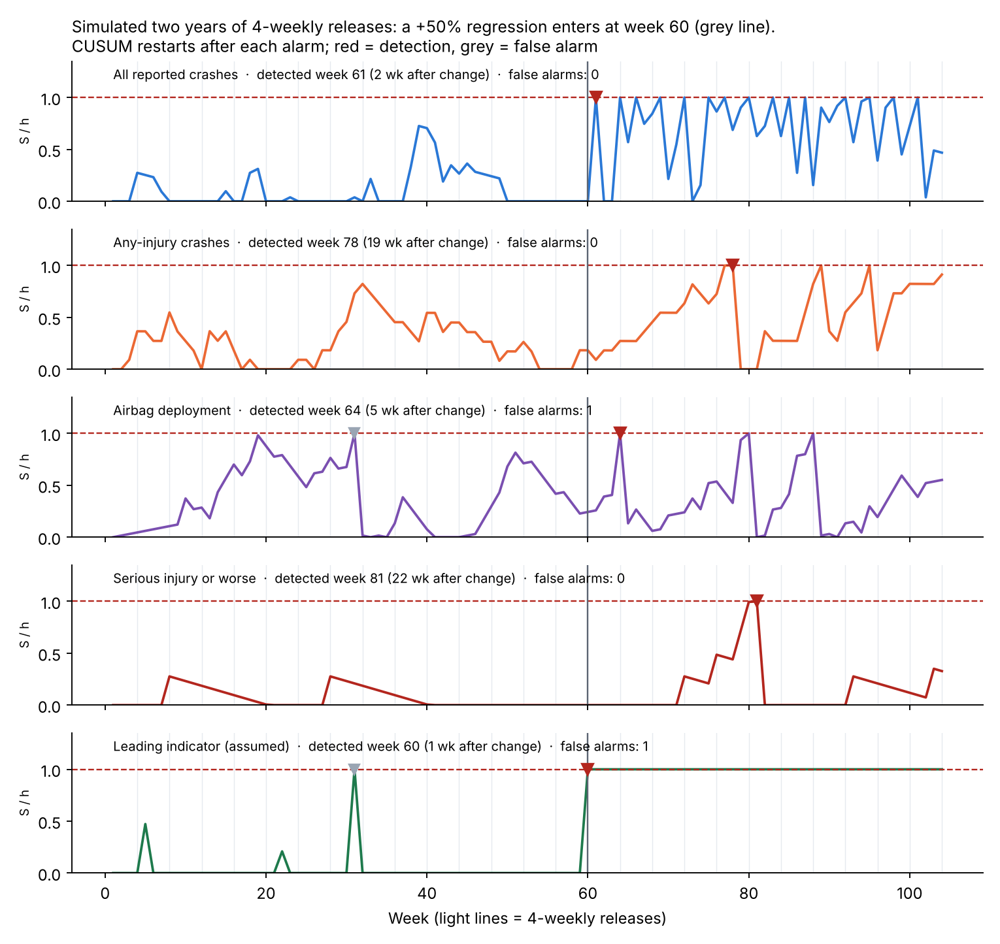
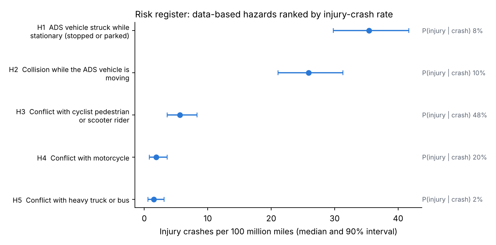
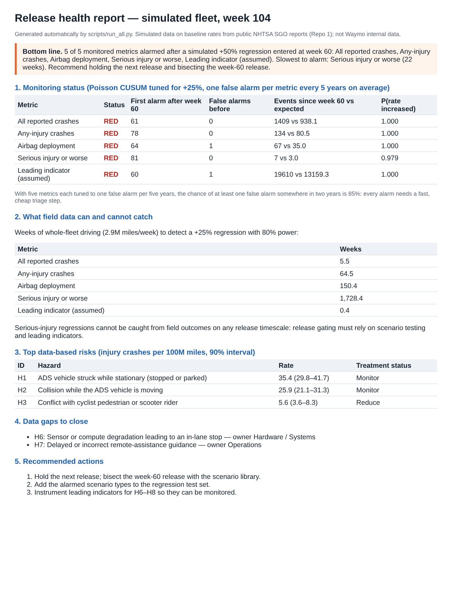

# Summary

Automated driving systems (ADS) receive frequent software updates. After each release, a safety team needs to know two things: whether testing before the release was enough, and how quickly field data would reveal a release that made driving less safe. This note answers both questions quantitatively. It uses event rates per mile derived from public NHTSA crash reports for Waymo's rider-only fleet (271.3 million miles through June 2026; companion analysis, DOI 10.5281/zenodo.23732384) and standard statistical methods.

**Findings:**

- **Field data catches only frequent outcomes quickly.** With the whole fleet driving about 2.9 million miles a week, a 25% increase in the all-crash rate is detectable in about **6 weeks**. The same increase in any-injury crashes takes about **65 weeks**. For serious-injury-or-worse crashes it takes about **1,730 weeks (33 years)**.
- **So release gating for severe outcomes must rely on testing and leading indicators.** A frequent leading indicator (assumed at 100 events per million miles) would reveal a 25% regression within about three days of fleet driving.
- **Scenario testing needs hundreds to thousands of runs per scenario type.** Showing a failure probability below 1% at 95% confidence takes 299 failure-free runs; below 0.1% takes 2,995.
- **Sequential monitoring works, but false alarms add up.** Poisson CUSUM charts tuned to one false alarm per metric every five years still give an **85%** chance of at least one false alarm somewhere across five metrics in two years. Every alarm needs a fast, cheap triage step.
- **The reporting can be automated.** A scored risk register following the ISO 31000 lifecycle and a one-page release health report are generated from the data by one script.

# 1. The question

A risk-management team for an ADS has to say what test coverage and field monitoring are needed to protect against regressions: a new release that performs worse than the one before. Two questions follow:

1. **Field monitoring:** after a release goes out, how many miles of driving does it take to detect a given increase in an event rate, and how should alarms be set?
2. **Test coverage:** if field data cannot catch a regression in time, how much pre-release testing is needed instead?

# 2. Data and assumptions

: Table 1. Event rates used (per million miles). PUBLISHED-DERIVED values come from public NHTSA Standing General Order crash reports for Waymo's rider-only fleet, analyzed in the companion repository; ASSUMED values are illustrative.

| Metric | Rate per million miles | Basis |
|---|---|---|
| All reported crashes | 7.13 | Published-derived: 1,934 crashed vehicles in 271.3M miles |
| Any-injury crashes | 0.612 | Published-derived: posterior median, 166 events |
| Airbag deployment | 0.266 | Published-derived: posterior median, 72 events |
| Serious injury or worse | 0.023 | Published-derived: posterior median, 6 events |
| Leading indicator (e.g. hard braking, near misses) | 100 | Assumed; not public |

**Fleet exposure.** About 12.7 million miles per month (2.9 million per week), derived from the 542 crashes reported in January–June 2026 at 7.13 crashes per million miles. Every release is assumed to run on the whole fleet.

**What is not used.** No Waymo internal data. Simulated release histories are synthetic; the risk register's operational hazards (H6–H8) have no public data and are flagged as data gaps.

# 3. Methods

**Detectability (exact Poisson test).** The baseline rate λ₀ is known from long fleet history. After a release, N events are observed in M million miles. An alarm is raised if P(N ≥ n | λ₀M) ≤ α = 0.05. The power to detect a regression to λ₁ = (1 + r)λ₀ is

$$\text{power}(M) = P\left(N \ge c \mid \lambda_1 M\right), \qquad c = \min\{\, n : P(N \ge n \mid \lambda_0 M) \le \alpha \,\}$$

and the exposure reported is the smallest M after which power stays at or above 80%. A release-versus-release comparison, with no known baseline, needs roughly twice as many miles (normal approximation on the log rate ratio; `results/table1_detectability.csv`).

**Test coverage (zero-failure demonstration).** To show that a scenario type's failure probability is below p at confidence C with n failure-free runs:

$$n = \left\lceil \frac{\ln(1 - C)}{\ln(1 - p)} \right\rceil \approx \frac{3}{p} \quad (C = 0.95)$$

**Sequential monitoring (Poisson CUSUM; Lucas, 1985).** With weekly counts X~t~, in-control mean m₀ and the regression to catch m₁ = 1.25 m₀:

$$k = \frac{m_1 - m_0}{\ln(m_1/m_0)}, \qquad S_t = \max\left(0,\; S_{t-1} + X_t - k\right), \qquad \text{alarm if } S_t \ge h$$

h is set by simulation so that the mean time between false alarms (ARL₀) is 260 weeks per metric. After each alarm the chart restarts, as it would after an investigation.

**Bayesian check.** With a Jeffreys prior, the posterior rate after N events in M million miles is Gamma(N + ½, M), giving P(λ > λ₀ | data).

**Risk register.** Hazards are scored by their injury-crash rate per 100 million miles, with Gamma posteriors for counts and Beta posteriors for P(injury | crash), following the ISO 31000 sequence: identify, analyze, evaluate, treat, monitor and report.

# 4. Results

## 4.1 How long field data needs to catch a regression

{width=100%}

: Table 2. Weeks of whole-fleet driving to detect a regression (80% power, 5% false alarm, known baseline).

| Metric | +10% | +25% | +50% | +100% |
|---|---|---|---|---|
| Leading indicator (assumed) | 2.3 | 0.4 | 0.1 | <0.1 |
| All reported crashes | 31.9 | 5.6 | 1.6 | 0.5 |
| Any-injury crashes | 372 | 65.1 | 18.4 | 5.7 |
| Airbag deployment | 855 | 150 | 42.4 | 13.1 |
| Serious injury or worse | 9,885 | 1,733 | 490 | 151 |

A release typically lives for weeks. Field data can therefore protect against regressions in frequent outcomes, but not in severe ones: even a doubling of the serious-injury rate would take about three years of whole-fleet driving to show.

## 4.2 How much testing replaces the missing field evidence

: Table 3. Failure-free scenario runs needed to show a failure probability below a target.

| Target failure probability | 90% confidence | 95% confidence | 99% confidence |
|---|---|---|---|
| 10% | 22 | 29 | 44 |
| 1% | 230 | 299 | 459 |
| 0.1% | 2,302 | 2,995 | 4,603 |
| 0.01% | 23,025 | 29,956 | 46,050 |

Simulation makes these numbers feasible; its credibility (validation against the field) then becomes the key evidence.

## 4.3 Sequential monitoring in practice

: Table 4. Poisson CUSUM design per metric (weekly counts; tuned for +25%; ARL₀ about 260 weeks). Median weeks to the first alarm after a regression starts.

| Metric | Expected weekly count | h | +25% | +50% | +100% |
|---|---|---|---|---|---|
| All reported crashes | 20.8 | 16.9 | 6 | 3 | 1 |
| Any-injury crashes | 1.79 | 10.9 | 30 | 14 | 7 |
| Airbag deployment | 0.78 | 8.5 | 45 | 24 | 12 |
| Serious injury or worse | 0.067 | 3.3 | 105 | 70 | 43 |
| Leading indicator (assumed) | 292 | 11.4 | 1 | 1 | 1 |

{width=100%}

In the simulated history (Figure 2), the leading indicator alarmed in the first week of the regression and all crashes in the second. Airbag deployments took 5 weeks, any-injury crashes 19 and serious injuries 22; the serious-injury metric was lucky here, since its median is 70 weeks. Two false alarms occurred before the change. Across five metrics each tuned to one false alarm per five years, the chance of at least one false alarm in two years is 85%.

## 4.4 Risk register and automated reporting

{width=88%}

: Table 5. Scored risk register (ISO 31000 lifecycle). H1–H5 are data-based (companion analysis); H6–H8 have no public data and are flagged as data gaps.

| ID | Hazard | Crash rate per M mi | P(injury given crash) | Injury crashes per 100M mi (90% interval) | Treatment status |
|---|---|---|---|---|---|
| H1 | Struck while stationary | 4.40 | 8.1% | 35.4 (29.8–41.7) | Monitor |
| H2 | Collision while moving | 2.73 | 9.5% | 25.9 (21.1–31.3) | Monitor |
| H3 | Cyclist, pedestrian or scooter rider | 0.11 | 48.4% | 5.6 (3.6–8.3) | Reduce |
| H4 | Motorcycle | 0.09 | 20.4% | 1.9 (0.8–3.6) | Reduce |
| H5 | Heavy truck or bus | 0.83 | 1.9% | 1.5 (0.6–3.1) | Accept and monitor |
| H6 | Sensor or compute degradation, in-lane stop | – | – | data gap | Data gap |
| H7 | Delayed or incorrect remote assistance | – | – | data gap | Data gap |
| H8 | Behavior regression from a release | – | – | monitored (Section 4.3) | Monitor |

The script also writes a one-page release health report (`results/release_health_report.html`): bottom line first, monitoring status per metric, what field data can and cannot catch, top risks, data gaps and recommended actions. Every number in it is computed, so it can be regenerated for each release without manual editing.

{width=70%}

# 5. What this means for release gating

1. **Gate on testing for severe outcomes.** Field outcomes cannot protect a single release against serious-injury regressions. A risk-weighted scenario library, re-run on every release, must carry that load, with its credibility established against field data.
2. **Monitor leading indicators.** Frequent precursors that correlate with severe outcomes give field monitoring real power. Establishing that correlation is itself a research task.
3. **Design alarms as a system.** Tune each chart to the regression size that matters and budget the family-wise false-alarm rate, with a fast triage step for each alarm.
4. **Automate the reporting.** A computed risk register and release report keep assessments consistent as the product scope grows.

# 6. Limitations

- Rates are from public, self-reported crash data, with the limitations described in the companion analysis.
- Every release is assumed to run on the whole fleet at a constant mileage; staged rollouts would lengthen detection times.
- Weekly counts are assumed Poisson; overdispersion (for example from weather or city mix) would need negative-binomial charts.
- The leading-indicator rate and its link to severe outcomes are assumed.
- The risk register is illustrative and does not describe any company's actual register.

# 7. Reproduce

```
pip install -r requirements.txt
python tests/test_core.py        # 8 tests
python scripts/run_all.py        # all tables, figures and the release health report (about 30 s)
```

# References

- Albati, M. (2026). How much evidence is enough? A Bayesian rare-event analysis of robotaxi crash data. Zenodo. doi:10.5281/zenodo.23732384
- International Organization for Standardization (2018). *ISO 31000:2018 Risk management: Guidelines*.
- International Organization for Standardization (2019). *IEC 31010:2019 Risk management: Risk assessment techniques*.
- Kalra, N., Paddock, S. M. (2016). *Driving to Safety: How Many Miles of Driving Would It Take to Demonstrate Autonomous Vehicle Reliability?* RAND RR-1478-RC.
- Lucas, J. M. (1985). Counted data CUSUM's. *Technometrics* 27(2), 129–144.
- Montgomery, D. C. (2019). *Introduction to Statistical Quality Control*, 8th ed. Wiley.
- National Highway Traffic Safety Administration. Standing General Order 2021-01 on crash reporting: ADS incident reports.
