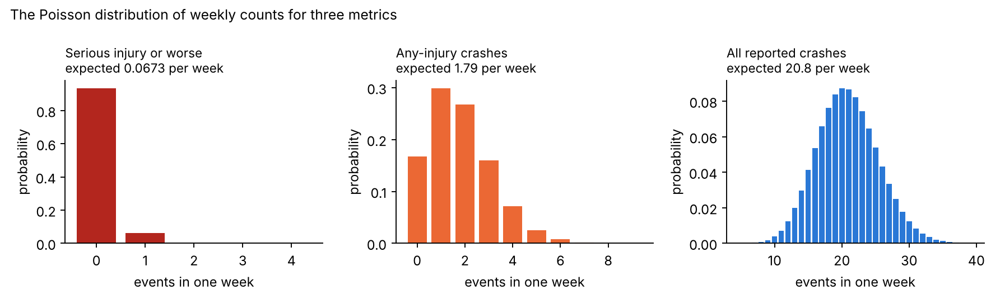
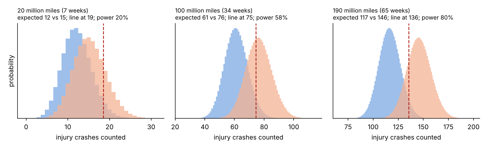
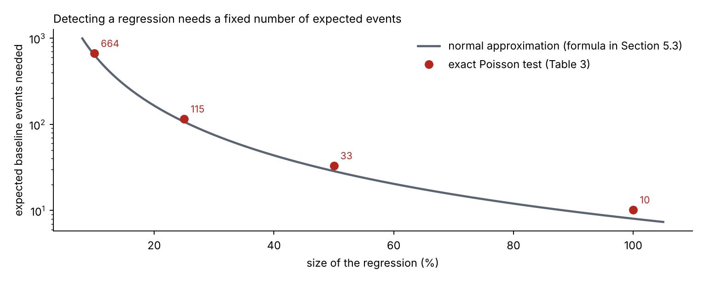
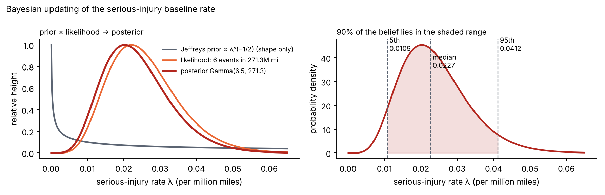
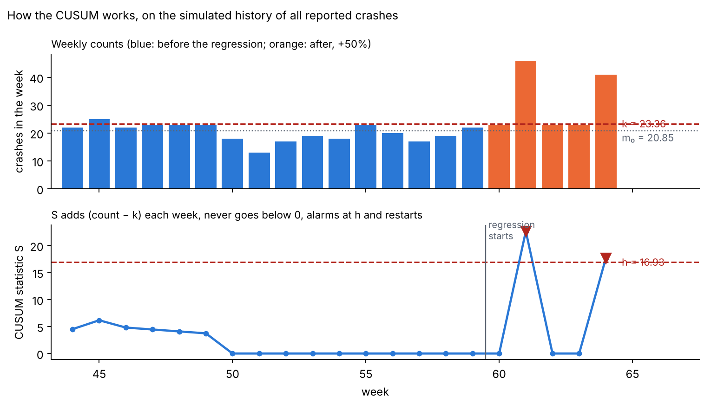
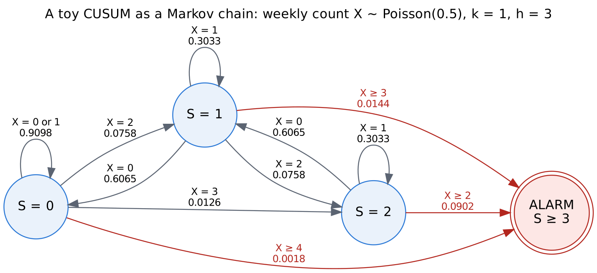
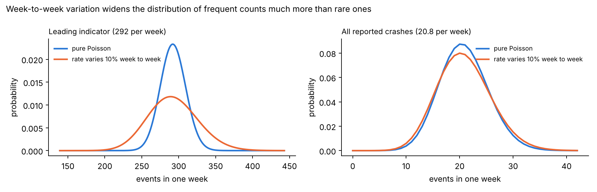
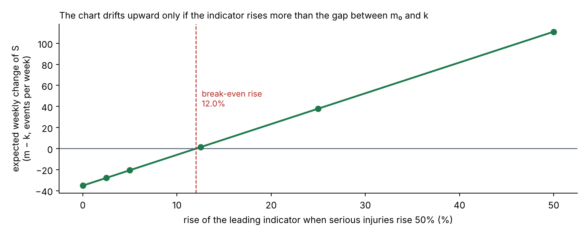
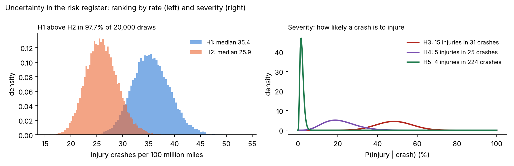

# Summary

Automated driving systems (ADS) receive software updates every few weeks. Each update can improve the driving, and each can also make some behavior worse. A safety team that owns release risk has to answer two questions for every release:

1. **Was the testing before the release enough?**
2. **If the release did make driving less safe, how quickly would field data show it, and how should the alarms be set?**

This report answers both questions with numbers. It uses event rates derived from public NHTSA Standing General Order (SGO) crash reports for Waymo's rider-only fleet (271.3 million miles through June 2026; companion analysis, DOI 10.5281/zenodo.23732384), standard statistical methods, and an open Python code base with verification tests. It does not use any company-internal data.

**Main findings**

- **Field data catches only frequent outcomes quickly.** With the whole fleet driving about 2.9 million miles a week, a 25% increase in the all-crash rate is detectable in about **6 weeks** (80% power, 5% false alarm). The same increase takes about **65 weeks** for any-injury crashes, **150 weeks** for airbag deployments and about **1,730 weeks (33 years)** for serious-injury-or-worse crashes. Detecting a +25% change always needs about **117 expected baseline events**, whatever the metric; rare outcomes simply take longer to collect them.
- **Staged rollouts make this worse.** A release running on 10% of the fleet needs ten times longer: about a year for a +25% change in all crashes.
- **So release gating for severe outcomes must rely on testing and on leading indicators.** Showing that a scenario type fails less than 1% of the time, at 95% confidence, takes **299 failure-free runs**; for 0.1% it takes **2,995**. Plans that tolerate one or two failures need 1.6–2.1 times more runs but pass good releases more often.
- **Sequential monitoring works, and its design can be verified.** Poisson CUSUM charts, calibrated by simulation to one false alarm per metric every five years, detect a +50% regression in a median of 3 weeks (all crashes) to 70 weeks (serious injuries). An independent Markov-chain calculation reproduces every simulated run length within 2.2%.
- **CUSUM beats a simple weekly threshold** by a factor of about 2 to 5 for moderate regressions in injury and airbag counts.
- **False alarms add up.** Five charts, each with one false alarm per five years, give an **86%** chance of at least one false alarm somewhere in two years. Every alarm needs a fast, cheap triage step.
- **Week-to-week variation breaks naive charts on frequent metrics.** If the true weekly rate varies by 5–20% (weather, city mix, demand), a chart designed for pure Poisson counts on a high-count leading indicator false-alarms every 1 to 11 months instead of every 5 years. Recalibrating the threshold restores the false-alarm interval while keeping detection within about 3 weeks.
- **A leading indicator helps only if it moves with the severe outcome.** If an indicator rises by 12.5% when serious injuries rise 50%, it alarms in about 2 weeks; if it rises by only 2.5%, it takes about a year (median 56 weeks).
- **The reporting can be automated.** One script produces a scored risk register following the ISO 31000 lifecycle, with uncertainty on every score, and a one-page release health report with the bottom line first.

**What this means for release gating**: gate severe outcomes on risk-weighted scenario testing; establish the credibility of the simulation that carries that testing; monitor leading indicators whose link to severe outcomes is demonstrated; design alarms as a system with a false-alarm budget; and generate the reporting from code so it stays consistent from release to release.

# 1. Introduction

## 1.1 The problem: regressions in a frequently updated safety-critical system

An ADS is a software-intensive system that is updated regularly: new maps and cities, new perception and prediction models, changes to the driving policy, and fixes to field issues. Every update is meant to make the system better, but a change that improves one behavior can degrade another. A **regression** in this report is any release whose rate of an undesirable event (a crash, an injury, a hard-braking event) is higher than that of the release before it.

Regression protection is a standard concern in safety-critical industries. In nuclear power, plant modifications go through a safety evaluation before installation and are followed by performance-indicator monitoring afterwards (for example the U.S. reactor oversight performance indicators, NEI 99-02). In automated driving, the safety-case standard UL 4600 asks for safety performance indicators that are monitored in the field and fed back into the safety case. The questions are the same in both industries: what evidence is needed before the change, and how fast would the field reveal a problem after it?

## 1.2 Questions answered

This report answers seven questions:

- **Q1. Detectability.** How many miles, and how many weeks of fleet driving, does it take to detect a regression of a given size in each safety metric?
- **Q2. Deployment strategy.** How do staged rollouts and release-to-release comparisons change that answer?
- **Q3. Test coverage.** When field data cannot catch a regression in time, how many scenario runs are needed instead, and what are the trade-offs of different test plans?
- **Q4. Sequential monitoring.** How should weekly field monitoring be designed, how fast does it detect a regression, and how can its design be verified?
- **Q5. Robustness.** How do false alarms across many charts, overdispersed counts and weak leading indicators affect monitoring?
- **Q6. Risk register.** How can hazards be scored and ranked with honest uncertainty, following the ISO 31000 lifecycle?
- **Q7. Reporting.** Can the analysis produce a release health report automatically?

## 1.3 Contributions

1. A quantitative map of what field data can and cannot catch, by metric and regression size, for a large robotaxi fleet, with a simple rule: about 117 expected baseline events to detect +25%.
2. Test-plan sizing linked to risk targets, including plans that allow failures, a Bayesian alternative, and operating-characteristic curves.
3. A calibrated, verified CUSUM monitoring design per metric, with a comparison against a simple threshold chart and a Markov-chain verification.
4. Three robustness studies that matter in practice: the false-alarm budget, overdispersion and leading-indicator coupling.
5. An ISO 31000 risk register with posterior uncertainty and ranking probabilities, and an automatically generated release health report.
6. A review of the standards and regulations that govern ADS release safety (ISO 26262, ISO 21448, ISO/TS 5083, UL 4600, UN R156, UN R185, EU 2022/1426 and others), showing that they require field monitoring and change management but leave the statistical design open (Section 2.5).
7. A step-by-step explanation of every method for non-specialists, with derivations, worked examples and figures (Section 5).
8. Open code with eleven verification tests; every number in this report is produced by `scripts/run_all.py`, `scripts/supplementary.py` and `scripts/explainer_figures.py`.

## 1.4 Relationship to the companion projects

This is the third of three open projects on automated-driving safety:

- **av-safety-bayesian-analysis** (DOI 10.5281/zenodo.23732384) asks how much evidence the fleet record provides. It supplies the event rates used here.
- **av-counterfactual-uq** (DOI 10.5281/zenodo.23838254) asks how certain a counterfactual crash simulation is. It matters here because, when field data cannot protect a release, simulation-based testing must, and its credibility becomes part of the safety evidence.
- **av-safety-monitoring** (this report) asks what protects a release after it ships.

{width=100%}

## 1.5 How to read this report

Section 2 reviews the statistical literature and, in detail, the standards and regulations that govern ADS release safety. Section 3 describes the data and every assumption. Section 4 states each method concisely with its equations. **Section 5 explains every method from first principles**, with derivations of all equations, the meaning of every symbol, the assumptions, the sources and worked examples with the study's numbers; it is written for readers without a background in statistics. Section 6 presents the results, Section 7 discusses what they mean for release gating, Section 8 summarizes verification, and Sections 9–11 cover limitations, future work and reproduction. The appendices contain the equation register, the assumption register, a glossary and the code map. Figures and tables in Sections 2 and 5 are numbered by section (for example Figure 5.3); all others are numbered in sequence.

# 2. Background and literature review

This section reviews the two bodies of work this report builds on. The first is the statistical literature: how to demonstrate safety from driving data, how to size a test program, and how to monitor a rate over time. The second is the body of standards and regulations that tell an ADS developer what must be shown before a release and what must be watched after it. Section 2.5 reviews the standards in detail, because they set the requirements that the methods of Section 4 turn into numbers.

## 2.1 Statistical demonstration of safety

**The problem of rare events.** Kalra and Paddock (2016) asked how many miles an automated fleet would need to drive, with no failures, to show that its fatality rate is below the human rate of about 1.09 deaths per 100 million miles in the United States at that time. Their answer, about 275 million failure-free miles for 95% confidence, and billions of miles to show a 20% improvement, made a point that every later study accepts: driving alone cannot demonstrate safety for the most severe outcomes in any reasonable time. Their arithmetic is the same zero-failure arithmetic used for test plans in Section 4.5.

**Comparison with human benchmarks.** Since then, developers have published crash-rate comparisons with human benchmarks matched to the same roads and conditions. Waymo's analyses (for example Kusano et al., 2024) compare police-reported and injury crash rates of its rider-only fleet with benchmarks built from state crash data and naturalistic driving. These studies answer "is the fleet safer than humans?", which is a one-time comparison of two rates. They do not address the question of this report: how quickly would the data reveal that a *new release* is worse than the *previous one*.

**Bayesian rare-event methods.** Nuclear probabilistic risk assessment (PRA) has long estimated rates of rare events from few or zero failures with Bayesian methods (Atwood et al., 2003). The companion analysis applied those methods to Waymo's public record and found, for example, that a new operator needs about 9.1 million miles with zero serious crashes to claim, at 95% confidence, that it beats human drivers on serious injuries. That analysis supplies the rates used here (Section 3.1).

**From one rate to a change in rate.** Detecting a regression is harder than estimating a rate, because two uncertain quantities are compared. Classic results for comparing Poisson rates (the exact conditional test, and the normal approximation on the log rate ratio) are standard in epidemiology and reliability engineering. Section 4.1 uses the exact one-sample test, and Section 4.2 the two-sample approximation.

## 2.2 Zero-failure demonstration testing

When failures are rare, reliability engineers size test programs by the number of failure-free trials needed to bound the failure probability. With zero failures in *n* independent trials, the one-sided upper confidence bound on the failure probability gives the "rule of three": about 3/*n* at 95% confidence (Hanley and Lippman-Hand, 1983). Plans that allow *c* failures use the exact binomial bound of Clopper and Pearson (1934). Bayesian versions put a prior distribution on the failure probability; the Jeffreys prior is the default non-informative choice in PRA (Atwood et al., 2003).

These ideas are standardized. IEC 61123:2019 gives compliance test plans for a *success ratio*, that is, for items tested as independent pass/fail trials with a constant failure probability, which is exactly the situation of a scenario library run against a release. It includes fixed-length plans and truncated sequential probability ratio test (SPRT) plans with tables of their operating characteristics. IEC 61124:2023 gives the corresponding plans for a *constant failure rate* (failures per unit time or distance). The U.S. military handbook MIL-HDBK-781A provides similar fixed-length and sequential reliability test plans. All of them describe a plan by its operating characteristic (OC) curve: the probability of passing as a function of the true failure probability, the tool used in Section 4.5.

## 2.3 Sequential monitoring and the CUSUM

**Sequential testing.** Wald (1945) introduced the sequential probability ratio test (SPRT): instead of fixing the sample size in advance, the evidence is examined after each observation, and testing stops as soon as the likelihood ratio crosses a boundary. On average the SPRT needs far fewer observations than a fixed-size test with the same error rates.

**The CUSUM.** Page (1954) turned the same idea into a monitoring tool. The cumulative sum (CUSUM) chart adds up the log-likelihood ratio of "the process has shifted" against "it has not", resets to zero when the sum becomes negative, and alarms when the sum crosses a threshold *h*. Lorden (1971) and Moustakides (1986) proved that the CUSUM is optimal: among all procedures with the same mean time between false alarms, it minimizes the worst-case delay in detecting the shift it is tuned for.

**Counted data.** Lucas (1985) gave the Poisson CUSUM for counts, with a reference value *k* chosen to detect a shift from a mean of *m*₀ to *m*₁ (Section 4.6). Performance is measured by the average run length (ARL): ARL₀, the mean time between false alarms when nothing has changed, and ARL₁, the mean time to detect a real shift. Brook and Evans (1972) showed that the ARL can be computed exactly by treating the CUSUM as a Markov chain (Section 4.7). Hawkins and Olwell (1998) and Montgomery (2019) are the standard textbooks. ISO 7870-4:2021 standardizes CUSUM charts, and ISO 7870-2:2023 the simpler Shewhart charts that alarm on a single unusual observation (Section 4.8).

**Health surveillance.** CUSUMs are widely used to monitor rare adverse events in health care and public health (Woodall, 2006), for example surgical mortality, where Steiner et al. (2000) introduced a risk-adjusted CUSUM that accounts for patient mix. Rare counts, a changing case mix and many charts monitored at once make that setting a close analogue of crash monitoring for an ADS fleet.

## 2.4 Risk management lifecycle

ISO 31000:2018 defines risk management as a cycle: establish the context; identify, analyze and evaluate risks; treat them; monitor and review; and communicate and report. IEC 31010:2019 catalogs the techniques used at each step. ISO/IEC Guide 51:2014 defines *tolerable risk* (risk accepted in a given context based on the current values of society) and describes risk reduction as an iterative process of assessment and reduction until the residual risk is tolerable. This report uses the ISO 31000 lifecycle for the risk register (Section 4.13) and treats CUSUM charts as one implementation of the "monitor and review" step.

## 2.5 Standards, regulations and guidance for ADS release safety

{width=100%}

### 2.5.1 Functional safety: IEC 61508 and ISO 26262

**IEC 61508** is the generic standard for the functional safety of electrical, electronic and programmable electronic safety-related systems. It introduced the safety lifecycle, safety integrity levels and the idea that the rigor of development must match the risk. Sector standards, including ISO 26262 for road vehicles, are adaptations of it.

**ISO 26262:2018** (second edition, 12 parts) addresses hazards caused by *malfunctioning behavior* of electrical and electronic systems, that is, faults. Hazards are classified by severity, exposure and controllability into Automotive Safety Integrity Levels (ASIL A to D), which set the required rigor. Three parts of it bear directly on release regressions:

- **Change management** (ISO 26262-8): every change to an item, including a software change, needs an impact analysis that identifies the work products and safety activities affected, and the change must be verified before release. A regression is precisely what an incomplete impact analysis lets through.
- **Safety management after release** (ISO 26262-2) and **production, operation, service and decommissioning** (ISO 26262-7): the organization must keep a field-monitoring process to detect safety-relevant anomalies after release and feed them back into development.
- **Confirmation measures** (ISO 26262-2): independent reviews and audits of the safety case and safety activities.

ISO 26262 does not say how fast a field-monitoring process must detect a problem, or how to set its thresholds.

### 2.5.2 Safety of the intended functionality: ISO 21448

**ISO 21448:2022** (SOTIF) covers hazards that arise *without any fault*, from performance limitations of the intended function (for example a perception system that misjudges an unusual object) or from reasonably foreseeable misuse. It divides scenarios into four areas: known safe, known hazardous, unknown hazardous and unknown safe. The aim of SOTIF activities is to shrink the two hazardous areas, the known ones by design and verification, the unknown ones by validation and exploration. Three of its concepts are used in this report:

- **Acceptance criteria and validation targets.** The developer defines what residual risk is acceptable, often from human-driver accident statistics, and derives validation targets (for example a number of miles or scenario runs without a hazardous event) that would demonstrate it with stated confidence. The zero-failure arithmetic of Section 4.5 is one way to derive such targets.
- **Triggering conditions.** Specific conditions of a scenario that trigger hazardous behavior. Scenario types in the test library of Section 4.5 are organized around them.
- **Operation phase activities.** After release, field monitoring must look for new triggering conditions and for evidence that the residual risk is higher than argued, and must feed this back into the SOTIF process.

### 2.5.3 Safety of ADS: ISO/TS 5083, UL 4600, SAE J3016, IEEE 2846 and the ISO 3450x series

**ISO/TS 5083:2025** (Road vehicles, safety for automated driving systems, design, verification and validation) replaced ISO/TR 4804:2020. It ties ISO 26262, ISO 21448 and cybersecurity together into an ADS-level safety case and covers the safety strategy (including risk acceptance criteria and the absence of unreasonable risk), safety by design, verification, validation and operation. Its operation clause includes field monitoring with data collection, change management, and the management of crashes and incidents; its validation clause includes metrics and an example of validation by computing collision rates. These are the activities quantified in Sections 4.1–4.11.

**ANSI/UL 4600** (third edition, 2023) is a standard for the *safety case* of autonomous products: a structured argument, supported by evidence, that the system is acceptably safe. It does not prescribe a design method; it lists what the safety case must address and how it is assessed. Central to it are **safety performance indicators (SPIs)**: metrics with defined thresholds that provide evidence that the claims of the safety case remain valid during operation. When an SPI is violated, the safety case must be re-examined and corrected. A Poisson CUSUM on an injury-crash rate or on a leading indicator, with a stated false-alarm interval and detection delay, is a concrete SPI design; Sections 4.6–4.11 give the numbers UL 4600 asks for but does not supply.

**SAE J3016:2021** defines the levels of driving automation (0–5) and the operational design domain (ODD), the conditions under which the system is designed to operate. The fleet analyzed here is Level 4. **IEEE 2846-2022** defines minimum reasonable assumptions about the behavior of other road users that an ADS safety model should make. The **ISO 3450x series** standardizes scenario-based testing: vocabulary (ISO 34501:2022), the scenario-based safety evaluation framework (ISO 34502:2022), the ODD taxonomy (ISO 34503:2023), scenario categorization (ISO 34504:2024) and scenario evaluation and test-case generation (ISO 34505:2025). The test-coverage plans of Section 4.5 assume a scenario library organized in this way.

### 2.5.4 Artificial intelligence and cybersecurity

**ISO/PAS 8800:2024** extends ISO 26262 and ISO 21448 to AI elements such as machine-learned perception. It addresses data quality, the AI development lifecycle, verification and validation of AI components, and monitoring after deployment. Because ADS releases often change machine-learned models, regressions in AI behavior are one of the main sources of the regressions studied here. **ISO/SAE 21434:2021** (cybersecurity engineering) and UN Regulation No. 155 (cybersecurity management system) govern security, which matters here mainly because every over-the-air update must be secure.

### 2.5.5 Software updates: UN Regulation No. 156 and ISO 24089

**UN Regulation No. 156** requires vehicle manufacturers to operate an audited **software update management system (SUMS)**. Before an update is released, the manufacturer must identify the target vehicles, check compatibility with each vehicle configuration, assess the impact on safety and on the type approval, test and validate the update, and plan for recovery if an update fails. Each type-approval-relevant software version is identified by a Regulation Software Identification Number (RXSWIN). **ISO 24089:2023** gives the engineering guidance for software updates. These documents make the *process* around each release mandatory; the release-to-release analysis of Sections 4.1–4.5 addresses the *evidence* that a release has not made driving less safe.

### 2.5.6 Regulation of ADS and crash reporting

**United States.** The NHTSA **Standing General Order 2021-01** requires manufacturers and operators of ADS and Level 2 vehicles to report qualifying crashes. Its third amendment was issued on 24 April 2025 and took effect on 16 June 2025: the most severe crashes must be reported within five days and less severe ones monthly, and ADS reporting now has a property-damage threshold for less severe crashes. These reports are the data source of this report and of its companion. In April 2025 NHTSA also announced an AV Framework, including an expanded exemption program; in June 2026 it withdrew its January 2025 proposal for a voluntary program (AV STEP). There is no U.S. federal performance standard that sets how safe an ADS release must be or how it must be monitored.

**United Nations.** **UN Regulation No. 157** (Automated Lane Keeping Systems) was the first binding regulation for a Level 3 system. In June 2026, the World Forum WP.29 adopted a UN Regulation (No. 185) and a UN Global Technical Regulation (No. 26) on automated driving systems. Their main elements are a safety management system covering the whole lifecycle, a safety case showing that the ADS is free of unreasonable risk and at least as safe as a competent and careful human driver, validation by simulation, track and real-world testing, and in-service obligations: data storage, prompt reporting of critical events and periodic reporting of safety performance.

**European Union.** **Regulation (EU) 2022/1426** sets the type-approval rules for the ADS of fully automated vehicles in defined use cases (for example hub-to-hub and predefined areas). It requires a safety management system, an assessment showing that the vehicle is free of unreasonable risk compared with manually driven vehicles in comparable services, and **in-service monitoring and reporting (ISMR)**: the manufacturer must collect field data, analyze safety-relevant incidents and report relevant occurrences to the authorities. An indicative benchmark of 10⁻⁷ fatalities per hour of operation is given in a footnote.

### 2.5.7 Analogues from nuclear power

In U.S. nuclear power, a plant change is screened under 10 CFR 50.59 to decide whether it needs prior regulatory approval, and plant performance is tracked through the Reactor Oversight Process performance indicators (NEI 99-02), each with predefined thresholds (green, white, yellow and red bands) and a defined regulatory response at each band. The maintenance rule (10 CFR 50.65) requires licensees to monitor the performance of structures, systems and components against goals and to take corrective action when goals are not met. The structure is the same as the one this report proposes for ADS releases: an evaluation before the change, indicators with thresholds after it, and a predefined response to a threshold crossing.

### 2.5.8 What the standards require and what this report supplies

: Table 2.1. How the standards and regulations relate to release safety, and what this report adds.

| Document | What it requires for release and field safety | What it leaves open | Where this report helps |
|---|---|---|---|
| ISO 26262:2018 | Impact analysis and verification for every change; field monitoring after release | How fast monitoring must detect a problem; thresholds | Detectability (4.1–4.4); CUSUM design (4.6–4.8) |
| ISO 21448:2022 | Acceptance criteria; validation targets; operation-phase monitoring | Sizing of validation per scenario type; statistical monitoring design | Test-plan sizing and OC curves (4.5) |
| ISO/TS 5083:2025 | ADS safety case; V&V; operation with field monitoring and change management | Quantitative monitoring design | Sections 4.1–4.11 |
| ANSI/UL 4600 | SPIs with thresholds, monitored in the field, triggering safety-case updates | Statistical design of SPI thresholds; false-alarm budgets | CUSUM SPIs (4.6); false alarms (4.9); dispersion (4.10); leading indicators (4.11) |
| ISO 3450x series | Scenario-based testing framework and test-case generation | How many runs per scenario type | Runs per scenario type (4.5) |
| UN R156 / ISO 24089 | Managed, validated, traceable software updates | Evidence that an update did not reduce safety | Release-versus-release comparison (4.2); staged rollout (4.3) |
| UN R185 / GTR 26; EU 2022/1426 | Safety management system; safety case; in-service monitoring and reporting | What can be detected from in-service data, and how quickly | Detectability map (6.1–6.3); release health report (4.14) |
| NHTSA SGO 2021-01 | Crash reporting | Normalization by exposure; trend detection | Rates (3.1); monitoring (4.6) |
| ISO 31000 / IEC 31010 | Risk lifecycle, including monitor and review | Uncertainty in risk scores | Register with posterior intervals and ranking probabilities (4.13) |
| ISO 7870-2/-4; IEC 61123/61124 | Chart and test-plan methods | Application to ADS rates and releases | All of Section 4 |

The pattern is consistent. Every recent standard and regulation requires field monitoring, change management and evidence that a release keeps risk acceptable. None of them specifies how to design the statistics: which metrics can detect what size of regression in what time, how many scenario runs a release needs, how to set thresholds, or how to budget false alarms across many indicators. Those design questions are the subject of this report.

## 2.6 What Waymo publishes

Waymo publishes crash-rate comparisons with human benchmarks (for example Kusano et al., 2024) and has described its overall approach to determining the absence of unreasonable risk (Favarò et al., 2023), which combines several complementary methodologies rather than a single metric. This report does not describe or evaluate Waymo's internal release process; it uses public rates to show, quantitatively, the constraints any such process faces.

# 3. Data and assumptions

## 3.1 Event rates

: Table 1. Event rates (per million miles). PUBLISHED-DERIVED values come from public NHTSA SGO crash reports for Waymo's rider-only fleet, analyzed in the companion repository; the ASSUMED value is illustrative.

| Metric | Rate per million miles | Events behind it | Basis |
|---|---|---|---|
| All reported crashes | 7.13 | 1,934 crashed vehicles | Published-derived: 1,934 / 271.3M miles |
| Any-injury crashes | 0.612 | 166 | Published-derived: posterior median (Jeffreys) |
| Airbag deployment | 0.266 | 72 | Published-derived: posterior median |
| Serious injury or worse | 0.023 | 6 | Published-derived: posterior median |
| Leading indicator (e.g. hard braking, near misses) | 100 | – | Assumed; such data are not public |

The leading indicator stands for any frequent event that on-board triggers or log review can count, such as hard-braking events, close-following events or disengagement-like interventions. Its value of 100 per million miles is chosen only to represent a metric that is about 14 times more frequent than reported crashes.

**Questions a reader might ask.** *Why posterior medians and not simple averages?* For the three injury metrics the companion analysis estimated rates with a Bayesian method (Section 5.6); the median is its central value. With 72 or more events it is almost identical to the simple count divided by the miles. *Why include an assumed metric?* Because the main lesson of this report is that rare outcomes cannot be monitored quickly; a frequent precursor is the obvious alternative, and its behavior must be shown even though no public data exist.

## 3.2 Fleet exposure

The companion analysis found 542 crashed vehicles reported in January–June 2026. At 7.13 crashes per million miles, that corresponds to about 76 million miles in six months:

$$W_{\text{month}} = \frac{542}{7.13 \times 6} \approx 12.7 \ \text{million miles per month}, \qquad W = W_{\text{month}} \times \frac{12}{52} \approx 2.92 \ \text{million miles per week}$$

Expected weekly counts are therefore 20.8 (all crashes), 1.79 (any injury), 0.78 (airbag), 0.067 (serious injury) and 292 (leading indicator).

**Step by step.** (1) The companion analysis counted 542 crashed vehicles in January–June 2026. (2) At 7.13 crashes per million miles, 542 crashes correspond to 542 / 7.13 = 76 million miles. (3) Over six months, that is 12.7 million miles a month. (4) Converting months to weeks (×12/52) gives 2.92 million miles a week. *Why derive it instead of using a published number?* No weekly mileage is published for the period; deriving it from the crash count keeps the analysis internally consistent. If the true mileage is higher, every detection time in this report shrinks in proportion, and vice versa.

## 3.3 Release model

Releases are assumed to go out every four weeks to the whole fleet unless stated otherwise. A regression multiplies the rate of a metric by (1 + *r*) from the release that introduces it. Section 6.2 relaxes the whole-fleet assumption.

## 3.4 What is not used

No company-internal data. The simulated release history is synthetic. The operational hazards H6–H8 in the risk register have no public data and are flagged as data gaps rather than given invented numbers. Appendix B lists every assumption.

# 4. Methods

## 4.1 Detectability: exact one-sample Poisson test

The baseline rate λ₀ is known well from long fleet history (thousands of events for frequent metrics). After a release, N events are observed in M million miles. Under the null hypothesis (no regression), N ~ Poisson(λ₀M). The test alarms if N reaches the critical count

$$c(M) = \min \{\, n : P(N \ge n \mid \lambda_0 M) \le \alpha \,\}, \qquad \alpha = 0.05$$

The power to detect a regression to λ₁ = (1 + r)λ₀ is

$$\text{power}(M) = P\left(N \ge c(M) \mid \lambda_1 M\right) = 1 - F_{\text{Pois}}\left(c(M) - 1;\ \lambda_1 M\right)$$

Because counts are discrete, power is not monotone in M: it rises in a saw-tooth as c(M) steps up. The exposure reported is therefore the smallest M after which power stays at or above 80%. It is computed exactly, tooth by tooth of the saw-tooth, rather than on a grid of trial mileages (Section 5.3.6). Weeks of fleet driving are M / W.

**Worked example (any-injury crashes, +25%).** The reported exposure is M = 190.5 million miles (65.1 weeks). The expected baseline count is 0.612 × 190.5 = 116.6 events, the critical count is c = 136 (actual false-alarm rate 4.2%), the expected count under the regression is 145.7, and the power is 80.0%. Section 5.3 explains each step.

## 4.2 Release-versus-release comparison

When there is no long baseline (for example the first months in a new city), the new release must be compared with the previous one, each observed over M miles. Using the normal approximation for the log rate ratio,

$$\operatorname{Var}\left[\ln \frac{\hat\lambda_1}{\hat\lambda_0}\right] \approx \frac{1}{\lambda_0 M} + \frac{1}{\lambda_1 M}, \qquad M = \frac{(z_{1-\alpha} + z_{\text{power}})^2 \left(\frac{1}{\lambda_0} + \frac{1}{\lambda_1}\right)}{\left[\ln(1+r)\right]^2}$$

## 4.3 Staged rollout

If a release runs on a fraction f of the fleet, it accumulates fM miles per week, so the calendar time to detect scales as 1/f:

$$T_f = \frac{M}{f\,W}$$

## 4.4 Baseline-rate uncertainty

For rare outcomes the baseline itself is uncertain. With a Jeffreys prior, the posterior of λ₀ after k events in 271.3 million miles is Gamma(k + ½, 271.3). Detection times are recomputed at the 5th, 50th and 95th posterior percentiles of λ₀.

## 4.5 Test coverage

**Zero-failure plan.** To show that a scenario type's failure probability p is below p₀ at confidence C with n failure-free runs:

$$(1 - p_0)^n \le 1 - C \quad \Rightarrow \quad n = \left\lceil \frac{\ln(1 - C)}{\ln(1 - p_0)} \right\rceil \approx \frac{-\ln(1-C)}{p_0} \approx \frac{3}{p_0} \ (C = 0.95)$$

**Plans that allow c failures.** The release passes if at most c failures occur in n runs; n is the smallest value with

$$F_{\text{Bin}}(c;\ n, p_0) = \sum_{j=0}^{c} \binom{n}{j} p_0^{\,j} (1-p_0)^{n-j} \le 1 - C$$

**Bayesian zero-failure plan.** With a Jeffreys prior Beta(½, ½) and zero failures in n runs, the posterior is Beta(½, n + ½); n is the smallest value with P(p < p₀ | data) ≥ C.

**Operating characteristic (OC).** For a plan (n, c), the probability that a release whose true failure probability is p passes is F~Bin~(c; n, p). The OC curve shows how often good releases are wrongly held and bad ones wrongly passed.

## 4.6 Poisson CUSUM

Let X~t~ be the event count in week t, with in-control mean m₀ = λ₀W. The chart is tuned to detect the shift to m₁ = (1 + r~d~)m₀ with r~d~ = 0.25 (Lucas, 1985):

$$k = \frac{m_1 - m_0}{\ln(m_1 / m_0)}, \qquad S_0 = 0, \qquad S_t = \max\left(0,\ S_{t-1} + X_t - k\right), \qquad \text{alarm if } S_t \ge h$$

The reference value k lies between m₀ and m₁, so S~t~ drifts down when the process is in control and up after a regression. The threshold h is chosen so that the in-control ARL is 260 weeks (one false alarm per metric every five years). It is found by bisection on h, with the ARL estimated from 1,500 simulated run lengths at each step. After an alarm the statistic is reset to zero, as it would be after an investigation.

**Worked example (all crashes).** m₀ = 20.85 crashes per week, m₁ = 26.06, k = 23.35 and h = 16.93. In the simulated history the weekly counts in weeks 55–60 were 23, 20, 17, 19, 22 and 23, all below k, so S~t~ stayed at 0. The regression starts in week 60; in week 61 the count was 46, S = 0 + 46 − 23.35 = 22.65 ≥ 16.93, and the chart alarmed.

## 4.7 Markov-chain verification of the run lengths

Brook and Evans (1972) represent the CUSUM statistic as a Markov chain. The statistic is placed on a grid of width 1/g, with g chosen between 100 and 1,200 so that k is represented as exactly as possible within 5,000 states. With K = round(kg) and H = ⌈hg⌉, the transition from state i is to state max(0, i + gX − K) with probability P(X = x), and any state ≥ H is absorbing (an alarm). With R the transition matrix among the H in-control states,

$$\mathbf{ARL} = (\mathbf{I} - \mathbf{R})^{-1}\,\mathbf{1}, \qquad \text{ARL from a fresh start} = \mathbf{ARL}_0$$

This is computed independently of the simulation and used to verify it (Section 8).

## 4.8 Shewhart comparison

A one-sided Shewhart chart alarms when a single week's count reaches a limit c, chosen as the smallest value with P(X ≥ c | m₀) ≤ 1/260. Its ARL is 1 / P(X ≥ c | m). Because counts are discrete, its ARL₀ is at least 260 weeks and can be much larger.

## 4.9 Family-wise false alarms

Run lengths of a well-designed CUSUM in control are close to geometric, so the probability that one chart false-alarms within T weeks is about 1 − exp(−T/ARL₀). For m independent charts,

$$P(\text{at least one false alarm in } T \text{ weeks}) \approx 1 - \exp\left(-\frac{mT}{\text{ARL}_0}\right)$$

The simulated value for the five charts of this study is checked against this approximation.

## 4.10 Overdispersion

Real weekly counts vary more than Poisson because the underlying rate changes with weather, city mix, events and demand. This is modeled by drawing each week's rate from a Gamma distribution with mean m₀ and coefficient of variation (CV) v, so that counts are negative binomial with

$$\operatorname{Var}(X_t) = m_0 + v^2 m_0^2$$

The extra term grows with m₀², so overdispersion matters most for frequent metrics. The ARL₀ of the Poisson-designed chart is estimated by simulation for v = 0, 5%, 10% and 20%; for v = 10% the threshold is then recalibrated by bisection to restore ARL₀ = 260 weeks, and the cost in detection speed is measured.

## 4.11 Leading-indicator coupling

Suppose serious injuries rise by 50% and the leading indicator rises by 50β%, where β ∈ [0, 1] measures how strongly the indicator moves with the severe outcome. The median run length of the leading-indicator chart is computed for β = 0, 0.05, 0.10, 0.25, 0.5 and 1 and compared with the serious-injury chart itself.

## 4.12 Bayesian sequential check

As a second view of the same data, after a suspected change at week t₀ the posterior probability that the rate has increased is computed with a Jeffreys prior:

$$P(\lambda > \lambda_0 \mid N, M) = 1 - F_{\Gamma}\left(\lambda_0;\ N + \tfrac{1}{2},\ M\right)$$

where N is the number of events since t₀ and M the miles since t₀. Unlike the CUSUM, this check needs a candidate change point; in practice it is used after an alarm, or from each release date.

## 4.13 Risk register

The register follows the ISO 31000 sequence. Hazards H1–H5 come from the companion analysis' event tree and crash-partner breakdown; H6–H8 are operational hazards without public data. For each data-based hazard with n crashes, of which k involved an injury, in 271.3 million miles:

$$\lambda_{\text{crash}} = \frac{n}{271.3}, \qquad P(\text{injury} \mid \text{crash}) \sim \text{Beta}\left(k + \tfrac{1}{2},\ n - k + \tfrac{1}{2}\right), \qquad \lambda_{\text{injury}} \sim \Gamma\left(k + \tfrac{1}{2},\ 271.3\right)$$

The hazard score is the posterior median injury-crash rate per 100 million miles with a 90% interval. Ranking probabilities are computed from 20,000 joint posterior draws. Each hazard is also given a treatment, a monitoring metric, an owner team and a status (monitor, reduce, accept and monitor, or data gap).

## 4.14 Simulated release history and automated report

To exercise the monitoring and reporting end to end, 104 weeks of counts are simulated for all five metrics (seed 2026), with releases every four weeks and a +50% regression in every metric from week 60. The same script then writes a one-page HTML release health report: a bottom line, monitoring status per metric (RED for an alarm, AMBER when the statistic is above half the threshold, GREEN otherwise), what field data can and cannot catch, the top data-based risks, the data gaps and recommended actions. An animation of the history (`scripts/make_monitoring_video.py`) shows the charts building week by week.

## 4.15 Software

The code is a small Python package (`src/avmon`): `rates.py` (inputs and labels), `power.py` (detectability and test plans), `monitor.py` (CUSUM, run lengths, calibration, Markov chain, Shewhart, Bayesian check). `scripts/run_all.py` produces the main results (about 30 s) and `scripts/supplementary.py` the supplementary studies (about 2 minutes). All random sampling uses fixed seeds.

# 5. The methods explained step by step

Section 4 states each method briefly, as a specialist would. This section explains the same methods from first principles, for a reader who has no background in statistics. For every method it gives the idea in plain words, the science behind it, a derivation of every equation in small steps, the meaning of every symbol, the assumptions and where they come from, and a worked example with the actual numbers of this study. Figures 5.1 to 5.12 illustrate the concepts and the examples. Each subsection also ends with the method told as a short sequence of steps and with the questions a reader is likely to ask, answered in plain words.

Nothing in this section changes the analysis; it explains it. All numbers can be reproduced with `python scripts/explainer_figures.py`, which prints them and draws the figures.

## 5.1 How to read the equations

### 5.1.1 Notation

: Table 5.1. Mathematical notation used in this report.

| Notation | Read as | Meaning |
|---|---|---|
| *P*(*A*) | "probability of A" | A number between 0 (impossible) and 1 (certain): the long-run share of times *A* happens |
| *P*(*A* \| *B*) | "probability of A given B" | Probability of *A* when we already know that *B* is true |
| *X* ~ Poisson(*m*) | "X follows a Poisson distribution with mean m" | *X* is a random count whose probabilities are given by Eq. (5.4) |
| E[*X*] | "expected value of X" | The long-run average of *X* over many repetitions |
| Var(*X*), SD(*X*) | "variance", "standard deviation" | How much *X* scatters around its average; SD = √Var, in the same units as *X* |
| Σ~j=0~^c^ | "sum over j from 0 to c" | Add up the expression for *j* = 0, 1, …, *c* |
| ln(*x*), exp(*x*) = e^*x*^ | "natural log", "exponential" | Inverse functions: ln(e^*x*^) = *x*; e ≈ 2.718. ln turns products into sums: ln(*ab*) = ln *a* + ln *b* |
| ⌈*x*⌉ | "ceiling of x" | *x* rounded up to the next whole number |
| min{*n* : condition} | "smallest n such that…" | The first whole number that meets the condition |
| max(0, *y*) | "maximum of 0 and y" | *y* if *y* is positive, otherwise 0 |
| ≈ | "approximately equal" | Equal up to a small, stated approximation |
| *z*~q~ | "the q quantile of the standard normal" | The value below which a fraction *q* of a bell curve lies: *z*~0.95~ = 1.645, *z*~0.80~ = 0.842 |
| *n*! and (*n* choose *j*) | "n factorial", "n choose j" | *n*! = 1 × 2 × … × *n*; (*n* choose *j*) = *n*! / [*j*! (*n* − *j*)!], the number of ways to pick *j* items from *n* |

### 5.1.2 Symbols

: Table 5.2. Symbols used in Sections 3, 4 and 5, with units and values for this study.

| Symbol | Meaning | Units | Value(s) in this study |
|---|---|---|---|
| λ, λ₀, λ₁ | Event rate; baseline rate; rate after a regression | events per million miles | Table 1 (0.023 to 100) |
| *r* | Size of a regression (relative increase in rate) | – | 0.10, 0.25, 0.50, 1.00 |
| *M* | Exposure: miles driven | million miles | varies |
| *W* | Fleet miles per week | million miles per week | 2.92 |
| *N* | Number of events counted in *M* miles | events | varies |
| *X*~t~ | Number of events in week *t* | events | varies |
| *m*₀, *m*₁ | Expected weekly count before and after a regression (*m* = λ*W*) | events per week | 0.067 to 292 |
| α | False-alarm probability of a test | – | 0.05 |
| power | Probability that a test detects a real regression | – | 0.80 |
| *c*, *c*(*M*) | Critical count: alarm if *N* ≥ *c* | events | e.g. 134 |
| *f* | Share of the fleet running a release | – | 0.05 to 1 |
| *p*, *p*₀ | Failure probability of a scenario type; its target | – | 0.1% to 10% |
| *C* | Confidence level | – | 0.90, 0.95, 0.99 |
| *n* | Number of scenario runs | runs | e.g. 299 |
| *c* (test plans) | Allowed number of failures in a plan | failures | 0, 1, 2, 5 |
| *k* | CUSUM reference value | events per week | Table 9 |
| *h* | CUSUM alarm threshold | events | Table 9 |
| *S*~t~ | CUSUM statistic after week *t* | events | ≥ 0 |
| ARL, ARL₀, ARL₁ | Average run length (weeks to alarm); in control; after a shift | weeks | ARL₀ = 260 |
| **R** | Transition matrix of the Markov chain among in-control states | – | Section 5.9 |
| *v* | Coefficient of variation of the weekly rate (overdispersion) | – | 0 to 0.20 |
| β | Coupling: the indicator rises by β times the rise in serious injuries | – | 0 to 1 |
| *k*, *n* (register) | Injury crashes and crashes of a hazard | events | Table 15 |

## 5.2 Building blocks: rates, exposure and the Poisson distribution

### 5.2.1 Rate and exposure

A **rate** is a count divided by the amount of activity that produced it. For a driving fleet, the activity is distance, so rates are expressed per million miles:

$$\lambda=\frac{\text{number of events}}{\text{million miles driven}} \qquad (5.1)$$

*Example.* 1,934 crashed vehicles in 271.3 million miles give λ = 1,934 / 271.3 = 7.13 crashes per million miles. The **exposure** *M* is the number of miles over which events are counted. If the rate is λ, the **expected number of events** in *M* million miles is

$$\mu=\lambda M \qquad (5.2)$$

**Weekly fleet exposure (Section 3.2).** The fleet's weekly mileage is not published, so it is derived from published crash counts. If 542 crashes were reported in six months at a rate of 7.13 per million miles, the fleet must have driven 542 / 7.13 = 76.0 million miles in six months, or 12.67 million miles per month. A year has 12 months and 52 weeks, so

$$W=12.67\times\frac{12}{52}=2.92\ \text{million miles per week} \qquad (5.3)$$

*Expected weekly counts* are then *m* = λ*W*: 7.13 × 2.92 = 20.8 crashes, 0.612 × 2.92 = 1.79 injury crashes, 0.023 × 2.92 = 0.067 serious-injury crashes, and so on.

### 5.2.2 Why counts follow the Poisson distribution

*The science.* Imagine one week of driving, 2.92 million miles, cut into one-mile pieces. In each mile, an injury crash either happens or not, with a tiny probability *p* = 0.612 / 1,000,000 = 6.12 × 10⁻⁷. If miles are independent, the number of injury crashes in the week is the number of "successes" in *n* = 2,924,282 trials, a **binomial** count. When *n* is very large and *p* very small, with *np* = *m* fixed, the binomial probabilities converge to a simpler formula, the **Poisson distribution** (Poisson, 1837):

$$P(X=x)=\frac{m^x e^{-m}}{x!},\qquad x=0,1,2,\dots \qquad (5.4)$$

*Derivation sketch.* The binomial probability of *x* events is (*n* choose *x*) *p*^*x*^ (1 − *p*)^*n*−*x*^. With *p* = *m*/*n*: (i) (*n* choose *x*) *p*^*x*^ = [*n*(*n* − 1)…(*n* − *x* + 1)/*x*!] (*m*/*n*)^*x*^, which tends to *m*^*x*^/*x*! as *n* grows, because each factor (*n* − *i*)/*n* tends to 1; (ii) (1 − *m*/*n*)^*n*^ tends to e^−*m*^, a classic limit; (iii) (1 − *m*/*n*)^−*x*^ tends to 1. Multiplying the three limits gives Eq. (5.4).

*Check with the real numbers.* For any-injury crashes in one week, the exact binomial gives *P*(*X* = 0) = 0.1670168 and the Poisson formula gives 0.1670168: identical to seven digits.

*Properties.* A Poisson count has E[*X*] = *m* and Var(*X*) = *m*, so SD(*X*) = √*m*. Its only parameter is the mean. Two assumptions are built in: events occur **independently** of each other, and at a **constant rate** over the period. Section 5.12 relaxes the second.

{width=100%}

*Worked examples (Figure 5.1).*

- **Serious injury or worse**, *m* = 0.067 per week: *P*(0) = e^−0.067^ = 0.935; *P*(1) = 0.067 × 0.935 = 0.063; *P*(2 or more) = 1 − 0.935 − 0.063 = 0.0021. In 93.5% of weeks nothing is observed, whether or not a regression has happened. This single fact explains most of the results for severe outcomes.
- **Any-injury crashes**, *m* = 1.79: *P*(0) = 0.167, *P*(1) = 0.299, *P*(2) = 0.267, *P*(7 or more) = 0.0025.
- **All reported crashes**, *m* = 20.8: SD = √20.8 = 4.6. Weeks with 15 or fewer crashes occur 12% of the time and weeks with 30 or more 3.5% of the time, with no change at all in the true rate. Week-to-week swings of ±5 crashes are noise, not signal.

### 5.2.3 The normal approximation

When *m* is larger than about 20, the Poisson distribution looks like a bell curve, the **normal distribution**, with the same mean *m* and standard deviation √*m* (right panel of Figure 5.1). This is a consequence of the central limit theorem: a Poisson(*m*) count is the sum of many independent small counts, and sums of many independent pieces are approximately normal. The approximation lets us write simple formulas: a value *z* standard deviations above the mean is exceeded with a probability that depends only on *z*. For example, 5% of a normal distribution lies more than *z*~0.95~ = 1.645 standard deviations above its mean, and 20% lies more than *z*~0.80~ = 0.842 standard deviations below its mean.

### 5.2.4 Step by step, and questions a reader might ask

**The story in four steps.** (1) The fleet drives a known number of miles each week. (2) Each mile carries a tiny, constant chance of an event. (3) Adding up millions of tiny independent chances gives a Poisson count, described completely by one number, its expected value *m*. (4) The count wobbles around *m* by about √*m*, purely by chance.

**If the true rate is constant, why does the weekly count change at all?** Because each week is a new draw of millions of tiny chances. Two weeks with exactly the same safety performance will almost never produce the same count, just as two rounds of 100 coin tosses rarely give the same number of heads.

**Why does the wobble grow only like √*m*, not like *m*?** Independent random pieces partly cancel each other: some weeks have a few more events, others a few fewer. Variances of independent pieces add, so the variance grows like *m* and the standard deviation, its square root, like √*m*. Relative to the mean, the wobble *shrinks*: √*m* / *m* = 1/√*m*. For all crashes (*m* = 20.8) the wobble is 22% of the mean; for the leading indicator (*m* = 292) only 6%; for serious injuries (*m* = 0.067) it is 386% of the mean. Frequent metrics are therefore much easier to read than rare ones.

**When is the Poisson model wrong?** When events are not independent (for example one incident producing several reports) or when the rate is not constant over the period (weather, city mix, demand). Section 5.12 measures the second effect.

## 5.3 Detectability: the exact Poisson test (Section 4.1)

This subsection follows one example from start to finish: **any-injury crashes**, and the question **"Did the new software release make them 25% more frequent?"** Four ideas fit together into one story: the noise in counts, the critical count (the alarm line), the false-alarm rate and the power. Together they answer the detectability question: how many miles must be driven before the test works.

A note on terms: *power* here is a probability (the chance that the test catches a real problem). It has nothing to do with "power laws".

### 5.3.1 Step 1: counts are noisy

From the fleet's long history, any-injury crashes happen at **0.612 per million miles**. A new release ships, and we count injury crashes.

Suppose the fleet drives 190.5 million miles on the new release. If nothing changed, we **expect** 0.612 × 190.5 ≈ **117** injury crashes. But we will not see exactly 117. Crashes are random, like dice rolls: even if the release is perfectly fine, the count might be 105, 120 or 128. By Section 5.2, the typical wobble is about √117 ≈ ±11.

So if we see, say, 125, we cannot immediately tell whether the release is worse or whether we had an unlucky stretch. That is the whole problem.

### 5.3.2 Step 2: two ways to be wrong

Any rule that decides from noisy data can be wrong in two ways:

- **False alarm** (type I error): the rule alarms although nothing changed. Its probability is α. The convention, used here, is α = 5%: we accept blaming a good release one time in twenty.
- **Missed detection** (type II error): the rule stays silent although the rate really rose. The **power** of the rule is the probability of *not* missing it. The convention is to require 80%.

The values 5% and 80% are the standard conventions of applied statistics (Cohen, 1988). They are a choice: a stricter false-alarm limit or a higher power would need more miles.

### 5.3.3 Step 3: the critical count (where to draw the alarm line)

We need a rule: **"If the count reaches *c* or more, raise an alarm."** The number *c* is the **critical count**. Where should the line go?

- **Too low** (say 120), and good releases trip it constantly, because 120 is well within normal luck.
- **Too high** (say 160), and it almost never trips, even for a bad release.

The line is placed where a release that is **perfectly fine** crosses it only **5% of the time**. In symbols, *c* is the smallest whole number for which the false-alarm probability is at most α:

$$c(M)=\min\{\,n:\ P(N\ge n\mid \lambda_0 M)\le\alpha\,\},\qquad P(N\ge n\mid\mu)=1-\sum_{j=0}^{n-1}\frac{\mu^j e^{-\mu}}{j!} \qquad (5.5)$$

: Table 5.3. Choosing the alarm line for any-injury crashes at 190.5 million miles (116.6 crashes expected if the release is fine).

| If the alarm line is at… | Chance that a *good* release crosses it (false alarm) | Allowed (≤ 5%)? |
|---|---|---|
| 132 or more | 8.5% | No |
| 133 or more | 7.2% | No |
| 134 or more | 6.1% | No |
| **135 or more** | **5.1%** | **No: just above 5%** |
| **136 or more** | **4.2%** | **Yes** |
| 137 or more | 3.5% | Yes, but stricter than needed |

So **136 is the lowest line that respects the 5% limit**: the critical count. The false-alarm rate comes out at 4.2% rather than exactly 5% because counts are whole numbers. The line cannot be placed at 135.4; it has to be the first whole number that stays at or below 5%.

The test is called **exact** because it uses the Poisson probabilities themselves rather than a bell-curve approximation.

### 5.3.4 Step 4: power (would the line catch a real problem?)

Now suppose the release really is **25% worse**. The rate becomes 0.612 × 1.25 = 0.765, so in the same 190.5 million miles we expect **145.7** crashes. The count is still random: it might be 135, 150 or 130. How often does it land at or above our line of 136?

$$\text{power}(M)=P\big(N\ge c(M)\mid \lambda_1 M\big) \qquad (5.6)$$

The answer is **80% of the time**. That is the power. The test catches this bad release four times out of five; one time in five, the bad release has an unluckily low count and slips under the line (a missed detection, 20%).

{width=100%}

### 5.3.5 Step 5: detectability (how many miles until the test works?)

The amount of driving decides how far apart the two hills in Figure 5.2 are. Table 5.4 repeats the calculation of Steps 3 and 4 for several mileages.

: Table 5.4. The same test at different exposures (any-injury crashes, +25% regression).

| Million miles driven | Weeks of whole-fleet driving | Expected if fine | Expected if +25% | Alarm line *c* | False alarm | **Power** |
|---|---|---|---|---|---|---|
| 20 | 7 | 12 | 15 | 19 | 4.4% | **20%** |
| 50 | 17 | 31 | 38 | 41 | 4.2% | **35%** |
| 100 | 34 | 61 | 77 | 75 | 4.8% | **58%** |
| 150 | 51 | 92 | 115 | 109 | 4.4% | **72%** |
| **190.5** | **65.1** | **117** | **146** | **136** | **4.2%** | **80%** |
| 250 | 85 | 153 | 191 | 175 | 4.3% | 89% |
| 300 | 103 | 184 | 230 | 207 | 4.8% | 94% |

With only 20 million miles, you expect 12 crashes if the release is fine and 15 if it is worse. A difference of 3 is swamped by a wobble of about ±3.5, so a bad release is caught only 20% of the time.

**Why more miles help.** The *gap* between the two expected counts grows in proportion to the miles (0.25 × 0.612 × *M*), but the random *wobble* grows only with the square root of the miles (√(0.612 *M*)). Multiply the miles by 4 and the gap grows 4 times while the wobble only doubles. So the two hills pull apart (Figure 5.3), and the test becomes more reliable.

{width=100%}

**"The search."** The detectability of Section 4.1 is the **smallest mileage at which the power reaches 80% and stays there**. For any-injury crashes and a +25% regression, that is **190.5 million miles**, which at 2.92 million miles a week is **65.1 weeks**: more than a year of whole-fleet driving to reliably catch a +25% rise in injury crashes.

### 5.3.6 Step 6: the saw-tooth (why "and stays there")

Power does not rise smoothly with the miles. It rises, then suddenly drops, again and again (Figure 5.4). The reason is one simple fact: **the alarm line must be a whole number, but expected counts grow smoothly.**

As the fleet accumulates miles, the expected count grows a little at a time: 114.0, 114.1, 114.2, and so on. The alarm line cannot grow a little; it stays at, say, 133, and then jumps to 134. Each cycle has three phases:

1. **The line sits still while the miles grow.** Both hills slide to the right past a fixed line. The blue hill (good release) pushes more of itself past the line, so the false-alarm rate creeps up (4.3% → 4.5% → 4.8%). The orange hill (bad release) also pushes more of itself past the line, so the power creeps up too (79.3% → 80.2% → 81.0%).
2. **The false-alarm rate is about to exceed 5%, so the line must step up by one.** Moving the line one step to the right cuts a slice off both hills at once: the false-alarm rate drops (4.8% → 4.3%), and **so does the power** (81.0% → 79.5%).
3. **Repeat.**

: Table 5.5. The saw-tooth in numbers (any-injury crashes, +25% regression).

| Million miles | Expected if fine | Alarm line | False alarm | Power | What happens |
|---|---|---|---|---|---|
| 186.0 | 113.8 | 133 | 4.3% | 79.3% | |
| 186.5 | 114.1 | 133 | 4.5% | 80.2% | creeping up |
| 187.0 | 114.4 | 133 | 4.8% | 81.0% | creeping up |
| **187.5** | 114.8 | **134** | **4.3%** | **79.5%** | **line steps up; both drop** |
| 188.0 | 115.1 | 134 | 4.5% | 80.4% | creeping up |
| 188.5 | 115.4 | 134 | 4.8% | 81.3% | creeping up |
| **189.0** | 115.7 | **135** | **4.3%** | **79.8%** | **line steps up; both drop** |

{width=100%}

Because of the teeth, power first touches 80% at about **179.6 million miles** and then **falls back** at the next step. Saying "80% power is reached at 179.6 million miles" would be misleading, because a little more driving would make the test *less* powerful. So the rule is to find the point after which **the bottoms of the teeth** stay above 80%. From there on, the test is at least 80% reliable whatever the exact mileage. The overall trend still climbs, because more miles always pull the hills further apart; the steps only make the climb jagged.

*How the program finds this point exactly.* Within each tooth, power only rises, so its lowest point is just after the line steps up. The program computes, for every possible alarm line *n*, the expected count at which the line steps up and the power just after that step, finds the last tooth whose lowest point is below 80%, and returns the point inside that tooth where the power reaches 80%. This uses the identity *P*(*N* ≥ *n* | μ) = *P*(*n*, μ), the regularized incomplete gamma function, so no grid of trial mileages is needed (`power.py::expected_events_to_detect`).

### 5.3.7 Step 7: where the rule of thumb comes from

**It was first seen in the results.** Multiplying the miles needed by each metric's rate gives the number of crashes you would *expect* over that distance if nothing had changed:

: Table 5.6. Expected baseline events at the detection point, for a +25% regression.

| Metric | Rate per million miles | Miles needed | Expected baseline events = rate × miles |
|---|---|---|---|
| All reported crashes | 7.13 | 16.3 million | **117** |
| Any-injury crashes | 0.612 | 190.5 million | **117** |
| Airbag deployment | 0.266 | 438 million | **117** |
| Serious injury or worse | 0.023 | 5,068 million | **117** |

The miles differ by a factor of 300, but the expected count is the same every time.

**Why: the test only "sees" the expected count.** A Poisson count has only *one* setting, its expected value (Section 5.2). A pile of 117 expected events behaves exactly the same whether it came from 16 million miles at a high rate or from 5 billion miles at a tiny rate: same spread, same wobble, same probabilities for every outcome. The rate and the miles enter the test only through their product, the expected count μ₀ = λ₀*M*. So "how much evidence is enough?" has a single answer in units of expected events, valid for every metric. Metrics differ only in how long they take to *collect* that many events.

**Where the number comes from: signal versus noise.** Write μ₀ for the expected baseline count.

- **Signal:** a +25% regression adds 0.25 × μ₀ extra events on average. That is what we are trying to see.
- **Noise:** random luck makes the count wobble by about √μ₀ (the standard deviation of a Poisson count).

To catch the regression reliably, the signal must stand clearly above the noise. Two requirements add up:

- **No more than 5% false alarms:** the alarm line must sit *z*~0.95~ = **1.645** wobbles above the "fine" average.
- **At least 80% power:** the "+25%" average must sit *z*~0.80~ = **0.842** wobbles above the alarm line. The wobble of the regressed count is slightly larger, √(1.25 μ₀), so this distance is 0.842 × √1.25 ≈ **0.94** baseline wobbles.

Together the signal must be at least 1.645 + 0.94 ≈ **2.59 wobbles**:

$$0.25\,\mu_0\;\ge\;2.59\,\sqrt{\mu_0}\;\;\Rightarrow\;\;\sqrt{\mu_0}\ge\frac{2.59}{0.25}=10.4\;\;\Rightarrow\;\;\mu_0\ge 107$$

For a general regression size *r*, the same steps give

$$\mu_0=\lambda_0 M=\frac{\left(z_{0.95}+z_{0.80}\sqrt{1+r}\right)^2}{r^2} \qquad (5.7)$$

The quick formula gives about **107** expected events for *r* = 0.25. The exact Poisson calculation gives **117**, a little higher because the alarm line must be a whole number and the power has to *stay* above 80% across the saw-tooth (Figure 5.5).

**The size of the regression matters a lot.** The signal is *r* × μ₀ and the noise √μ₀, so the events needed grow roughly as 1/*r*²:

: Table 5.7. Expected baseline events needed (exact test, 5% false alarm, 80% power).

| Regression to detect | Normal approximation, Eq. (5.7) | Exact Poisson test |
|---|---|---|
| +10% | 639 | **665** |
| +25% | 107 | **117** |
| +50% | 29 | **33** |
| +100% (doubling) | 8 | **10** |

A regression half as large needs about four times the evidence. This is the same square-root law behind sample sizes in opinion polls: halving the margin of error needs four times as many people.

{width=92%}

**How to use it.** *Weeks to detect = events needed ÷ expected events per week.* For a +25% regression:

- all reported crashes: 117 ÷ 20.8 per week ≈ **5.6 weeks**;
- any-injury crashes: 117 ÷ 1.79 per week ≈ **65 weeks**;
- serious injury or worse: 117 ÷ 0.067 per week ≈ **1,730 weeks (33 years)**.

This reproduces the whole detectability table (Table 2) without a search. It also shows why rare outcomes cannot be monitored quickly from field data: the evidence needed is fixed, and rare events simply arrive too slowly to collect it.

### 5.3.8 Questions a reader might ask

**Why 5% and 80%, and not something else?** They are conventions, chosen so that results can be compared across studies. A program can choose others. Tightening the false-alarm limit to 1% raises *z*~0.95~ = 1.645 to *z*~0.99~ = 2.33 in Eq. (5.7), and raising power to 90% raises 0.842 to 1.28; both increase the events needed.

**Does the test look at the data only once?** Yes. This test is decided once, after *M* miles. Looking repeatedly at a fixed-sample test inflates the false-alarm rate. Continuous weekly monitoring is the job of the CUSUM (Section 5.8), which is designed for repeated looks.

**Is the baseline really known?** For frequent metrics, nearly: thousands of events pin it down. For rare outcomes it is uncertain; Section 5.6 shows how much that changes the answer. When there is no long baseline at all, Section 5.4 compares two releases instead.

**What does "detect" mean in practice?** That the count crosses the alarm line. It does not identify the cause; an alarm starts an investigation.

**An analogy.** Think of a smoke detector. The critical count is its sensitivity setting; the false-alarm rate is how often it goes off when you are only making toast; power is how often it goes off when there really is a fire; and detectability is how much smoke has to build up before it reliably goes off. For rare outcomes, such as serious injuries, the smoke builds up very slowly.

*Assumptions.* Events are Poisson (independent, constant rate within the period); the baseline rate is known (relaxed in Section 5.6); the regression is a step change at the release; the whole fleet runs the release (relaxed in Section 5.5).

## 5.4 Comparing two releases (Section 4.2)

When there is no long history, a new release is compared with the previous one, both observed for *M* million miles. Now both rates are uncertain.

*The science: the log rate ratio.* The natural measure of change is the ratio of the two estimated rates, λ̂₁/λ̂₀ (the hat means "estimated from data"). Its logarithm is better behaved: it is symmetric (a doubling and a halving are +0.69 and −0.69) and close to normally distributed. Its variance follows from the **delta method**, a first-order approximation: for a count *N* with mean μ, Var(ln *N*) ≈ Var(*N*)/μ² = μ/μ² = 1/μ. The two counts are independent, so their variances add:

$$\operatorname{Var}\!\left[\ln\frac{\hat\lambda_1}{\hat\lambda_0}\right]\approx\frac{1}{\lambda_0 M}+\frac{1}{\lambda_1 M} \qquad (5.8)$$

*Sample size.* The true log ratio is ln(1 + *r*). It must be at least (*z*~0.95~ + *z*~0.80~) standard deviations away from zero to be detected with 5% false alarms and 80% power, the same reasoning as in Section 5.3.6:

$$\ln(1+r)=(z_{0.95}+z_{0.80})\sqrt{\frac{1}{M}\left(\frac{1}{\lambda_0}+\frac{1}{\lambda_1}\right)}\;\Rightarrow\; M=\frac{(z_{0.95}+z_{0.80})^2\left(\frac{1}{\lambda_0}+\frac{1}{\lambda_1}\right)}{[\ln(1+r)]^2} \qquad (5.9)$$

*Worked example (any-injury crashes, +25%).* *z*~0.95~ + *z*~0.80~ = 2.486, squared 6.183. 1/0.612 + 1/0.765 = 1.634 + 1.307 = 2.941. [ln 1.25]² = 0.2231² = 0.0498. *M* = 6.183 × 2.941 / 0.0498 = **365 million miles per release**, almost twice the 190.5 million miles needed against a known baseline. The factor of about two arises because the old release's rate is now uncertain too, which roughly doubles the variance.

**Step by step.** (1) Drive the old and the new release *M* miles each. (2) Count events in each. (3) Compare the two rates by their ratio, on a log scale. (4) Alarm if the log ratio is more than 1.645 standard deviations above zero.

**Why does comparing two releases need about twice the miles?** With a known baseline, only the new count is noisy. With two releases, both counts are noisy, and their noises add: Eq. (5.8) has two terms instead of roughly one. Twice the variance needs about twice the data to reach the same certainty. For any-injury crashes, 365 million miles per release are needed instead of 190.5, a factor of 1.9.

**Why use the logarithm of the ratio?** A ratio is lopsided: it cannot go below 0 but can go far above 1. Its logarithm is symmetric around 0 (no change) and close to a bell curve, so the simple *z*-values of Section 5.2.3 apply.

**When would a team use this instead of Section 5.3?** When there is no long, stable history: a new city, a new vehicle platform, or a release that changes the operating domain so much that the old rate no longer applies.

## 5.5 Staged rollout (Section 4.3)

If a release runs on a fraction *f* of the fleet, it accumulates *f* × *W* million miles per week. The exposure *M* needed does not change, because the statistics depend only on the miles driven by the release, so the calendar time grows by 1/*f*:

$$T_f=\frac{M}{f\,W} \qquad (5.10)$$

*Worked example.* Any-injury crashes, +25%, on 10% of the fleet: 190.5 / (0.10 × 2.92) = **651 weeks**, ten times the 65.1 weeks for the whole fleet. A canary release therefore limits how many people are exposed while a problem is found by other means; it is not a fast statistical test of crash outcomes.

**Questions a reader might ask.**

**Why doesn't a staged rollout change the miles needed?** The test only cares about how many events the release has had a chance to produce, which depends on its miles, not on how many vehicles drove them. 190.5 million miles are 190.5 million miles whether 10% or 100% of the fleet drove them; at 10% they simply take ten times longer to accumulate.

**Then what is a staged rollout good for?** Limiting harm while a problem is found. If a release is bad, only 10% of the fleet's trips are exposed while engineers investigate alarms from frequent metrics, field reports and testing. It is a risk-reduction measure, not a faster statistical test (Table 4).

## 5.6 Uncertainty in the baseline: Bayesian estimation (Section 4.4)

### 5.6.1 Bayes' theorem

The baseline rate of a rare outcome is itself uncertain: six serious-injury crashes do not pin down the rate. **Bayesian statistics** describes what we know about an unknown quantity as a probability distribution, and updates it with data using **Bayes' theorem** (Bayes, 1763):

$$\underbrace{p(\lambda\mid\text{data})}_{\text{posterior}}\;\propto\;\underbrace{P(\text{data}\mid\lambda)}_{\text{likelihood}}\times\underbrace{p(\lambda)}_{\text{prior}} \qquad (5.11)$$

In words: what we believe after seeing the data (posterior) is proportional to how well each value of λ explains the data (likelihood) times what we believed before (prior). The symbol ∝ means "proportional to": the right side is rescaled so that the total probability is 1.

### 5.6.2 The Jeffreys prior

With little prior knowledge, PRA practice uses the **Jeffreys prior** (Jeffreys, 1946; Atwood et al., 2003), which is built from the data model itself so that the answer does not depend on how the parameter is written (for example a rate or its inverse, a mean time between events). It is proportional to the square root of the **Fisher information**, which measures how much one observation tells us about the parameter. For a Poisson count with mean λ*M*, the Fisher information about λ is *M*/λ, so

$$p(\lambda)\propto\sqrt{M/\lambda}\;\propto\;\lambda^{-1/2} \qquad (5.12)$$

### 5.6.3 The posterior is a gamma distribution

The likelihood of *k* events in *M* million miles is the Poisson probability (λ*M*)^*k*^ e^−λ*M*^ / *k*!. Multiplying by the prior and dropping factors that do not involve λ:

$$p(\lambda\mid k,M)\;\propto\;\lambda^{k}e^{-\lambda M}\times\lambda^{-1/2}=\lambda^{(k+\frac12)-1}e^{-\lambda M} \qquad (5.13)$$

This is the shape of a **gamma distribution** with shape *k* + ½ and rate *M*, written Gamma(*k* + ½, *M*). Its mean is (*k* + ½)/*M*. Because the prior and posterior belong to the same family, this pair is called **conjugate**, which is why the gamma distribution appears throughout PRA rate estimation.

### 5.6.4 Worked example (serious injury, 6 events in 271.3 million miles)

1. Posterior: Gamma(6.5, 271.3).
2. Mean: 6.5 / 271.3 = 0.0240 per million miles. Median: 0.0227 (the value used in Table 1, rounded to 0.023). The simple estimate 6 / 271.3 = 0.0221 lies close by.
3. 5th and 95th percentiles: 0.0109 and 0.0412. The rate is known only to within a factor of about four.
4. Each of these values is put into the detectability calculation of Section 5.3. A lower rate means fewer events per week and therefore a longer time to collect the ~117 events: 71 years at the 5th percentile, 34 years at the median and 19 years at the 95th percentile (Table 6).

{width=100%}

*Interpretation.* A Bayesian 90% interval states directly that, given the data and the prior, the rate lies between 0.0109 and 0.0412 with 90% probability. A frequentist confidence interval answers a different question (how often the interval-making procedure covers the true value in repeated experiments), but with the Jeffreys prior the two kinds of interval are numerically close.

### 5.6.5 Step by step, and questions a reader might ask

**The story in four steps.** (1) Before the data, admit how little we know (the prior). (2) Score every possible rate by how well it explains 6 events in 271.3 million miles (the likelihood). (3) Multiply and rescale: the posterior. (4) Read off the median and a range, and carry the range into every calculation that uses the rate.

**Why not simply use 6 / 271.3 = 0.022?** It is a fine single guess, but it hides how uncertain it is. With only six events, one more or one fewer would change it by 17%. The posterior shows the whole range of rates that are consistent with the data.

**Does the prior decide the answer?** Hardly, here. The Jeffreys prior adds the equivalent of half an event, so Gamma(6.5, 271.3) instead of Gamma(6, 271.3); the median moves from 0.0209 to 0.0227. With 166 injury crashes, the prior's effect is negligible. It matters only when counts are very small.

**Why does a lower rate mean a longer detection time?** Because detection needs about 117 expected events (Section 5.3.7). If the true rate is half as large, those events take twice as long to arrive.

## 5.7 Test coverage: how many scenario runs (Section 4.5)

### 5.7.1 Zero-failure plans and the rule of three

Suppose a scenario type (for example "pedestrian steps out from behind a parked van") is run *n* times in simulation, each run an independent draw of the scenario's details, and the release passes only if all *n* runs pass. If the true failure probability per run is *p*, the probability that all runs pass is (1 − *p*) multiplied by itself *n* times, because independent events multiply:

$$P(\text{all } n \text{ pass}\mid p)=(1-p)^n \qquad (5.14)$$

*The demonstration logic.* We want to show that *p* < *p*₀ with confidence *C*. We require that a scenario type that is *just bad enough* (*p* = *p*₀) would pass all *n* runs with probability at most 1 − *C*. Then passing is unlikely to happen by luck if the scenario type were that bad:

$$(1-p_0)^n\le 1-C$$

Take logarithms of both sides (ln is increasing, so the inequality keeps its direction), *n* ln(1 − *p*₀) ≤ ln(1 − *C*). Dividing by ln(1 − *p*₀), which is negative, reverses the inequality:

$$n\ge\frac{\ln(1-C)}{\ln(1-p_0)}\;\Rightarrow\;n=\left\lceil\frac{\ln(1-C)}{\ln(1-p_0)}\right\rceil \qquad (5.15)$$

*The rule of three.* For small *p*₀, ln(1 − *p*₀) ≈ −*p*₀ (first term of the Taylor series), and for *C* = 0.95, ln(0.05) = −3.00. So *n* ≈ 3/*p*₀ (Hanley and Lippman-Hand, 1983).

*Worked example (1% target, 95% confidence).* ln(0.05) = −2.9957; ln(0.99) = −0.01005; ratio 298.07; rounded up, **n = 299**. Check: 0.99^299^ = 0.0495 ≤ 0.05, while 0.99^298^ = 0.0500 is not. The rule of three gives 300.

### 5.7.2 The operating characteristic and the cost of harsh plans

The plan's **operating characteristic** (OC) is the probability that a release passes, as a function of the true *p* (Figure 5). For the 299-run zero-failure plan:

- a scenario type with *p* = 0.1%, ten times better than the target, passes with probability 0.999^299^ = 0.741, so a good release is held 26% of the time;
- with *p* = 0.3%, it passes with probability 0.997^299^ = 0.407 and is held 59% of the time.

### 5.7.3 Plans that allow failures

A plan (*n*, *c*) passes if at most *c* of the *n* runs fail. The number of failures in *n* independent runs is binomial: the probability of exactly *j* failures is (*n* choose *j*) *p*^*j*^(1 − *p*)^*n*−*j*^, where (*n* choose *j*) counts the ways to choose which *j* runs failed. The demonstration condition becomes

$$P(\text{at most } c \text{ failures}\mid p_0)=\sum_{j=0}^{c}\binom{n}{j}p_0^{\,j}(1-p_0)^{n-j}\le 1-C \qquad (5.16)$$

*Worked example (c = 1, 1%, 95%).* The smallest *n* that satisfies Eq. (5.16) is **473**: with *n* = 473 the left side is 0.0498. The plan costs 1.6 times as many runs as the zero-failure plan but does not fail a release over one unlucky run.

### 5.7.4 The Bayesian zero-failure plan

The Bayesian version puts the Jeffreys prior on *p*. For a pass/fail trial the Fisher information is 1/[*p*(1 − *p*)], so the Jeffreys prior is ∝ *p*^−½^(1 − *p*)^−½^, a **beta distribution** Beta(½, ½). After *n* runs with zero failures, the likelihood is (1 − *p*)^*n*^, and the posterior is

$$p(p\mid 0\text{ failures in } n)\propto p^{-1/2}(1-p)^{n-1/2}\;\Rightarrow\;\text{Beta}\left(\tfrac12,\ n+\tfrac12\right) \qquad (5.17)$$

We require *P*(*p* < *p*₀ | data) ≥ *C*. *Worked example:* for 1% at 95%, the smallest such *n* is **191** (posterior probability 0.9501). The saving relative to 299 runs comes from the prior, which already places much of its weight on small values of *p*; it is only as good as that prior (Figure 5.7, right).

{width=100%}

*Assumptions.* Runs are independent and identically distributed draws from the scenario type, the simulator's pass/fail verdict is correct, and the failure probability does not change between runs. Correlated runs (for example small variations of one logged event) carry less information, so the real number needed is larger (Section 9).

### 5.7.5 Step by step, and questions a reader might ask

**The story in four steps.** (1) Pick a target: this scenario type must fail less than 1% of the time. (2) Imagine a scenario type that fails *exactly* 1% of the time, the worst one we want to reject. (3) Ask how many runs it would need to pass by luck less than 5% of the time. (4) That number of runs, all passing, demonstrates the target with 95% confidence.

**Why 299 runs and not 100?** A scenario type that is *just* bad enough (1% failures) passes all of *n* runs by luck with probability 0.99^*n*^:

: Table 5.8. Probability that a scenario type with a 1% failure probability passes all *n* runs by luck.

| Runs *n* | 50 | 100 | 200 | 299 | 459 |
|---|---|---|---|---|---|
| P(all pass) | 61% | 37% | 13% | 5.0% | 1.0% |

With 100 runs, a bad scenario type would slip through 37% of the time; 299 runs bring that down to 5% (95% confidence), and 459 runs to 1% (99% confidence, Table 7).

**What does "95% confidence" mean here?** That the procedure would let a 1%-failing scenario type through no more than 5% of the time. It is a property of the test plan, guaranteed before any run is made.

**Why would a plan that allows one failure be better if it needs more runs?** Because the zero-failure plan is harsh on good releases: a scenario type that is ten times better than the target (0.1% failures) still fails the 299-run plan 26% of the time, just by bad luck. Allowing one failure in 473 runs keeps the same protection against bad scenario types while rarely holding back good ones.

**Why are these numbers only practical in simulation?** 299 independent runs per scenario type per release, for hundreds of scenario types, is far beyond what track testing or public-road driving can deliver. That is why the credibility of the simulator becomes part of the safety evidence (Section 7.4).

## 5.8 The Poisson CUSUM (Section 4.6)

### 5.8.1 The idea in plain words

A fixed-sample test (Section 5.3) waits until a set number of miles have been driven and then decides once. A **CUSUM** decides every week. It keeps a running score *S*: each week it adds the week's count minus an allowance *k*. If the count is below the allowance, the score goes down (but never below zero); if above, the score goes up. When the score reaches the threshold *h*, the chart alarms. A useful picture is a bucket with a hole: events pour in, *k* drains out each week, and the alarm sounds when the bucket overflows.

### 5.8.2 Where the reference value *k* comes from

*The science: the likelihood ratio.* Each week's count *X* is evidence for one of two hypotheses: in control (mean *m*₀) or shifted (mean *m*₁). The strength of that evidence is the ratio of the two Poisson probabilities. By Eq. (5.4),

$$\frac{P(X=x\mid m_1)}{P(X=x\mid m_0)}=\frac{m_1^x e^{-m_1}/x!}{m_0^x e^{-m_0}/x!}=\left(\frac{m_1}{m_0}\right)^{x}e^{-(m_1-m_0)}$$

Its logarithm, the **log-likelihood ratio**, is

$$\ell(x)=x\ln\frac{m_1}{m_0}-(m_1-m_0) \qquad (5.18)$$

It is positive when *x* favors the shift and negative when it favors no shift. Evidence from independent weeks adds up, because the log of a product is a sum. Page (1954) showed that the right way to accumulate it, when the shift may start at any time, is to restart at zero whenever the sum becomes negative: *S*′~t~ = max(0, *S*′~t−1~ + ℓ(*X*~t~)). Dividing everything by ln(*m*₁/*m*₀), which is positive, does not change when the chart alarms, and gives the familiar form:

$$S_t=\max\big(0,\ S_{t-1}+X_t-k\big),\qquad k=\frac{m_1-m_0}{\ln(m_1/m_0)} \qquad (5.19)$$

The reference value *k* is the count at which a week is neutral evidence (ℓ = 0). It always lies between *m*₀ and *m*₁ (it is their *logarithmic mean*). So, on average, *S* drifts down by *m*₀ − *k* per week when nothing has changed and up by *m*₁ − *k* after a shift of the designed size. This optimal form, with *k* tuned to the shift that matters, is the result of Lucas (1985), and the optimality proofs of Lorden (1971) and Moustakides (1986) apply to it.

### 5.8.3 Choosing the threshold *h*

A lower *h* detects sooner but false-alarms more often. *h* is chosen so that the **in-control average run length** ARL₀, the average number of weeks between false alarms when nothing has changed, is 260 weeks (five years). There is no simple formula for the ARL of a discrete chart, so it is computed: the program guesses *h*, simulates 1,500 in-control histories, measures their average run length, and halves the interval of possible *h* values (bisection) until the target is met. Section 5.9 gives an independent, exact check.

### 5.8.4 Worked example (all reported crashes)

1. *m*₀ = 20.85 crashes per week; the chart is tuned to +25%, so *m*₁ = 1.25 × 20.85 = 26.06.
2. *k* = (26.06 − 20.85) / ln(1.25) = 5.21 / 0.2231 = **23.36**.
3. Average drift of *S*: in control, 20.85 − 23.36 = −2.5 per week (the bucket drains); after a +25% shift, +2.7; after +50% (*m* = 31.3), +7.9 per week.
4. Threshold from the calibration: *h* = 16.93.
5. In the simulated history (Figure 5.8), weeks 55 to 60 had 23, 20, 17, 19, 22 and 23 crashes. All are below 23.36, so *S* stayed at 0. The +50% regression started in week 60. Week 61 had 46 crashes: *S* = max(0, 0 + 46 − 23.36) = 22.64 ≥ 16.93, so the chart alarmed and restarted at zero.
6. A rough estimate of the delay after a +50% shift is *h*/drift = 16.93 / 7.9 ≈ 2.1 weeks; the exact average from Section 5.9 is 2.8 weeks, slightly longer because *S* also has to climb back from noise.

{width=100%}

*Rare outcomes.* For serious injuries, *k* = 0.075 and *h* = 3.34. Each event adds about 0.93 (1 − 0.075) and each quiet week subtracts 0.075. Ignoring the floor at zero, the chart alarms when *n* events arrive within *t* weeks such that *n* − 0.075*t* ≥ 3.34: four events within 8.8 weeks, five within 22 weeks, or six within 35 weeks. With 0.067 events expected per week, four events in nine weeks almost never happen by chance, which is why the false-alarm interval is five years, and why detection after a real +50% shift still takes a median of 70 weeks.

*Assumptions.* Weekly counts are independent Poisson with a known in-control mean; the shift is a step; the chart restarts after each alarm, as it would after an investigation.

### 5.8.5 Step by step, and questions a reader might ask

**The story in five steps.** (1) Each week, count the events. (2) Compare the count with the allowance *k*: a count above *k* is evidence of a shift, a count below *k* evidence against. (3) Add that week's evidence (*X* − *k*) to a running score *S*, but never let *S* go below zero. (4) If *S* reaches the threshold *h*, alarm. (5) After an alarm, investigate and restart *S* at zero.

**Why not just alarm when one week's count is high?** That is the Shewhart chart of Section 5.10. It ignores small, persistent increases that never make a single week stand out. The CUSUM adds up modest evidence over several weeks, which is why it detects moderate regressions 2 to 5 times faster (Table 10).

**Why reset to zero instead of letting *S* go negative?** If *S* could go negative, a long run of good weeks would build up "credit" that would have to be paid off before a later regression could trigger an alarm, delaying detection. Resetting at zero means the chart always starts from a neutral position, ready to detect a shift that may begin at any time.

**What does *h* mean physically?** It is an amount of excess events. For all reported crashes, *h* = 16.93 means that the chart alarms when about 17 more crashes have occurred than the allowance permits, accumulated over recent weeks; for serious injuries, about 3.3 more than allowed.

**Why tune *k* to a +25% shift?** The CUSUM is fastest for the shift it is tuned for and still works, a little less efficiently, for other shifts. +25% is a regression worth catching that field data can still detect for frequent metrics. A team could tune separate charts to different shift sizes.

**Why is a five-year false-alarm interval (ARL₀ = 260 weeks) chosen?** It is a design choice: lower thresholds alarm sooner but more often falsely. Section 5.11 shows that even five years per chart gives frequent false alarms when many charts run at once.

## 5.9 Verifying run lengths with a Markov chain (Section 4.7)

### 5.9.1 The idea

Next week's CUSUM value depends only on this week's value and next week's count, not on the earlier history. A process with this property is a **Markov chain** (Markov, 1906). If the possible values of *S* are listed as **states**, the chart is a walk between states with known transition probabilities, and the average time to reach the alarm state can be computed exactly, without simulation (Brook and Evans, 1972).

### 5.9.2 Derivation: first-step analysis

Let *L*~i~ be the expected number of weeks until an alarm, starting from state *i*. One week certainly passes; then the chart moves to state *j* with probability *R*~ij~, after which it needs *L*~j~ more weeks on average (moves to the alarm state need no more weeks). Hence

$$L_i=1+\sum_j R_{ij}L_j \qquad (5.20)$$

for every in-control state *i*. In matrix form, **L** = **1** + **R** **L**, so (**I** − **R**) **L** = **1**, and

$$\mathbf L=(\mathbf I-\mathbf R)^{-1}\mathbf 1 \qquad (5.21)$$

where **I** is the identity matrix and **1** a column of ones. The ARL from a fresh start is the element for *S* = 0.

### 5.9.3 Worked toy example

To make the method visible, take a tiny chart: weekly counts *X* ~ Poisson(0.5), *k* = 1 and *h* = 3, so *S* can only be 0, 1 or 2 before an alarm (Figure 5.9). The Poisson probabilities are *P*(0) = 0.6065, *P*(1) = 0.3033, *P*(2) = 0.0758, *P*(3) = 0.0126, *P*(4 or more) = 0.0018.

- From *S* = 0, the new value is max(0, 0 + *X* − 1): it stays 0 if *X* = 0 or 1 (0.9098), moves to 1 if *X* = 2 (0.0758), to 2 if *X* = 3 (0.0126), and alarms if *X* ≥ 4 (0.0018).
- From *S* = 1: to 0 if *X* = 0 (0.6065), stays 1 if *X* = 1 (0.3033), to 2 if *X* = 2 (0.0758), alarm if *X* ≥ 3 (0.0144).
- From *S* = 2: to 1 if *X* = 0 (0.6065), stays 2 if *X* = 1 (0.3033), alarm if *X* ≥ 2 (0.0902).

Eq. (5.20) gives three linear equations:

$$\begin{aligned}L_0&=1+0.9098\,L_0+0.0758\,L_1+0.0126\,L_2\\ L_1&=1+0.6065\,L_0+0.3033\,L_1+0.0758\,L_2\\ L_2&=1+0.6065\,L_1+0.3033\,L_2\end{aligned}$$

Solving them (by substitution or with a computer) gives *L*₀ = **174.2**, *L*₁ = 169.3 and *L*₂ = 148.8 weeks. A simulation of 200,000 run lengths of the same chart gives 174.0 weeks, which confirms the calculation.

{width=82%}

### 5.9.4 The real charts

For the real charts, *k* and *h* are not whole numbers, so the statistic is placed on a fine grid (steps of 1/*g*, with *g* between 100 and 1,200), giving up to 5,000 states. The same Eq. (5.21) is solved numerically. Table 19 shows that the Markov chain and the simulation agree within 2.2% for all 25 comparisons, which is within the simulation's own random error. Two independent methods giving the same answer is strong evidence that both are implemented correctly.

**Questions a reader might ask.**

**Why verify the simulation at all?** The thresholds *h* are found by simulation (Section 5.8.3), and a simulation can be wrong because of a coding error or too few runs. The Markov chain calculates the same quantity in a completely different way. If the two agree, both are very likely right; if they disagree, at least one has a problem.

**Why not use the Markov chain for everything?** It needs *k* and *h* to be rounded onto a grid, it handles only the simple chart, and it becomes large for frequent metrics. Simulation handles any variant (overdispersion, resets, leading-indicator coupling) easily. The two methods complement each other.

**What is the "absorbing" state?** The alarm. Once the chain enters it, the run is over: the run length is the number of weeks it took to get there.

## 5.10 The Shewhart chart (Section 4.8)

A **Shewhart chart** (Shewhart, 1931) looks only at the current week: it alarms if one week's count reaches a limit *c*. Each week is an independent chance to alarm, with probability *q* = *P*(*X* ≥ *c*). The number of weeks to the first alarm then follows a **geometric distribution**, whose mean is

$$\text{ARL}=\frac{1}{q}=\frac{1}{P(X\ge c\mid m)} \qquad (5.22)$$

*Derivation.* The alarm happens in week *t* if the first *t* − 1 weeks are quiet and week *t* is not: probability (1 − *q*)^*t*−1^ *q*. The mean of this distribution is Σ *t*(1 − *q*)^*t*−1^ *q* = 1/*q*. Intuitively, an event with a 1-in-260 chance per week happens on average once every 260 weeks.

*Worked example (serious injury).* With *m*₀ = 0.067, *P*(*X* ≥ 1) = 0.065 is far above 1/260 = 0.0038, so the limit must be *c* = 2: *P*(*X* ≥ 2) = 1 − e^−0.067^(1 + 0.067) = 0.00215, giving ARL₀ = 466 weeks. After a +50% shift (*m* = 0.1005), *P*(*X* ≥ 2) = 0.0047 and the ARL is 212 weeks, against 91 weeks for the CUSUM (Table 10). *Any-injury crashes*: *P*(*X* ≥ 6 | 1.79) = 0.0101 is too high, *P*(*X* ≥ 7) = 0.0025 meets the target, so *c* = 7 and ARL₀ = 402 weeks. Because counts jump in whole numbers, the Shewhart chart cannot be tuned exactly to 260 weeks; the CUSUM can, because *h* is continuous.

**Questions a reader might ask.** *Is the Shewhart chart ever better?* For very large shifts, where a single week is already unusual (a doubling of all crashes), both charts alarm within about a week. *Why keep it at all?* It is simple to explain and to audit, and it catches sudden, large jumps immediately; many programs run both.

## 5.11 False alarms across many charts (Section 4.9)

*Derivation.* If a chart alarms falsely with a small probability of about 1/ARL₀ in each week, the probability that it stays quiet for *T* weeks is (1 − 1/ARL₀)^*T*^. Using ln(1 − *x*) ≈ −*x* for small *x*, this is approximately exp(−*T*/ARL₀). For *m* independent charts, all must stay quiet, so their probabilities multiply: exp(−*mT*/ARL₀). The probability of at least one false alarm is the complement:

$$P(\text{at least one false alarm in } T \text{ weeks})\approx 1-\exp\left(-\frac{mT}{\text{ARL}_0}\right) \qquad (5.23)$$

*Worked example.* One chart, two years (*T* = 104), ARL₀ = 260: 1 − exp(−0.4) = **0.33**. Five charts: 1 − exp(−2) = **0.86**. Twenty charts with ARL₀ = 520 weeks: 1 − exp(−4) = **0.98**. The direct simulation reported in Section 6.8 gives 85% for five charts, confirming the approximation. *The lesson:* in a real program with dozens of charts, a false alarm somewhere is practically certain every few months, so a cheap triage step is part of the design, not an afterthought.

**Step by step.** (1) One chart false-alarms on average once every ARL₀ weeks. (2) Over *T* weeks, the chance that it stays quiet is about exp(−*T*/ARL₀). (3) For *m* independent charts, all must stay quiet: multiply the chances. (4) One minus that is the chance of at least one false alarm somewhere.

: Table 5.9. Probability of at least one false alarm, for charts with ARL₀ = 260 weeks (one false alarm per chart per five years).

| Number of charts | 1 year | 2 years |
|---|---|---|
| 1 | 18% | 33% |
| 5 | 63% | 86% |
| 10 | 86% | 98% |
| 20 | 98% | >99% |
| 50 | >99% | >99% |

**Does this mean the charts are badly designed?** No. Each chart does what it was designed to do. The point is that a monitoring *program* with many charts will generate false alarms routinely, so the response to an alarm must start with a quick, cheap check before any expensive action, such as halting a release.

**Could the thresholds simply be raised?** Yes, at the cost of slower detection: doubling ARL₀ halves the false-alarm rate but delays real detections. Budgeting false alarms across all charts, and deciding which metrics deserve the most sensitive charts, is a design decision for the program as a whole.

## 5.12 Overdispersion (Section 4.10)

*The idea.* The Poisson model assumes a constant rate. In reality the weekly rate moves with weather, city mix, holidays and demand. When the rate itself varies, counts scatter more than Poisson: this is **overdispersion**.

*Derivation: the law of total variance.* Let the true weekly rate Λ vary from week to week with mean *m*₀ and standard deviation *v m*₀ (so *v* is its coefficient of variation). Given Λ, the count is Poisson(Λ), with mean and variance both equal to Λ. The law of total variance splits the total variance into the average within-week variance plus the variance of the weekly means:

$$\operatorname{Var}(X)=\mathbb E[\operatorname{Var}(X\mid\Lambda)]+\operatorname{Var}(\mathbb E[X\mid\Lambda])=\mathbb E[\Lambda]+\operatorname{Var}(\Lambda)=m_0+v^2m_0^2 \qquad (5.24)$$

When Λ follows a gamma distribution, *X* follows the **negative binomial** distribution, the standard model for overdispersed counts.

*Why frequent metrics suffer most.* The Poisson part grows like *m*₀ and the extra part like *m*₀². Their ratio, 1 + *v*²*m*₀, is close to 1 for rare metrics and large for frequent ones (Figure 5.10):

- Leading indicator, *m*₀ = 292, *v* = 10%: variance 292 + 0.01 × 292² = 1,148, four times the Poisson value; standard deviation 34 instead of 17.
- All reported crashes, *m*₀ = 20.8: variance 25.2 instead of 20.8, 21% more.
- Any-injury crashes: 2% more. Serious injury: 0.07% more.

A chart whose threshold was set for SD 17 sees routine swings of 34 and false-alarms constantly: every 11 weeks instead of every 260 (Table 12). Recalibrating *h* on the wider distribution (by the same bisection, but simulating negative binomial counts) restores the false-alarm interval.

{width=100%}

**Questions a reader might ask.**

**How would a team know how much week-to-week variation there is?** From history. If weekly counts over a stable period have mean *x̄* and variance *s*², Eq. (5.24) gives the estimate *v*² ≈ (*s*² − *x̄*) / *x̄*². If the variance equals the mean, the counts are Poisson; any excess is overdispersion.

**Why not just remove the causes, for example by adjusting for weather?** That is the better long-term fix: charts stratified by city and conditions, or risk-adjusted charts that use the expected count for each week's mix of driving (Steiner et al., 2000). Recalibrating *h* is the simple fix when such adjustment is not yet available.

**Why are rare metrics almost unaffected?** Because their Poisson noise is already huge relative to their mean. With 0.067 serious injuries a week, a 10% swing in the rate changes the expected count by 0.007, invisible next to the Poisson wobble of ±0.26.

## 5.13 Leading indicators must move with the outcome (Section 4.11)

*The idea.* A leading indicator, such as hard-braking events, is useful only if a release that increases serious injuries also increases the indicator. β measures that coupling: if serious injuries rise by 50%, the indicator rises by 50β%.

*The science, through the drift of the chart.* The leading-indicator chart has *m*₀ = 292.4 and *k* = 327.6 (tuned for +25%). The average weekly change of its statistic is *m* − *k* (Section 5.8.2). With no rise it is 292.4 − 327.6 = −35.2 events per week: the statistic stays pinned at zero. The drift becomes positive only when the indicator's mean exceeds *k*, that is, when it rises by more than *k*/*m*₀ − 1 = 12.0% (Figure 5.11):

- a 2.5% rise (β = 0.05): drift −27.9 per week; the chart alarms only when random noise (SD 17 per week) happens to push it up, so the median time is 56 weeks;
- a 12.5% rise (β = 0.25): drift +1.4 per week; median 2 weeks;
- a 25% rise (β = 0.5): drift +37.9; it alarms within a week.

So the value of a leading indicator depends on β, which must be established from data (for example from the events that precede injury crashes), not assumed.

{width=92%}

**Step by step.** (1) The leading-indicator chart has an allowance *k* that sits 12% above its normal weekly mean. (2) If the indicator rises by less than 12%, the weekly evidence (*X* − *k*) is negative on average and the score stays near zero. (3) It can then alarm only through a lucky run of high weeks. (4) If the indicator rises by more than 12%, the score climbs steadily and alarms within weeks.

**Questions a reader might ask.** *Could the chart be tuned to a smaller rise?* Yes: tuning *k* to, say, +5% makes the chart sensitive to smaller rises, but frequent metrics are sensitive to overdispersion (Section 5.12), so a smaller design shift also brings more false alarms from ordinary variation. *How could β be measured?* From data: for example, by checking how often the indicator's events (hard braking, close following) precede injury crashes, or by comparing indicator and crash rates across past releases and conditions.

## 5.14 The Bayesian sequential check (Section 4.12)

After an alarm, or from a release date *t*₀, the question "how sure are we that the rate really rose?" is answered with the posterior of Section 5.6. With *N* events in *M* million miles since *t*₀ and the Jeffreys prior, the posterior of the new rate is Gamma(*N* + ½, *M*), and

$$P(\lambda>\lambda_0\mid N,M)=1-F_\Gamma\!\left(\lambda_0;\ N+\tfrac12,\ M\right) \qquad (5.25)$$

where *F*~Γ~ is the gamma cumulative distribution function, the probability that a gamma-distributed quantity is below a given value.

*Worked example (serious injury in the simulated history).* From week 60 to week 104 (45 weeks), the fleet drove *M* = 45 × 2.92 = 131.6 million miles and recorded *N* = 7 serious-injury crashes, against 0.023 × 131.6 = 3.0 expected at the baseline rate. The posterior is Gamma(7.5, 131.6), with median 0.054 per million miles, and the probability that the rate exceeds 0.023 is **0.979**. Unlike the CUSUM, this calculation needs a candidate start date; its value is to state the strength of the evidence in a form a decision maker can use directly.

**Questions a reader might ask.** *How is this different from the CUSUM?* The CUSUM answers "should we look?" continuously and with a controlled false-alarm rate. The Bayesian check answers "how sure are we, now, that the rate is higher?" for a specific start date, for example the release date or the week of an alarm. *Why 0.979 and not 1?* Seven events against three expected is strong but not overwhelming evidence; the posterior still gives about a 2% chance that the true rate did not increase.

## 5.15 The risk register (Section 4.13)

Each data-based hazard *h* has *n* crashes, *k* of them with an injury, in 271.3 million miles. Three quantities are estimated:

1. **Crash rate**: *n* / 271.3 per million miles (Eq. 5.1).
2. **Severity**, the probability that a crash of this type causes an injury. With the Jeffreys prior Beta(½, ½) and *k* injuries in *n* crashes, the binomial likelihood *p*^*k*^(1 − *p*)^*n*−*k*^ gives the posterior Beta(*k* + ½, *n* − *k* + ½), by the same steps as Eq. (5.17).
3. **Injury-crash rate**, the score used for ranking: Gamma(*k* + ½, 271.3), by Eq. (5.13).

*Worked example (H3, crashes with cyclists, pedestrians or scooter riders).* *n* = 31 crashes, *k* = 15 with an injury. Crash rate 31 / 271.3 = 0.114 per million miles. Severity: Beta(15.5, 16.5), median 48.4%. Injury-crash rate: Gamma(15.5, 271.3), median 5.59 per 100 million miles, 90% interval 3.55–8.29. H3 is ranked third by rate, but its severity is six times that of H1 (8.1%), which is why its treatment is "reduce".

*Ranking probabilities.* To ask "how sure are we that H1 is the largest risk?", 20,000 values are drawn at random from each hazard's posterior, the hazards are ranked in each draw, and the share of draws in which each hazard is first is counted. This **Monte Carlo** method turns the uncertainty in each score into an uncertainty in the ranking. H1 (median 35.4) exceeds H2 (median 25.9) in about 98% of draws (Figure 5.12, Table 16).

{width=100%}

**Step by step.** (1) For each hazard, count crashes and injury crashes. (2) Turn the counts into posterior distributions, not single numbers. (3) Draw 20,000 random values from each posterior. (4) Rank the hazards in each draw. (5) Count how often each hazard comes first.

**Questions a reader might ask.**

**Why rank by injury-crash rate and not by crash rate?** Because the register is about harm. H5 (heavy trucks and buses) has seven times as many crashes as H3, but almost none cause an injury (1.9%), while about half of H3's crashes do.

**Why 20,000 draws?** The ranking probability is itself estimated by counting, so it has a small random error: about √(0.978 × 0.022 / 20,000) = 0.001 for P(H1 first). 20,000 draws make that error negligible.

**What do H6 to H8 contribute without data?** They keep known hazards visible. A register that lists only what can be measured would hide the operational hazards that have no public data; marking them as data gaps assigns an owner to collecting that data.

## 5.16 Summary of the methods, their assumptions and sources

: Table 5.10. Every method, the question it answers, its key equation, its main assumptions and its source.

| Method | Question | Key equation | Main assumptions | Source |
|---|---|---|---|---|
| Poisson model | How do counts vary by chance? | (5.4) | Independent events, constant rate | Poisson (1837) |
| Exact test and power | How many miles to detect a regression? | (5.5)–(5.7) | Known baseline; step change | Standard exact test; Cohen (1988) for α and power conventions |
| Two-sample comparison | Same, with no known baseline | (5.9) | Normal approximation on log ratio | Delta method |
| Staged rollout | How long on part of the fleet? | (5.10) | Same miles needed | Derived |
| Bayesian baseline | How uncertain is a rare rate? | (5.11)–(5.13) | Jeffreys prior | Jeffreys (1946); Atwood et al. (2003) |
| Zero-failure and c-failure plans | How many scenario runs? | (5.15)–(5.16) | Independent, identical runs | Hanley and Lippman-Hand (1983); Clopper and Pearson (1934); IEC 61123 |
| Bayesian plan | Same, with a prior | (5.17) | Jeffreys prior | Atwood et al. (2003) |
| Poisson CUSUM | How to monitor weekly? | (5.18)–(5.19) | Poisson counts; known *m*₀; step shift | Page (1954); Lucas (1985); ISO 7870-4 |
| Markov chain | What is the exact run length? | (5.20)–(5.21) | Grid approximation of *k* and *h* | Brook and Evans (1972) |
| Shewhart chart | Simpler alternative | (5.22) | Independent weeks | Shewhart (1931); ISO 7870-2 |
| Family-wise false alarms | How many false alarms overall? | (5.23) | Independent charts; geometric run lengths | Derived |
| Overdispersion | What if the rate varies? | (5.24) | Gamma-distributed weekly rate | Law of total variance |
| Leading-indicator coupling | When does an indicator help? | *m* − *k* drift | Proportional coupling β | Derived |
| Bayesian check | How sure is a detected increase? | (5.25) | Jeffreys prior; known start | Jeffreys (1946) |
| Risk register | Which hazards matter most? | Beta and gamma posteriors | Independent hazards | Atwood et al. (2003); ISO 31000 |

# 6. Results

## 6.1 How long field data needs to catch a regression

{width=100%}

: Table 2. Weeks of whole-fleet driving to detect a regression (exact Poisson test, known baseline, 80% power, 5% false alarm). Million miles in brackets.

| Metric | +10% | +25% | +50% | +100% |
|---|---|---|---|---|
| Leading indicator (assumed) | 2.3 (6.7) | 0.4 (1.2) | 0.1 (0.3) | <0.1 (0.1) |
| All reported crashes | 31.9 (93) | 5.6 (16) | 1.6 (4.6) | 0.5 (1.4) |
| Any-injury crashes | 372 (1,086) | 65.1 (190) | 18.4 (54) | 5.7 (17) |
| Airbag deployment | 855 (2,499) | 150 (438) | 42.4 (124) | 13.1 (38) |
| Serious injury or worse | 9,885 (28,905) | 1,733 (5,068) | 490 (1,434) | 151 (442) |

**A rule of thumb.** Multiplying each exposure by its rate gives the expected number of baseline events needed, which is the same for every metric:

: Table 3. Expected baseline events needed to detect a regression (80% power, 5% false alarm).

| Regression | +10% | +25% | +50% | +100% |
|---|---|---|---|---|
| Expected baseline events | 665 | 117 | 33 | 10 |

So the question "how long until we would know?" reduces to "how long until we expect about 117 events?". For serious injuries, at 0.067 per week, that is 33 years.

{width=100%}

**How to read Table 2.** Each cell answers one question: "if the release made this metric worse by this much, how many weeks of whole-fleet driving would it take before the test catches it four times out of five?" Read across a row to see how bigger regressions are caught sooner; read down a column to see how rarer outcomes take longer.

**Questions a reader might ask.**

*Why does a +10% regression take so much longer than +25%?* The events needed grow roughly as 1/*r*² (Section 5.3.7): a regression 2.5 times smaller needs about 6 times the evidence (665 versus 117 events).

*Is 33 years for serious injuries a realistic answer?* It is the honest answer for *statistical detection from field counts alone*. It does not mean the fleet would go 33 years without noticing; individual serious crashes are investigated one by one, and testing and leading indicators provide earlier warning. It means field statistics cannot be the protection for that outcome.

## 6.2 Staged rollout and release-versus-release comparison

: Table 4. Weeks to detect a +25% regression when the release runs on part of the fleet.

| Metric | 5% | 10% | 25% | 50% | 100% |
|---|---|---|---|---|---|
| Leading indicator (assumed) | 8.0 | 4.0 | 1.6 | 0.8 | 0.4 |
| All reported crashes | 112 | 56 | 22 | 11 | 5.6 |
| Any-injury crashes | 1,303 | 651 | 260 | 130 | 65 |
| Airbag deployment | 2,997 | 1,498 | 599 | 300 | 150 |
| Serious injury or worse | 34,662 | 17,331 | 6,932 | 3,466 | 1,733 |

{width=92%}

A 10% canary release protects against regressions in a frequent leading indicator within a month, but needs about a year for all reported crashes. A staged rollout is therefore valuable mainly for limiting exposure while a regression is found by other means, not as a statistical test of crash outcomes.

Comparing two releases with no known baseline roughly doubles the exposure (Table 5). For example, a +25% regression in any-injury crashes needs 365 million miles per release (125 weeks) instead of 190.5 million.

: Table 5. Million miles per release to detect a regression when comparing two releases (normal approximation on the log rate ratio), with weeks in brackets.

| Metric | +10% | +25% | +50% | +100% |
|---|---|---|---|---|
| All reported crashes | 182 (62) | 31 (11) | 8.8 (3.0) | 2.7 (0.9) |
| Any-injury crashes | 2,123 (726) | 365 (125) | 102 (35) | 32 (11) |
| Airbag deployment | 4,885 (1,670) | 840 (287) | 236 (81) | 73 (25) |
| Serious injury or worse | 56,492 (19,318) | 9,717 (3,323) | 2,725 (932) | 839 (287) |

**Questions a reader might ask.** *Why is release-versus-release comparison almost twice as slow?* Both releases' rates are uncertain, so the noise doubles (Section 5.4). *Should a team therefore avoid staged rollouts?* No. A staged rollout limits exposure while a problem is found by other means; it simply should not be relied on as a quick statistical test of crash outcomes (Section 5.5).

## 6.3 Uncertainty in the baseline rate

: Table 6. Weeks to detect +25% at the 5th, 50th and 95th posterior percentiles of the baseline rate.

| Metric | Events | 5th percentile rate | Median | 95th percentile rate |
|---|---|---|---|---|
| Any-injury crashes | 166 | 74 weeks | 65 weeks | 57 weeks |
| Airbag deployment | 72 | 183 | 150 | 124 |
| Serious injury or worse | 6 | 3,671 (71 years) | 1,753 (34 years) | 967 (19 years) |

Even at the most favorable end of its uncertainty, the serious-injury rate needs 19 years of whole-fleet driving to reveal a +25% regression. The conclusion does not depend on the exact baseline.

**Questions a reader might ask.** *Why do the columns run from slowest to fastest?* The left column uses a low plausible value of the baseline rate: fewer events per week, so more weeks to collect the ~117 needed. *Does the uncertainty change the conclusion?* No: even the most favorable value leaves 19 years for serious injuries.

## 6.4 How much testing replaces the missing field evidence

: Table 7. Failure-free scenario runs needed to show a failure probability below a target.

| Target failure probability | 90% confidence | 95% confidence | 99% confidence |
|---|---|---|---|
| 10% | 22 | 29 | 44 |
| 1% | 230 | 299 | 459 |
| 0.1% | 2,302 | 2,995 | 4,603 |
| 0.01% | 23,025 | 29,956 | 46,050 |

: Table 8. Runs needed at 95% confidence when the plan allows some failures, and with a Bayesian (Jeffreys) zero-failure plan.

| Target | 0 failures | ≤ 1 failure | ≤ 2 failures | ≤ 5 failures | Bayesian, 0 failures |
|---|---|---|---|---|---|
| 1% | 299 | 473 | 628 | 1,049 | 191 |
| 0.1% | 2,995 | 4,742 | 6,294 | 10,511 | 1,920 |

{width=92%}

The zero-failure plan is the cheapest, but it is harsh on good releases: a scenario type whose true failure probability is 0.1%, ten times better than the target, still fails the 299-run plan 26% of the time; at 0.3% it fails 59% of the time. Plans that allow one or two failures cost 1.6–2.1 times more runs but rarely hold a good release. The Bayesian plan needs about a third fewer runs because the Jeffreys prior already places much of its weight on small failure probabilities; that saving is only as good as the prior, and it should be justified for each scenario type.

These numbers are practical only in simulation. The credibility of the simulation, which the companion project av-counterfactual-uq quantifies for one model class, therefore becomes part of the release evidence.

**How to read Tables 7 and 8.** Each number is the count of independent scenario runs a release must pass to demonstrate a target failure probability with a stated confidence (Section 5.7).

**Questions a reader might ask.** *Why does a tenfold stricter target need ten times as many runs?* Because *n* ≈ 3/*p*₀: halving the allowed failure probability doubles the runs. *Is the Bayesian plan "cheating"?* No, but it relies on the prior: it is a fair saving only if the prior's assumption that small failure probabilities are likely is justified for that scenario type.

## 6.5 Sequential monitoring: design and performance

: Table 9. Poisson CUSUM design per metric (weekly counts; tuned for +25%; target ARL₀ 260 weeks). Median weeks to the first alarm after a regression starts (simulation).

| Metric | Expected weekly count | k | h | ARL₀ (weeks) | +25% | +50% | +100% |
|---|---|---|---|---|---|---|---|
| All reported crashes | 20.8 | 23.35 | 16.93 | 259 | 6 | 3 | 1 |
| Any-injury crashes | 1.79 | 2.005 | 10.91 | 271 | 30 | 14 | 7 |
| Airbag deployment | 0.778 | 0.871 | 8.47 | 260 | 45 | 24 | 12 |
| Serious injury or worse | 0.067 | 0.075 | 3.34 | 256 | 105 | 70 | 43 |
| Leading indicator (assumed) | 292 | 327.6 | 11.38 | 233 | 1 | 1 | 1 |

{width=92%}

The CUSUM detects a +25% regression in all reported crashes in about 6 weeks, matching the fixed-sample analysis (5.6 weeks), but it does so continuously, without having to choose a test window. For serious injuries, a +50% regression takes a median of 70 weeks; for any single release that is too slow, but the chart still protects against a persistent drift across several releases.

**How to read Table 9.** For each metric: the expected weekly count, the chart's allowance *k* and threshold *h*, the false-alarm interval achieved (about 260 weeks), and the median number of weeks until the first alarm after a regression of each size starts.

**Questions a reader might ask.** *Why do the thresholds differ so much (3.3 to 16.9)?* *h* is measured in events, and it must be large enough to absorb each metric's normal random fluctuation for five years on average; that fluctuation depends on how many events occur per week. *Why does the CUSUM match the fixed-sample test for all crashes (about 6 weeks)?* Both need about the same amount of evidence; the CUSUM's advantage is that it watches continuously and does not need a test window chosen in advance.

## 6.6 CUSUM versus a weekly threshold

: Table 10. Average weeks to alarm: one-sided Shewhart chart (alarm when one week's count reaches the limit) and CUSUM, both designed for a false-alarm interval of at least 260 weeks.

| Metric | Shewhart limit (ARL₀) | +25% Shewhart / CUSUM | +50% | +100% |
|---|---|---|---|---|
| All reported crashes | ≥ 35 per week (350) | 18.5 / 6.8 | 3.6 / 2.8 | 1.2 / 1.4 |
| Any-injury crashes | ≥ 7 (401) | 123 / 36 | 50 / 16 | 14 / 7.5 |
| Airbag deployment | ≥ 5 (800) | 307 / 56 | 145 / 27 | 47 / 13 |
| Serious injury or worse | ≥ 2 (466) | 302 / 140 | 212 / 91 | 122 / 52 |
| Leading indicator (assumed) | ≥ 340 (282) | 1.1 / 1.1 | 1.0 / 1.0 | 1.0 / 1.0 |

For moderate regressions in the rarer counts, the CUSUM is about 2 to 5 times faster because it accumulates evidence over weeks instead of waiting for one unusual week. Part of the Shewhart chart's slowness comes from discreteness: with weekly means below 2, the smallest admissible limit already gives an ARL₀ well above 260 weeks. The Shewhart chart is competitive only for very large shifts, where a single week is already unusual.

**Questions a reader might ask.** *Why is the Shewhart chart's false-alarm interval not exactly 260 weeks?* Its limit must be a whole number of events, and with small weekly means the smallest admissible limit already overshoots the target (Section 5.10). *When would a team still use it?* For sudden, very large jumps, which it catches as quickly as the CUSUM, and because it is simple to explain.

## 6.7 A simulated two-year history

{width=92%}

: Table 11. Detections in the simulated history (regression from week 60).

| Metric | First alarm | Weeks after change | False alarms before change | Events after change vs expected | Weeks until Bayesian P ≥ 0.95 |
|---|---|---|---|---|---|
| Leading indicator (assumed) | week 60 | 1 | 1 (week 31) | 19,610 vs 13,159 | 1 |
| All reported crashes | week 61 | 2 | 0 | 1,409 vs 938 | 2 |
| Airbag deployment | week 64 | 5 | 1 (week 31) | 67 vs 35 | 5 |
| Any-injury crashes | week 78 | 19 | 0 | 134 vs 81 | 14 |
| Serious injury or worse | week 81 | 22 | 0 | 7 vs 3.0 | 21 |

The serious-injury chart was lucky in this run (median 70 weeks). The Bayesian check, started at the true change point, reaches 95% confidence at about the same time as the CUSUM; in practice it is most useful after an alarm, to state how confident the team is that the rate really rose.

{width=88%}

**How to read Figure 7.** Each panel is one metric. The line is the CUSUM statistic divided by its threshold, so an alarm happens when it reaches 1. Grey markers before week 60 are false alarms; red markers after week 60 are detections of the real regression.

**Questions a reader might ask.** *Why did the airbag and leading-indicator charts false-alarm in week 31?* Pure chance: with five charts, at least one false alarm in two years is expected (Section 6.8). *Why did serious injuries take 22 weeks here but a median of 70 weeks in Table 9?* One simulated history is one roll of the dice; this one happened to produce several serious-injury events soon after the change.

## 6.8 False alarms add up

{width=85%}

With five charts at ARL₀ = 260 weeks, the probability of at least one false alarm in two years is 86% by the approximation of Section 4.9 and 85% by direct simulation. A realistic program monitors many more metrics, by city, vehicle platform and scenario type; twenty charts at ARL₀ = 520 weeks give a 98% chance of a false alarm in two years. False alarms are therefore not a failure of the method but a certainty to plan for: each alarm needs a cheap, fast triage step (for example, checking the alarmed events, the city and weather mix, and the release notes) before any expensive response.

**Questions a reader might ask.** *If each chart false-alarms only once in five years, how can the program false-alarm 86% of the time in two years?* Because the chances add up across charts: each of the five charts has a 33% chance of a false alarm in two years, and the chance that *none* of them does is only 14% (Section 5.11, Table 5.9).

## 6.9 Overdispersion: the hidden risk for frequent metrics

: Table 12. In-control ARL (weeks between false alarms) of the Poisson-designed charts when the true weekly rate varies from week to week.

| Metric | Pure Poisson | CV 5% | CV 10% | CV 20% |
|---|---|---|---|---|
| All reported crashes (20.8 per week) | 263 | 210 | 134 | 49 |
| Any-injury crashes (1.79 per week) | 271 | 260 | 257 | 223 |
| Leading indicator (292 per week) | 276 | 47 | 11 | 5 |

: Table 13. Recalibrated thresholds for 10% week-to-week variation.

| Metric | h (Poisson) | h (recalibrated) | ARL₀ after recalibration | ARL at +25% before / after |
|---|---|---|---|---|
| All reported crashes | 16.9 | 20.2 | 259 | 6.8 / 8.1 weeks |
| Leading indicator (assumed) | 11.4 | 73.8 | 269 | 1.1 / 2.7 weeks |

Rare metrics are almost unaffected, because Poisson noise dominates any rate variation. Frequent metrics are badly affected: a leading indicator with only 5% week-to-week variation would false-alarm about once a year instead of once every five years, and with 10% variation about every 11 weeks. The remedy is to estimate the dispersion from historical data and calibrate the threshold on it (or use a negative-binomial CUSUM). After recalibration the leading indicator still detects a +25% change in under 3 weeks.

**Questions a reader might ask.** *Why is the leading indicator hit hardest when it is the most useful metric?* Its high weekly count makes Poisson noise small relative to the mean, which is what makes it fast; but that also means that any real-world variation in the rate (weather, city mix) dominates its fluctuations (Section 5.12). The remedy is to calibrate its threshold on historical data, after which it still detects a +25% change in under 3 weeks.

## 6.10 Leading indicators must move with the outcome

: Table 14. Median weeks to alarm on the leading-indicator chart when serious injuries rise 50% and the indicator rises by a fraction of that.

| Indicator rise | 0% | 2.5% | 5% | 12.5% | 25% | 50% |
|---|---|---|---|---|---|---|
| Median weeks to alarm | 195 (false alarm only) | 56 | 20 | 2 | 1 | 1 |

{width=88%}

A leading indicator beats the serious-injury chart (median 70 weeks) as long as it rises by more than about 2.5% when serious injuries rise 50%. Rising by 5% gives a median of 20 weeks, and rising by 12.5% about 2 weeks. Establishing that coupling, for example from the conflict patterns that precede injury crashes, is therefore as important as building the chart.

**Questions a reader might ask.** *Why is there a sharp change between a 5% and a 12.5% rise?* The chart's allowance sits about 12% above the indicator's normal mean. Below that, the chart drifts down and alarms only by chance; above it, it drifts up and alarms within weeks (Section 5.13, Figure 5.11).

## 6.11 Risk register

{width=90%}

: Table 15. Scored risk register (ISO 31000 lifecycle). H1–H5 are data-based (companion analysis); H6–H8 have no public data.

| ID | Hazard | Crashes | Crash rate per M mi | P(injury given crash) | Injury crashes per 100M mi (90% interval) | Status | Owner |
|---|---|---|---|---|---|---|---|
| H1 | Struck while stationary | 1,194 | 4.40 | 8.1% | 35.4 (29.8–41.7) | Monitor | Behavior / Planning |
| H2 | Collision while moving | 740 | 2.73 | 9.5% | 25.9 (21.1–31.3) | Monitor | Behavior / Simulation |
| H3 | Cyclist, pedestrian or scooter rider | 31 | 0.11 | 48.4% | 5.6 (3.6–8.3) | Reduce | Perception / Behavior |
| H4 | Motorcycle | 25 | 0.09 | 20.4% | 1.9 (0.8–3.6) | Reduce | Perception |
| H5 | Heavy truck or bus | 224 | 0.83 | 1.9% | 1.5 (0.6–3.1) | Accept and monitor | Behavior |
| H6 | Sensor or compute degradation, in-lane stop | – | – | – | data gap | Data gap | Hardware / Systems |
| H7 | Delayed or incorrect remote assistance | – | – | – | data gap | Data gap | Operations |
| H8 | Behavior regression from a release | – | – | – | monitored (Section 6.5) | Monitor | Safety / Release |

: Table 16. Ranking probabilities from 20,000 posterior draws.

| ID | P(ranked first) | P(in top two) | Median rank |
|---|---|---|---|
| H1 | 97.8% | 100% | 1 |
| H2 | 2.2% | 100% | 2 |
| H3 | 0% | 0% | 3 |
| H4 | 0% | 0% | 4 |
| H5 | 0% | 0% | 5 |

The ranking is robust: H1 exceeds H2 with probability 97.8% and H3 exceeds H4 with probability 99.0%. H3 (vulnerable road users) is ranked third by rate but carries the highest severity, with nearly half of its crashes causing an injury; its treatment is therefore "reduce" rather than "monitor". The register also lists, for each hazard, its treatment, monitoring metric and owner team (`data/risk_register.csv`), so it can be reviewed with the teams that own the design.

**How to read Table 15.** For each hazard: how many crashes it caused, how often they occurred, how likely each was to injure someone, and the resulting rate of injury crashes with a 90% interval. Table 16 then says how certain the ranking is.

**Questions a reader might ask.** *Why is H3 (vulnerable road users) "reduce" when it ranks only third?* Because its severity is much higher: about half of its crashes injure someone, against 8% for H1. Treatment decisions use both frequency and severity, not only the ranking. *What do the 90% intervals mean?* Given the data and the prior, the true injury-crash rate lies in that range with 90% probability (Section 5.6).

## 6.12 Automated release health report

{width=62%}

The report is written by the same script that runs the analysis, so every number in it is computed. Its structure follows what a decision maker needs, in order: the bottom line and recommended action; the status of each monitored metric with the evidence behind it; what field data can and cannot catch; the top risks with uncertainty; the data gaps with owners; and the next actions. For a real program, the same structure would be fed from the fleet's event database at each release.

**Questions a reader might ask.** *Why generate the report from code?* Releases are frequent; a report written by hand each time risks inconsistency and errors. Generating it from the same code that runs the analysis means every number is computed, and the structure stays the same from release to release.

# 7. Discussion: what this means for release gating

## 7.1 A layered protection scheme

The results suggest matching each type of evidence to the outcomes it can actually protect:

: Table 17. Evidence matched to what it can protect.

| Layer | Protects against | Timescale | Evidence from this report |
|---|---|---|---|
| Risk-weighted scenario testing before release | Regressions in severe outcomes | Before release | 299 to 3,000 runs per scenario type (Tables 7–8) |
| Staged rollout | Limits exposure while a problem is found | Weeks | Statistical detection of crash outcomes is slow at 10% (Table 4) |
| Leading-indicator monitoring | Regressions that move frequent precursors | Days to weeks | Fast if coupled (Table 14); calibrate for dispersion (Table 13) |
| Crash-outcome monitoring (CUSUM) | Regressions in frequent outcomes; persistent drift | Weeks to months | Table 9 |
| Severe-outcome review | Individual serious events | Every event | Statistical charts are too slow; review each case |

## 7.2 Alarm design as a system

Three practical rules follow. First, tune each chart to the regression size that matters for its metric, and compute its run-length curve (Figure 6) so the team knows how fast it is. Second, budget false alarms across all charts (Figure 9), and plan a triage step that is cheap enough to run for every alarm. Third, calibrate thresholds on historical week-to-week variation, not on the Poisson assumption, especially for frequent metrics (Table 12).

## 7.3 Test coverage as a function of risk

The zero-failure arithmetic links test coverage directly to a risk target: a scenario type whose consequences are severe gets a tighter target, and therefore more runs, than one whose consequences are minor. Combined with the risk register, this gives a traceable chain from hazard (for example H3, vulnerable road users) to scenario types, to a target failure probability, to a number of runs per release.

## 7.4 The role of simulation credibility

If release protection for severe outcomes rests on thousands of simulated runs, the simulation becomes part of the safety argument. The companion project av-counterfactual-uq showed, for one class of rear-end conflicts, that a single deterministic replay can hide most of the uncertainty in a counterfactual result. The same discipline (uncertainty quantification, sensitivity analysis and validation against field events) should apply to the simulation used for release gating.

## 7.5 Analogies with nuclear practice

In nuclear power, plant changes are screened and evaluated before installation, and plant performance is tracked with indicators that have predefined thresholds and responses. The approach here is analogous: risk-informed testing before the release, monitored indicators with thresholds after it, and a documented response to each alarm. One difference is tempo: ADS releases are far more frequent than plant modifications, which is why automation of the analysis and the reporting matters.

# 8. Verification

: Table 18. Verification tests (`python tests/test_core.py`; all 11 pass).

| Test | What it checks |
|---|---|
| Rule of three | 299 runs for 1% at 95%; n·p ≈ 3 for 0.1% |
| False-alarm control | The exact test never exceeds a 5% false-alarm rate |
| Power at the reported exposure | Power ≥ 80% at, and beyond, the reported exposure |
| Scaling | Two-sample exposure scales as 1/λ |
| CUSUM calibration | Simulated ARL₀ within 15% of the target |
| CUSUM sensitivity | A +50% shift cuts the run length by more than 60% |
| CUSUM reset | Alarms and resets are counted correctly |
| Bayesian check | P(rate increased) ≈ 0.5 at the baseline for large counts |
| Markov chain vs simulation | Brook–Evans ARL within 5% of simulated ARL |
| Shewhart limit | The limit meets the false-alarm target and is the smallest such limit |
| Exact detectability search | Agrees with a brute-force scan at steps of 0.0002% of the exposure; power never falls below 80% beyond the reported exposure |

: Table 19. Run-length verification: simulation (4,000 runs) against the Markov chain, in weeks.

| Metric | ARL₀ sim / Markov | +25% | +50% | +100% |
|---|---|---|---|---|
| All reported crashes | 260.8 / 257.0 | 6.7 / 6.8 | 2.8 / 2.8 | 1.5 / 1.4 |
| Any-injury crashes | 264.9 / 262.1 | 35.5 / 36.2 | 15.8 / 16.0 | 7.5 / 7.5 |
| Airbag deployment | 251.5 / 253.1 | 56.6 / 55.9 | 27.1 / 27.3 | 13.2 / 13.3 |
| Serious injury or worse | 257.5 / 261.9 | 139.1 / 139.8 | 91.9 / 90.6 | 51.2 / 51.5 |
| Leading indicator (assumed) | 273.6 / 274.9 | 1.1 / 1.1 | 1.0 / 1.0 | 1.0 / 1.0 |

The largest relative difference across all 25 comparisons is 2.2%, within the Monte Carlo error of 4,000 runs (about 1.6% for an ARL of 260). Two independent methods therefore agree on every run length used in this report.

One subtlety appears for the leading indicator: its threshold sits close to a jump in the discrete run-length distribution, so its ARL₀ is sensitive to the third digit of h (233 weeks in the design table, which used the unrounded threshold and 3,000 runs; 274 weeks with the rounded threshold). In practice this is another reason to calibrate thresholds on historical data.

**Questions a reader might ask.** *What does verification prove, and what not?* It shows that the code computes what the equations say: the exact test never exceeds its false-alarm limit, the CUSUM thresholds give the intended false-alarm interval, and two independent methods agree on every run length. It does not show that the inputs (rates, exposure, the Poisson assumption) describe the real fleet; that is the role of the limitations in Section 9 and of validation against real data. *Why is a 2.2% difference between simulation and Markov chain acceptable?* Because 4,000 simulated run lengths themselves have a random error of about 1.6% for an ARL of 260 weeks; differences of that size are expected even if both methods are exactly right.

# 9. Limitations

- **Public, self-reported data.** Rates come from NHTSA SGO reports, with the limitations described in the companion analysis (self-reporting, redactions, rule changes in 2025).
- **Whole-fleet, constant mileage.** Except in Section 6.2, every release is assumed to run on the whole fleet at constant weekly mileage. Real fleets grow, change their city mix and roll releases out in stages.
- **One rate per metric.** Rates are treated as fleet-wide constants. Real rates differ by city, time of day and weather, which is one source of the overdispersion studied in Section 6.9; stratified charts would be needed in practice.
- **Assumed leading indicator.** The leading-indicator rate and its coupling to severe outcomes are assumed. Section 6.10 shows how much the conclusions depend on that coupling.
- **Independent scenario runs.** The test-coverage arithmetic assumes runs are independent draws from the scenario type. Correlated runs (for example small variations of one logged event) carry less information.
- **Illustrative risk register.** The register shows the method; it does not describe any company's actual register, and H6–H8 have no data.
- **Synthetic history.** The two-year history is simulated and shows the method, not real performance.

# 10. Future work

1. **Stratified and risk-adjusted monitoring:** charts by city and conditions, with expected counts adjusted for exposure mix (risk-adjusted CUSUM).
2. **Negative-binomial CUSUM** with dispersion estimated from historical data, compared with the recalibration approach of Section 6.9.
3. **Leading-indicator validation:** estimating the coupling β from field data, for example from the sequence of events before injury crashes.
4. **Change-point estimation** after an alarm, to locate the responsible release, combined with release-to-release bisection on the scenario library.
5. **Test-plan optimization:** allocating a fixed simulation budget across scenario types to minimize residual risk, weighted by the risk register.
6. **Integration with simulation credibility:** carrying the uncertainty of the simulator (companion project 2) into the test-plan arithmetic.

# 11. Reproduce

```
pip install -r requirements.txt
python tests/test_core.py              # 11 tests
python scripts/run_all.py              # main tables, figures, release report (about 30 s)
python scripts/supplementary.py        # supplementary studies (about 2 minutes)
python scripts/workflow_figure.py      # Figure 1
python scripts/explainer_figures.py    # Section 5 worked examples and Figures 5.1-5.10
dot -Tpng -Gdpi=170 docs/figsrc/standards_map.dot -o results/fig2_1_standards_map.png   # Figure 2.1
python scripts/make_monitoring_video.py results/monitoring.mp4 results/monitoring_last_frame.png
python scripts/build_docs.py           # this report and the short note (needs pandoc)
```

# References

- Albati, M. (2026). How certain is a counterfactual crash simulation? Uncertainty quantification for reference-model benchmarking of automated driving systems. Zenodo. doi:10.5281/zenodo.23838254
- Albati, M. (2026). How much evidence is enough? A Bayesian rare-event analysis of robotaxi crash data. Zenodo. doi:10.5281/zenodo.23732384
- Atwood, C. L., LaChance, J. L., Martz, H. F., Anderson, D. J., Englehardt, M., Whitehead, D., Wheeler, T. (2003). *Handbook of Parameter Estimation for Probabilistic Risk Assessment*. NUREG/CR-6823. U.S. Nuclear Regulatory Commission.
- Bayes, T. (1763). An essay towards solving a problem in the doctrine of chances. *Philosophical Transactions of the Royal Society* 53, 370–418.
- Brook, D., Evans, D. A. (1972). An approach to the probability distribution of CUSUM run length. *Biometrika* 59(3), 539–549.
- Clopper, C. J., Pearson, E. S. (1934). The use of confidence or fiducial limits illustrated in the case of the binomial. *Biometrika* 26(4), 404–413.
- Cohen, J. (1988). *Statistical Power Analysis for the Behavioral Sciences*, 2nd ed. Lawrence Erlbaum.
- European Commission (2022). Commission Implementing Regulation (EU) 2022/1426 laying down rules for the application of Regulation (EU) 2019/2144 as regards uniform procedures and technical specifications for the type-approval of the automated driving system (ADS) of fully automated vehicles.
- Favarò, F., et al. (2023). Building a credible case for safety: Waymo's approach for the determination of absence of unreasonable risk. arXiv:2306.01917.
- Hanley, J. A., Lippman-Hand, A. (1983). If nothing goes wrong, is everything all right? Interpreting zero numerators. *JAMA* 249(13), 1743–1745.
- Hawkins, D. M., Olwell, D. H. (1998). *Cumulative Sum Charts and Charting for Quality Improvement*. Springer.
- IEEE (2022). *IEEE 2846-2022 Standard for Assumptions in Safety-Related Models for Automated Driving Systems*.
- International Electrotechnical Commission (2010). *IEC 61508:2010 Functional safety of electrical/electronic/programmable electronic safety-related systems*, 2nd ed.
- International Electrotechnical Commission (2019). *IEC 61123:2019 Reliability testing: Compliance test plans for success ratio*, 2nd ed.
- International Electrotechnical Commission (2023). *IEC 61124:2023 Reliability testing: Compliance tests for constant failure rate and constant failure intensity*.
- International Organization for Standardization (2018). *ISO 26262:2018 Road vehicles: Functional safety*.
- International Organization for Standardization (2018). *ISO 31000:2018 Risk management: Guidelines*.
- International Organization for Standardization (2019). *IEC 31010:2019 Risk management: Risk assessment techniques*.
- International Organization for Standardization (2020). *ISO/TR 4804:2020 Road vehicles: Safety and cybersecurity for automated driving systems: Design, verification and validation* (withdrawn, replaced by ISO/TS 5083:2025).
- International Organization for Standardization (2021). *ISO 7870-4:2021 Control charts: Part 4: Cumulative sum charts*.
- International Organization for Standardization (2022). *ISO 21448:2022 Road vehicles: Safety of the intended functionality*.
- International Organization for Standardization (2022–2025). *ISO 34501:2022* (vocabulary), *ISO 34502:2022* (scenario-based safety evaluation framework), *ISO 34503:2023* (ODD taxonomy), *ISO 34504:2024* (scenario categorization), *ISO 34505:2025* (scenario evaluation and test case generation). Road vehicles: Test scenarios for automated driving systems.
- International Organization for Standardization (2023). *ISO 24089:2023 Road vehicles: Software update engineering*.
- International Organization for Standardization (2023). *ISO 7870-2:2023 Control charts: Part 2: Shewhart control charts*.
- International Organization for Standardization (2024). *ISO/PAS 8800:2024 Road vehicles: Safety and artificial intelligence*.
- International Organization for Standardization (2025). *ISO/TS 5083:2025 Road vehicles: Safety for automated driving systems: Design, verification and validation*.
- ISO and IEC (2014). *ISO/IEC Guide 51:2014 Safety aspects: Guidelines for their inclusion in standards*.
- ISO and SAE International (2021). *ISO/SAE 21434:2021 Road vehicles: Cybersecurity engineering*.
- Jeffreys, H. (1946). An invariant form for the prior probability in estimation problems. *Proceedings of the Royal Society of London A* 186, 453–461.
- Kalra, N., Paddock, S. M. (2016). *Driving to Safety: How Many Miles of Driving Would It Take to Demonstrate Autonomous Vehicle Reliability?* RAND Corporation, RR-1478-RC.
- Kusano, K. D., et al. (2024). Comparison of Waymo rider-only crash data to human benchmarks at 7.1 million miles. *Traffic Injury Prevention* 25(sup1).
- Lorden, G. (1971). Procedures for reacting to a change in distribution. *Annals of Mathematical Statistics* 42(6), 1897–1908.
- Lucas, J. M. (1985). Counted data CUSUM's. *Technometrics* 27(2), 129–144.
- Markov, A. A. (1906). Extension of the law of large numbers to dependent quantities (in Russian). *Izvestiya Fiziko-Matematicheskogo Obshchestva pri Kazanskom Universitete*, 2nd series, 15, 135–156.
- Montgomery, D. C. (2019). *Introduction to Statistical Quality Control*, 8th ed. Wiley.
- Moustakides, G. V. (1986). Optimal stopping times for detecting changes in distributions. *Annals of Statistics* 14(4), 1379–1387.
- National Highway Traffic Safety Administration (2025). Third Amended Standing General Order 2021-01: Incident Reporting Requirements for ADS and Level 2 ADAS (issued 24 April 2025, effective 16 June 2025).
- National Highway Traffic Safety Administration. Standing General Order 2021-01 on crash reporting for vehicles equipped with automated driving systems and Level 2 ADAS (as amended).
- Nuclear Energy Institute. *NEI 99-02: Regulatory Assessment Performance Indicator Guideline*.
- Page, E. S. (1954). Continuous inspection schemes. *Biometrika* 41(1/2), 100–115.
- Poisson, S. D. (1837). *Recherches sur la probabilité des jugements en matière criminelle et en matière civile*. Bachelier, Paris.
- SAE International (2021). *SAE J3016_202104 Taxonomy and Definitions for Terms Related to Driving Automation Systems for On-Road Motor Vehicles*.
- Shewhart, W. A. (1931). *Economic Control of Quality of Manufactured Product*. Van Nostrand.
- Steiner, S. H., Cook, R. J., Farewell, V. T., Treasure, T. (2000). Monitoring surgical performance using risk-adjusted cumulative sum charts. *Biostatistics* 1(4), 441–452.
- U.S. Department of Defense (1996). *MIL-HDBK-781A Handbook for Reliability Test Methods, Plans, and Environments for Engineering, Development, Qualification, and Production*.
- U.S. Nuclear Regulatory Commission. *10 CFR 50.59 Changes, tests and experiments*; *10 CFR 50.65 Requirements for monitoring the effectiveness of maintenance at nuclear power plants*.
- UL Standards & Engagement (2023). *ANSI/UL 4600 Standard for Safety for the Evaluation of Autonomous Products*, 3rd ed.
- United Nations Economic Commission for Europe (2021). *UN Regulation No. 155: Cyber security and cyber security management system*; *UN Regulation No. 156: Software update and software update management system*; *UN Regulation No. 157: Automated Lane Keeping Systems*.
- United Nations Economic Commission for Europe (2026). *UN Regulation No. 185 and UN Global Technical Regulation No. 26 on Automated Driving Systems* (adopted by WP.29, June 2026).
- Wald, A. (1945). Sequential tests of statistical hypotheses. *Annals of Mathematical Statistics* 16(2), 117–186.
- Woodall, W. H. (2006). The use of control charts in health-care and public-health surveillance. *Journal of Quality Technology* 38(2), 89–104.

# Appendix A. Equation register

: Table A1. Every equation used, where it is implemented and its source.

| No. | Equation | Purpose | Code | Source |
|---|---|---|---|---|
| A1 | W = 542 / (7.13 × 6) × 12/52 | Weekly fleet exposure | `rates.py` | Derived (Section 3.2) |
| A2 | c(M) = min{n : P(N ≥ n \| λ₀M) ≤ α} | Critical count | `power.py::_critical` | Exact Poisson test |
| A3 | power(M) = P(N ≥ c(M) \| λ₁M) | Power | `power.py::power_one_sample` | Exact Poisson test |
| A4 | M = (z₁₋α + z~power~)²(1/λ₀ + 1/λ₁) / ln²(1+r) | Release vs release | `power.py::miles_to_detect_two_sample` | Normal approximation |
| A5 | T_f = M / (fW) | Staged rollout | `supplementary.py` S1 | Derived |
| A6 | λ₀ \| k ~ Gamma(k + ½, 271.3) | Baseline uncertainty | `supplementary.py` S3 | Jeffreys (1946) |
| A7 | n = ⌈ln(1−C)/ln(1−p₀)⌉ | Zero-failure runs | `power.py::tests_for_zero_failures` | Hanley and Lippman-Hand (1983) |
| A8 | F~Bin~(c; n, p₀) ≤ 1 − C | Runs with c failures | `supplementary.py` S4 | Clopper and Pearson (1934) |
| A9 | P(p < p₀ \| Beta(½, n+½)) ≥ C | Bayesian runs | `supplementary.py` S4 | Jeffreys prior |
| A10 | k = (m₁ − m₀)/ln(m₁/m₀) | CUSUM reference value | `monitor.py::PoissonCUSUM` | Lucas (1985) |
| A11 | S~t~ = max(0, S~t−1~ + X~t~ − k) | CUSUM statistic | `monitor.py::PoissonCUSUM.path` | Page (1954) |
| A12 | ARL = (I − R)⁻¹ 1 | Markov-chain run length | `monitor.py::arl_markov` | Brook and Evans (1972) |
| A13 | c = min{c : P(X ≥ c \| m₀) ≤ 1/260} | Shewhart limit | `monitor.py::shewhart_limit` | Montgomery (2019) |
| A14 | 1 − exp(−mT/ARL₀) | Family-wise false alarms | `supplementary.py` S7 | Geometric run lengths |
| A15 | Var(X) = m₀ + v²m₀² | Overdispersion | `supplementary.py` S8 | Gamma–Poisson mixture |
| A16 | P(λ > λ₀) = 1 − F~Γ~(λ₀; N + ½, M) | Bayesian check | `monitor.py::bayes_prob_increase` | Jeffreys prior |
| A17 | Beta(k+½, n−k+½); Gamma(k+½, 271.3) | Register scores | `run_all.py` step 5 | Atwood et al. (2003) |

# Appendix B. Assumption register

: Table B1. Assumptions, their basis and their effect.

| No. | Assumption | Basis | Effect if wrong |
|---|---|---|---|
| B1 | Rates from public SGO data represent fleet-wide rates | Companion analysis; 99.5% match to Waymo's crash list | Detection times scale with 1/λ |
| B2 | Exposure 2.92M miles per week | Derived from 2026 crash counts | Detection times scale with 1/W |
| B3 | Leading indicator at 100 per million miles | Assumed for illustration | Its detection times only |
| B4 | Releases every 4 weeks to the whole fleet | Simplification | Section 6.2 shows staged rollout |
| B5 | Weekly counts are Poisson | Standard for rare events | Section 6.9: large effect for frequent metrics |
| B6 | Regression is a step change in rate | Simplification | Gradual drifts are detected later |
| B7 | Design shift +25%, ARL₀ 260 weeks | Choice | Table 9 and Figure 6 show the trade-off |
| B8 | Scenario runs are independent | Simplification | Correlated runs need more runs |
| B9 | Jeffreys prior | PRA default | Matters only for very small counts |
| B10 | Risk register hazards and owners are illustrative | Method demonstration | No effect on the method |

# Appendix C. Glossary

- **ARL (average run length):** mean number of weeks until a chart alarms. ARL₀ is in control (time between false alarms); ARL₁ after a real change.
- **CUSUM:** cumulative sum control chart; accumulates evidence of a shift over time.
- **Exact Poisson test:** a test that uses the Poisson distribution directly rather than a normal approximation.
- **Leading indicator:** a frequent event (for example hard braking) whose rate moves with rarer, severe outcomes.
- **Operating characteristic (OC):** probability that a test plan passes a release as a function of its true failure probability.
- **Overdispersion:** more week-to-week variation in counts than a Poisson model allows.
- **Power:** probability of detecting a real regression.
- **Regression:** a release whose event rate is higher than the previous release's.
- **SGO:** NHTSA Standing General Order 2021-01 on crash reporting.
- **Bayesian statistics:** describes an unknown quantity by a probability distribution and updates it with data by Bayes' theorem. Prior: belief before the data; likelihood: how well each value explains the data; posterior: belief after the data.
- **Jeffreys prior:** a default prior built from the data model so that the result does not depend on how the parameter is written; Beta(½, ½) for a probability, ∝ λ^−½^ for a rate.
- **Markov chain:** a random process whose next state depends only on the current state; used to compute exact CUSUM run lengths.
- **ODD (operational design domain):** the conditions under which an ADS is designed to operate (SAE J3016).
- **SOTIF:** safety of the intended functionality (ISO 21448): hazards from performance limitations without a fault.
- **SPI (safety performance indicator):** a metric with a threshold that provides evidence that a safety case remains valid in operation (UL 4600).
- **SUMS:** software update management system (UN Regulation No. 156).
- **ISMR:** in-service monitoring and reporting (EU 2022/1426).
- **Type I and type II error:** a false alarm, and a missed detection.

# Appendix D. Code and output map

: Table D1. Where each result comes from.

| Output | Produced by | Report location |
|---|---|---|
| `table1_detectability.csv`, `fig1_detectability.png` | `run_all.py` step 1 | Table 2, Figure 2 |
| `table2_test_coverage.csv` | `run_all.py` step 2 | Table 7 |
| `table3_cusum_design.csv` | `run_all.py` step 3 | Table 9 |
| `fig2_release_timeline.png`, `timeline_demo.json` | `run_all.py` step 4 | Figure 7, Table 11 |
| `table4_risk_register_scored.csv`, `fig3_risk_register.png` | `run_all.py` step 5 | Table 15, Figure 11 |
| `release_health_report.html` | `run_all.py` step 6 | Figure 12 |
| `table5`–`table12`, `fig5`–`fig11` | `supplementary.py` S1–S11 | Sections 6.2–6.11 |
| `fig0_workflow.png` | `workflow_figure.py` | Figure 1 |
| `fig2_1_standards_map.png` | `docs/figsrc/standards_map.dot` (Graphviz) | Figure 2.1 |
| `figE1_*.png`–`figE10_*.png`, `explainer_numbers.json` | `explainer_figures.py` | Section 5, Figures 5.1–5.10 |
