# Summary

Automated driving systems (ADS) receive software updates every few weeks. Each update can improve the driving, and each can also make some behavior worse. A safety team that owns release risk has to answer two questions for every release:

1. **Was the testing before the release enough?**
2. **If the release did make driving less safe, how quickly would field data show it, and how should the alarms be set?**

This report answers both questions with numbers. It uses event rates derived from public NHTSA Standing General Order (SGO) crash reports for Waymo's rider-only fleet (271.3 million miles through June 2026; companion analysis, DOI 10.5281/zenodo.23732384), standard statistical methods, and an open Python code base with verification tests. It does not use any company-internal data.

**Main findings**

- **Field data catches only frequent outcomes quickly.** With the whole fleet driving about 2.9 million miles a week, a 25% increase in the all-crash rate is detectable in about **6 weeks** (80% power, 5% false alarm). The same increase takes about **65 weeks** for any-injury crashes, **150 weeks** for airbag deployments and about **1,730 weeks (33 years)** for serious-injury-or-worse crashes. Detecting a +25% change always needs about **116 expected baseline events**, whatever the metric; rare outcomes simply take longer to collect them.
- **Staged rollouts make this worse.** A release running on 10% of the fleet needs ten times longer: about a year for a +25% change in all crashes.
- **So release gating for severe outcomes must rely on testing and on leading indicators.** Showing that a scenario type fails less than 1% of the time, at 95% confidence, takes **299 failure-free runs**; for 0.1% it takes **2,995**. Plans that tolerate one or two failures need 1.6–2.1 times more runs but pass good releases more often.
- **Sequential monitoring works, and its design can be verified.** Poisson CUSUM charts, calibrated by simulation to one false alarm per metric every five years, detect a +50% regression in a median of 3 weeks (all crashes) to 70 weeks (serious injuries). An independent Markov-chain calculation reproduces every simulated run length within 2.2%.
- **CUSUM beats a simple weekly threshold** by a factor of about 2 to 5 for moderate regressions in injury and airbag counts.
- **False alarms add up.** Five charts, each with one false alarm per five years, give an **86%** chance of at least one false alarm somewhere in two years. Every alarm needs a fast, cheap triage step.
- **Week-to-week variation breaks naive charts on frequent metrics.** If the true weekly rate varies by 5–20% (weather, city mix, demand), a chart designed for pure Poisson counts on a high-count leading indicator false-alarms every 1 to 11 months instead of every 5 years. Recalibrating the threshold restores the false-alarm interval while keeping detection within about 3 weeks.
- **A leading indicator helps only if it moves with the severe outcome.** If an indicator rises by 12.5% when serious injuries rise 50%, it alarms in about 2 weeks; if it rises by only 2.5%, it takes about a year (median 56 weeks).
- **The reporting can be automated.** One script produces a scored risk register following the ISO 31000 lifecycle, with uncertainty on every score, and a one-page release health report with the bottom line first.

**What this means for release gating**: gate severe outcomes on risk-weighted scenario testing; establish the credibility of the simulation that carries that testing; monitor leading indicators whose link to severe outcomes is demonstrated; design alarms as a system with a false-alarm budget; and generate the reporting from code so it stays consistent from release to release.

# 1. Introduction

## 1.1 The problem: regressions in a frequently updated safety-critical system

An ADS is a software-intensive system that is updated regularly: new maps and cities, new perception and prediction models, changes to the driving policy, and fixes to field issues. Every update is meant to make the system better, but a change that improves one behavior can degrade another. A **regression** in this report is any release whose rate of an undesirable event (a crash, an injury, a hard-braking event) is higher than that of the release before it.

Regression protection is a standard concern in safety-critical industries. In nuclear power, plant modifications go through a safety evaluation before installation and are followed by performance-indicator monitoring afterwards (for example the U.S. reactor oversight performance indicators, NEI 99-02). In automated driving, the safety-case standard UL 4600 asks for safety performance indicators that are monitored in the field and fed back into the safety case. The questions are the same in both industries: what evidence is needed before the change, and how fast would the field reveal a problem after it?

## 1.2 Questions answered

This report answers seven questions:

- **Q1. Detectability.** How many miles, and how many weeks of fleet driving, does it take to detect a regression of a given size in each safety metric?
- **Q2. Deployment strategy.** How do staged rollouts and release-to-release comparisons change that answer?
- **Q3. Test coverage.** When field data cannot catch a regression in time, how many scenario runs are needed instead, and what are the trade-offs of different test plans?
- **Q4. Sequential monitoring.** How should weekly field monitoring be designed, how fast does it detect a regression, and how can its design be verified?
- **Q5. Robustness.** How do false alarms across many charts, overdispersed counts and weak leading indicators affect monitoring?
- **Q6. Risk register.** How can hazards be scored and ranked with honest uncertainty, following the ISO 31000 lifecycle?
- **Q7. Reporting.** Can the analysis produce a release health report automatically?

## 1.3 Contributions

1. A quantitative map of what field data can and cannot catch, by metric and regression size, for a large robotaxi fleet, with a simple rule: about 116 expected baseline events to detect +25%.
2. Test-plan sizing linked to risk targets, including plans that allow failures, a Bayesian alternative, and operating-characteristic curves.
3. A calibrated, verified CUSUM monitoring design per metric, with a comparison against a simple threshold chart and a Markov-chain verification.
4. Three robustness studies that matter in practice: the false-alarm budget, overdispersion and leading-indicator coupling.
5. An ISO 31000 risk register with posterior uncertainty and ranking probabilities, and an automatically generated release health report.
6. Open code with ten verification tests; every number in this report is produced by `scripts/run_all.py` and `scripts/supplementary.py`.

## 1.4 Relationship to the companion projects

This is the third of three open projects on automated-driving safety:

- **av-safety-bayesian-analysis** (DOI 10.5281/zenodo.23732384) asks how much evidence the fleet record provides. It supplies the event rates used here.
- **av-counterfactual-uq** (DOI 10.5281/zenodo.23838254) asks how certain a counterfactual crash simulation is. It matters here because, when field data cannot protect a release, simulation-based testing must, and its credibility becomes part of the safety evidence.
- **av-safety-monitoring** (this report) asks what protects a release after it ships.

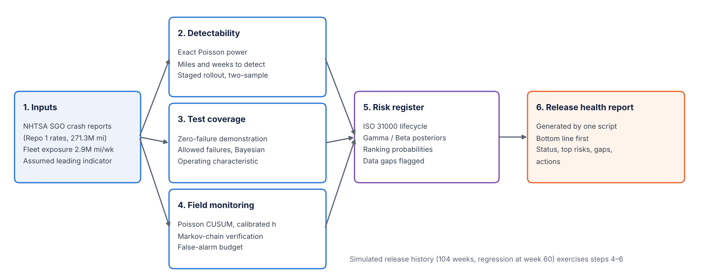{width=100%}

## 1.5 How to read this report

Section 2 reviews the background. Section 3 describes the data and every assumption. Section 4 gives each method with its equations. Section 5 presents the results, Section 6 discusses what they mean for release gating, Section 7 summarizes verification, and Sections 8–10 cover limitations, future work and reproduction. The appendices contain the equation register, the assumption register, a glossary and the code map.

# 2. Background

## 2.1 Statistical demonstration of safety

Kalra and Paddock (2016) showed that demonstrating ADS safety from driving alone would take hundreds of millions to billions of miles for fatal outcomes. The same arithmetic applies to regressions, with one difference: a regression test compares two rates, which is harder than comparing one rate to a fixed target. The companion analysis applied rare-event Bayesian methods from nuclear probabilistic risk assessment (PRA) to Waymo's record and found that a new operator needs about 9.1 million miles with zero serious crashes to claim, at 95% confidence, that it beats human drivers on serious injuries.

## 2.2 Zero-failure demonstration testing

When failures are rare, reliability engineers size test programs by the number of failure-free trials needed to bound the failure probability. With zero failures in *n* independent trials, the one-sided upper confidence bound on the failure probability gives the classic "rule of three": about 3/*n* at 95% confidence (Hanley and Lippman-Hand, 1983). Plans that allow *c* failures use the binomial (Clopper and Pearson, 1934) bound. Bayesian versions put a prior on the failure probability; the Jeffreys prior is the default non-informative choice in PRA (Atwood et al., 2003).

## 2.3 Sequential monitoring and the CUSUM

The cumulative sum (CUSUM) chart (Page, 1954) accumulates evidence of a shift over time and alarms when the accumulated evidence crosses a threshold. For counted data, Lucas (1985) gave the Poisson CUSUM with a reference value that makes it optimal for detecting a specific shift. Its performance is measured by the average run length (ARL): the mean time to an alarm. ARL₀, the in-control ARL, is the mean time between false alarms; ARL₁ is the mean time to detect a real shift. Brook and Evans (1972) showed that the ARL can be computed exactly with a Markov chain, which gives an independent check on simulation. Hawkins and Olwell (1998) and Montgomery (2019) are standard references. CUSUMs are used widely in public-health surveillance (Woodall, 2006), a setting with rare counts similar to crash monitoring.

## 2.4 Risk management lifecycle

ISO 31000:2018 defines risk management as a cycle: establish the context; identify, analyze and evaluate risks; treat them; monitor and review; and communicate and report. IEC 31010:2019 catalogs the techniques used at each step. Automotive functional safety (ISO 26262) and safety of the intended functionality (ISO 21448, SOTIF) address the design; UL 4600 addresses the safety case, including field monitoring through safety performance indicators. This report uses the ISO 31000 lifecycle for the risk register and treats CUSUM charts as one implementation of the "monitor and review" step.

## 2.5 What Waymo publishes

Waymo publishes crash-rate comparisons with human benchmarks (for example Kusano et al., 2024) and has described its overall approach to determining the absence of unreasonable risk (Favarò et al., 2023). This report does not describe or evaluate Waymo's internal release process; it uses public rates to show, quantitatively, the constraints any such process faces.

# 3. Data and assumptions

## 3.1 Event rates

: Table 1. Event rates (per million miles). PUBLISHED-DERIVED values come from public NHTSA SGO crash reports for Waymo's rider-only fleet, analyzed in the companion repository; the ASSUMED value is illustrative.

| Metric | Rate per million miles | Events behind it | Basis |
|---|---|---|---|
| All reported crashes | 7.13 | 1,934 crashed vehicles | Published-derived: 1,934 / 271.3M miles |
| Any-injury crashes | 0.612 | 166 | Published-derived: posterior median (Jeffreys) |
| Airbag deployment | 0.266 | 72 | Published-derived: posterior median |
| Serious injury or worse | 0.023 | 6 | Published-derived: posterior median |
| Leading indicator (e.g. hard braking, near misses) | 100 | – | Assumed; such data are not public |

The leading indicator stands for any frequent event that on-board triggers or log review can count, such as hard-braking events, close-following events or disengagement-like interventions. Its value of 100 per million miles is chosen only to represent a metric that is about 14 times more frequent than reported crashes.

## 3.2 Fleet exposure

The companion analysis found 542 crashed vehicles reported in January–June 2026. At 7.13 crashes per million miles, that corresponds to about 76 million miles in six months:

$$W_{\text{month}} = \frac{542}{7.13 \times 6} \approx 12.7 \ \text{million miles per month}, \qquad W = W_{\text{month}} \times \frac{12}{52} \approx 2.92 \ \text{million miles per week}$$

Expected weekly counts are therefore 20.8 (all crashes), 1.79 (any injury), 0.78 (airbag), 0.067 (serious injury) and 292 (leading indicator).

## 3.3 Release model

Releases are assumed to go out every four weeks to the whole fleet unless stated otherwise. A regression multiplies the rate of a metric by (1 + *r*) from the release that introduces it. Section 5.2 relaxes the whole-fleet assumption.

## 3.4 What is not used

No company-internal data. The simulated release history is synthetic. The operational hazards H6–H8 in the risk register have no public data and are flagged as data gaps rather than given invented numbers. Appendix B lists every assumption.

# 4. Methods

## 4.1 Detectability: exact one-sample Poisson test

The baseline rate λ₀ is known well from long fleet history (thousands of events for frequent metrics). After a release, N events are observed in M million miles. Under the null hypothesis (no regression), N ~ Poisson(λ₀M). The test alarms if N reaches the critical count

$$c(M) = \min \{\, n : P(N \ge n \mid \lambda_0 M) \le \alpha \,\}, \qquad \alpha = 0.05$$

The power to detect a regression to λ₁ = (1 + r)λ₀ is

$$\text{power}(M) = P\left(N \ge c(M) \mid \lambda_1 M\right) = 1 - F_{\text{Pois}}\left(c(M) - 1;\ \lambda_1 M\right)$$

Because counts are discrete, power is not monotone in M: it rises in a saw-tooth as c(M) steps up. The exposure reported is therefore the smallest M after which power stays at or above 80% (searched on a fine logarithmic grid from 0.001 to 100,000 million miles). Weeks of fleet driving are M / W.

**Worked example (any-injury crashes, +25%).** The reported exposure is M = 188.5 million miles (64.5 weeks). The expected baseline count is 0.612 × 188.5 = 115.4 events, the critical count is c = 134 (actual false-alarm rate 4.8%), the expected count under the regression is 144.2, and the power is 81.3%.

## 4.2 Release-versus-release comparison

When there is no long baseline (for example the first months in a new city), the new release must be compared with the previous one, each observed over M miles. Using the normal approximation for the log rate ratio,

$$\operatorname{Var}\left[\ln \frac{\hat\lambda_1}{\hat\lambda_0}\right] \approx \frac{1}{\lambda_0 M} + \frac{1}{\lambda_1 M}, \qquad M = \frac{(z_{1-\alpha} + z_{\text{power}})^2 \left(\frac{1}{\lambda_0} + \frac{1}{\lambda_1}\right)}{\left[\ln(1+r)\right]^2}$$

## 4.3 Staged rollout

If a release runs on a fraction f of the fleet, it accumulates fM miles per week, so the calendar time to detect scales as 1/f:

$$T_f = \frac{M}{f\,W}$$

## 4.4 Baseline-rate uncertainty

For rare outcomes the baseline itself is uncertain. With a Jeffreys prior, the posterior of λ₀ after k events in 271.3 million miles is Gamma(k + ½, 271.3). Detection times are recomputed at the 5th, 50th and 95th posterior percentiles of λ₀.

## 4.5 Test coverage

**Zero-failure plan.** To show that a scenario type's failure probability p is below p₀ at confidence C with n failure-free runs:

$$(1 - p_0)^n \le 1 - C \quad \Rightarrow \quad n = \left\lceil \frac{\ln(1 - C)}{\ln(1 - p_0)} \right\rceil \approx \frac{-\ln(1-C)}{p_0} \approx \frac{3}{p_0} \ (C = 0.95)$$

**Plans that allow c failures.** The release passes if at most c failures occur in n runs; n is the smallest value with

$$F_{\text{Bin}}(c;\ n, p_0) = \sum_{j=0}^{c} \binom{n}{j} p_0^{\,j} (1-p_0)^{n-j} \le 1 - C$$

**Bayesian zero-failure plan.** With a Jeffreys prior Beta(½, ½) and zero failures in n runs, the posterior is Beta(½, n + ½); n is the smallest value with P(p < p₀ | data) ≥ C.

**Operating characteristic (OC).** For a plan (n, c), the probability that a release whose true failure probability is p passes is F~Bin~(c; n, p). The OC curve shows how often good releases are wrongly held and bad ones wrongly passed.

## 4.6 Poisson CUSUM

Let X~t~ be the event count in week t, with in-control mean m₀ = λ₀W. The chart is tuned to detect the shift to m₁ = (1 + r~d~)m₀ with r~d~ = 0.25 (Lucas, 1985):

$$k = \frac{m_1 - m_0}{\ln(m_1 / m_0)}, \qquad S_0 = 0, \qquad S_t = \max\left(0,\ S_{t-1} + X_t - k\right), \qquad \text{alarm if } S_t \ge h$$

The reference value k lies between m₀ and m₁, so S~t~ drifts down when the process is in control and up after a regression. The threshold h is chosen so that the in-control ARL is 260 weeks (one false alarm per metric every five years). It is found by bisection on h, with the ARL estimated from 1,500 simulated run lengths at each step. After an alarm the statistic is reset to zero, as it would be after an investigation.

**Worked example (all crashes).** m₀ = 20.85 crashes per week, m₁ = 26.06, k = 23.35 and h = 16.93. In the simulated history the weekly counts in weeks 55–60 were 23, 20, 17, 19, 22 and 23, all below k, so S~t~ stayed at 0. The regression starts in week 60; in week 61 the count was 46, S = 0 + 46 − 23.35 = 22.65 ≥ 16.93, and the chart alarmed.

## 4.7 Markov-chain verification of the run lengths

Brook and Evans (1972) represent the CUSUM statistic as a Markov chain. The statistic is placed on a grid of width 1/g, with g chosen between 100 and 1,200 so that k is represented as exactly as possible within 5,000 states. With K = round(kg) and H = ⌈hg⌉, the transition from state i is to state max(0, i + gX − K) with probability P(X = x), and any state ≥ H is absorbing (an alarm). With R the transition matrix among the H in-control states,

$$\mathbf{ARL} = (\mathbf{I} - \mathbf{R})^{-1}\,\mathbf{1}, \qquad \text{ARL from a fresh start} = \mathbf{ARL}_0$$

This is computed independently of the simulation and used to verify it (Section 7).

## 4.8 Shewhart comparison

A one-sided Shewhart chart alarms when a single week's count reaches a limit c, chosen as the smallest value with P(X ≥ c | m₀) ≤ 1/260. Its ARL is 1 / P(X ≥ c | m). Because counts are discrete, its ARL₀ is at least 260 weeks and can be much larger.

## 4.9 Family-wise false alarms

Run lengths of a well-designed CUSUM in control are close to geometric, so the probability that one chart false-alarms within T weeks is about 1 − exp(−T/ARL₀). For m independent charts,

$$P(\text{at least one false alarm in } T \text{ weeks}) \approx 1 - \exp\left(-\frac{mT}{\text{ARL}_0}\right)$$

The simulated value for the five charts of this study is checked against this approximation.

## 4.10 Overdispersion

Real weekly counts vary more than Poisson because the underlying rate changes with weather, city mix, events and demand. This is modeled by drawing each week's rate from a Gamma distribution with mean m₀ and coefficient of variation (CV) v, so that counts are negative binomial with

$$\operatorname{Var}(X_t) = m_0 + v^2 m_0^2$$

The extra term grows with m₀², so overdispersion matters most for frequent metrics. The ARL₀ of the Poisson-designed chart is estimated by simulation for v = 0, 5%, 10% and 20%; for v = 10% the threshold is then recalibrated by bisection to restore ARL₀ = 260 weeks, and the cost in detection speed is measured.

## 4.11 Leading-indicator coupling

Suppose serious injuries rise by 50% and the leading indicator rises by 50β%, where β ∈ [0, 1] measures how strongly the indicator moves with the severe outcome. The median run length of the leading-indicator chart is computed for β = 0, 0.05, 0.10, 0.25, 0.5 and 1 and compared with the serious-injury chart itself.

## 4.12 Bayesian sequential check

As a second view of the same data, after a suspected change at week t₀ the posterior probability that the rate has increased is computed with a Jeffreys prior:

$$P(\lambda > \lambda_0 \mid N, M) = 1 - F_{\Gamma}\left(\lambda_0;\ N + \tfrac{1}{2},\ M\right)$$

where N is the number of events since t₀ and M the miles since t₀. Unlike the CUSUM, this check needs a candidate change point; in practice it is used after an alarm, or from each release date.

## 4.13 Risk register

The register follows the ISO 31000 sequence. Hazards H1–H5 come from the companion analysis' event tree and crash-partner breakdown; H6–H8 are operational hazards without public data. For each data-based hazard with n crashes, of which k involved an injury, in 271.3 million miles:

$$\lambda_{\text{crash}} = \frac{n}{271.3}, \qquad P(\text{injury} \mid \text{crash}) \sim \text{Beta}\left(k + \tfrac{1}{2},\ n - k + \tfrac{1}{2}\right), \qquad \lambda_{\text{injury}} \sim \Gamma\left(k + \tfrac{1}{2},\ 271.3\right)$$

The hazard score is the posterior median injury-crash rate per 100 million miles with a 90% interval. Ranking probabilities are computed from 20,000 joint posterior draws. Each hazard is also given a treatment, a monitoring metric, an owner team and a status (monitor, reduce, accept and monitor, or data gap).

## 4.14 Simulated release history and automated report

To exercise the monitoring and reporting end to end, 104 weeks of counts are simulated for all five metrics (seed 2026), with releases every four weeks and a +50% regression in every metric from week 60. The same script then writes a one-page HTML release health report: a bottom line, monitoring status per metric (RED for an alarm, AMBER when the statistic is above half the threshold, GREEN otherwise), what field data can and cannot catch, the top data-based risks, the data gaps and recommended actions. An animation of the history (`scripts/make_monitoring_video.py`) shows the charts building week by week.

## 4.15 Software

The code is a small Python package (`src/avmon`): `rates.py` (inputs and labels), `power.py` (detectability and test plans), `monitor.py` (CUSUM, run lengths, calibration, Markov chain, Shewhart, Bayesian check). `scripts/run_all.py` produces the main results (about 30 s) and `scripts/supplementary.py` the supplementary studies (about 2 minutes). All random sampling uses fixed seeds.

# 5. Results

## 5.1 How long field data needs to catch a regression

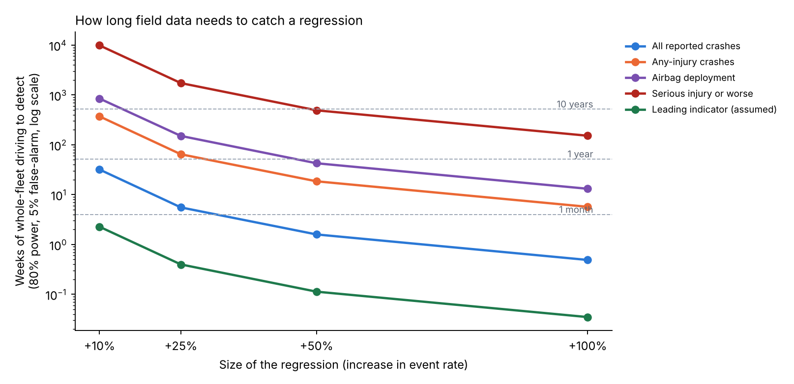{width=100%}

: Table 2. Weeks of whole-fleet driving to detect a regression (exact Poisson test, known baseline, 80% power, 5% false alarm). Million miles in brackets.

| Metric | +10% | +25% | +50% | +100% |
|---|---|---|---|---|
| Leading indicator (assumed) | 2.3 (6.6) | 0.4 (1.2) | 0.1 (0.3) | <0.1 (0.1) |
| All reported crashes | 31.9 (93) | 5.5 (16) | 1.6 (4.6) | 0.5 (1.4) |
| Any-injury crashes | 371 (1,085) | 64.5 (189) | 18.5 (54) | 5.7 (17) |
| Airbag deployment | 846 (2,475) | 150 (440) | 42.6 (125) | 13.1 (38) |
| Serious injury or worse | 9,859 (28,831) | 1,728 (5,054) | 492 (1,437) | 152 (444) |

**A rule of thumb.** Multiplying each exposure by its rate gives the expected number of baseline events needed, which is the same for every metric:

: Table 3. Expected baseline events needed to detect a regression (80% power, 5% false alarm).

| Regression | +10% | +25% | +50% | +100% |
|---|---|---|---|---|
| Expected baseline events | 664 | 116 | 33 | 10 |

So the question "how long until we would know?" reduces to "how long until we expect about 116 events?". For serious injuries, at 0.067 per week, that is 33 years.

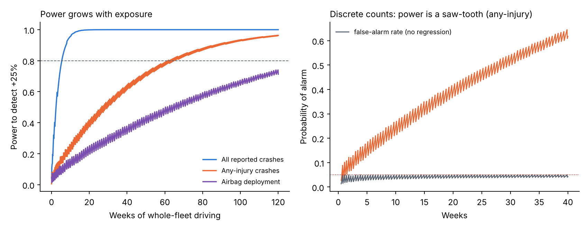{width=100%}

## 5.2 Staged rollout and release-versus-release comparison

: Table 4. Weeks to detect a +25% regression when the release runs on part of the fleet.

| Metric | 5% | 10% | 25% | 50% | 100% |
|---|---|---|---|---|---|
| Leading indicator (assumed) | 7.9 | 4.0 | 1.6 | 0.8 | 0.4 |
| All reported crashes | 111 | 55 | 22 | 11 | 5.5 |
| Any-injury crashes | 1,289 | 645 | 258 | 129 | 64.5 |
| Airbag deployment | 3,009 | 1,505 | 602 | 301 | 150 |
| Serious injury or worse | 34,569 | 17,285 | 6,914 | 3,457 | 1,728 |

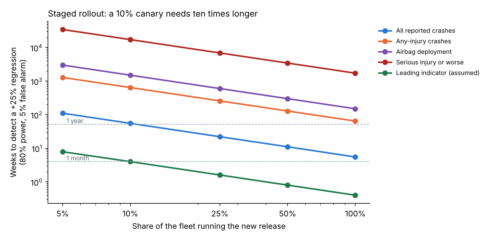{width=92%}

A 10% canary release protects against regressions in a frequent leading indicator within a month, but needs about a year for all reported crashes. A staged rollout is therefore valuable mainly for limiting exposure while a regression is found by other means, not as a statistical test of crash outcomes.

Comparing two releases with no known baseline roughly doubles the exposure (Table 5). For example, a +25% regression in any-injury crashes needs 365 million miles per release (125 weeks) instead of 189 million.

: Table 5. Million miles per release to detect a regression when comparing two releases (normal approximation on the log rate ratio), with weeks in brackets.

| Metric | +10% | +25% | +50% | +100% |
|---|---|---|---|---|
| All reported crashes | 182 (62) | 31 (11) | 8.8 (3.0) | 2.7 (0.9) |
| Any-injury crashes | 2,123 (726) | 365 (125) | 102 (35) | 32 (11) |
| Airbag deployment | 4,885 (1,670) | 840 (287) | 236 (81) | 73 (25) |
| Serious injury or worse | 56,492 (19,318) | 9,717 (3,323) | 2,725 (932) | 839 (287) |

## 5.3 Uncertainty in the baseline rate

: Table 6. Weeks to detect +25% at the 5th, 50th and 95th posterior percentiles of the baseline rate.

| Metric | Events | 5th percentile rate | Median | 95th percentile rate |
|---|---|---|---|---|
| Any-injury crashes | 166 | 73 weeks | 65 weeks | 56 weeks |
| Airbag deployment | 72 | 183 | 150 | 123 |
| Serious injury or worse | 6 | 3,629 (70 years) | 1,761 (34 years) | 950 (18 years) |

Even at the most favorable end of its uncertainty, the serious-injury rate needs 18 years of whole-fleet driving to reveal a +25% regression. The conclusion does not depend on the exact baseline.

## 5.4 How much testing replaces the missing field evidence

: Table 7. Failure-free scenario runs needed to show a failure probability below a target.

| Target failure probability | 90% confidence | 95% confidence | 99% confidence |
|---|---|---|---|
| 10% | 22 | 29 | 44 |
| 1% | 230 | 299 | 459 |
| 0.1% | 2,302 | 2,995 | 4,603 |
| 0.01% | 23,025 | 29,956 | 46,050 |

: Table 8. Runs needed at 95% confidence when the plan allows some failures, and with a Bayesian (Jeffreys) zero-failure plan.

| Target | 0 failures | ≤ 1 failure | ≤ 2 failures | ≤ 5 failures | Bayesian, 0 failures |
|---|---|---|---|---|---|
| 1% | 299 | 473 | 628 | 1,049 | 192 |
| 0.1% | 2,995 | 4,742 | 6,294 | 10,511 | 1,928 |

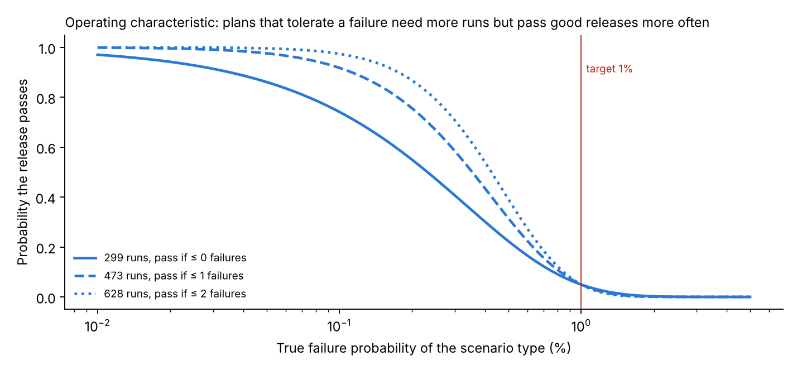{width=92%}

The zero-failure plan is the cheapest, but it is harsh on good releases: a scenario type whose true failure probability is 0.1%, ten times better than the target, still fails the 299-run plan 26% of the time; at 0.3% it fails 59% of the time. Plans that allow one or two failures cost 1.6–2.1 times more runs but rarely hold a good release. The Bayesian plan needs about a third fewer runs because the Jeffreys prior already places much of its weight on small failure probabilities; that saving is only as good as the prior, and it should be justified for each scenario type.

These numbers are practical only in simulation. The credibility of the simulation, which the companion project av-counterfactual-uq quantifies for one model class, therefore becomes part of the release evidence.

## 5.5 Sequential monitoring: design and performance

: Table 9. Poisson CUSUM design per metric (weekly counts; tuned for +25%; target ARL₀ 260 weeks). Median weeks to the first alarm after a regression starts (simulation).

| Metric | Expected weekly count | k | h | ARL₀ (weeks) | +25% | +50% | +100% |
|---|---|---|---|---|---|---|---|
| All reported crashes | 20.8 | 23.35 | 16.93 | 259 | 6 | 3 | 1 |
| Any-injury crashes | 1.79 | 2.005 | 10.91 | 271 | 30 | 14 | 7 |
| Airbag deployment | 0.778 | 0.871 | 8.47 | 260 | 45 | 24 | 12 |
| Serious injury or worse | 0.067 | 0.075 | 3.34 | 256 | 105 | 70 | 43 |
| Leading indicator (assumed) | 292 | 327.6 | 11.38 | 233 | 1 | 1 | 1 |

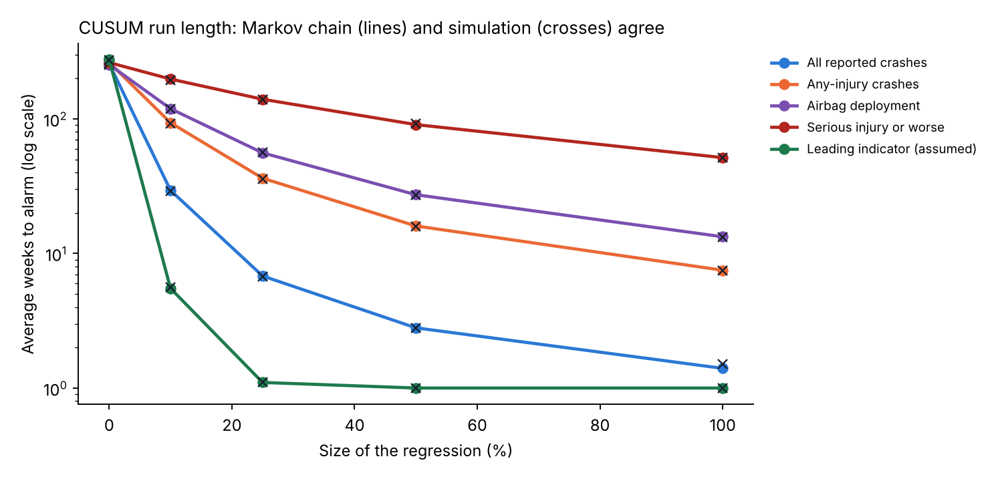{width=92%}

The CUSUM detects a +25% regression in all reported crashes in about 6 weeks, matching the fixed-sample analysis (5.5 weeks), but it does so continuously, without having to choose a test window. For serious injuries, a +50% regression takes a median of 70 weeks; for any single release that is too slow, but the chart still protects against a persistent drift across several releases.

## 5.6 CUSUM versus a weekly threshold

: Table 10. Average weeks to alarm: one-sided Shewhart chart (alarm when one week's count reaches the limit) and CUSUM, both designed for a false-alarm interval of at least 260 weeks.

| Metric | Shewhart limit (ARL₀) | +25% Shewhart / CUSUM | +50% | +100% |
|---|---|---|---|---|
| All reported crashes | ≥ 35 per week (350) | 18.5 / 6.8 | 3.6 / 2.8 | 1.2 / 1.4 |
| Any-injury crashes | ≥ 7 (401) | 123 / 36 | 50 / 16 | 14 / 7.5 |
| Airbag deployment | ≥ 5 (800) | 307 / 56 | 145 / 27 | 47 / 13 |
| Serious injury or worse | ≥ 2 (466) | 302 / 140 | 212 / 91 | 122 / 52 |
| Leading indicator (assumed) | ≥ 340 (282) | 1.1 / 1.1 | 1.0 / 1.0 | 1.0 / 1.0 |

For moderate regressions in the rarer counts, the CUSUM is about 2 to 5 times faster because it accumulates evidence over weeks instead of waiting for one unusual week. Part of the Shewhart chart's slowness comes from discreteness: with weekly means below 2, the smallest admissible limit already gives an ARL₀ well above 260 weeks. The Shewhart chart is competitive only for very large shifts, where a single week is already unusual.

## 5.7 A simulated two-year history

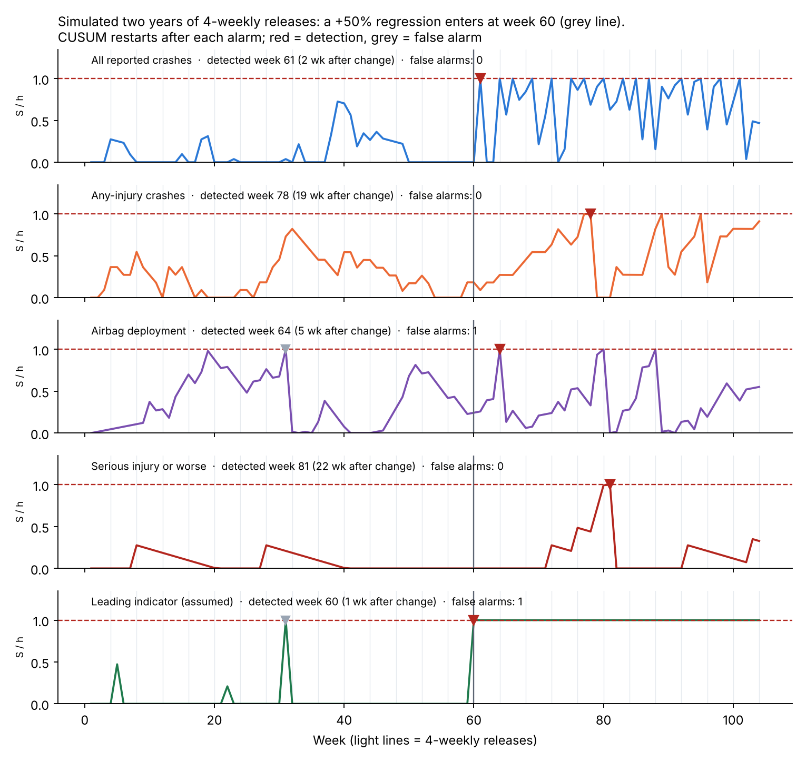{width=92%}

: Table 11. Detections in the simulated history (regression from week 60).

| Metric | First alarm | Weeks after change | False alarms before change | Events after change vs expected | Weeks until Bayesian P ≥ 0.95 |
|---|---|---|---|---|---|
| Leading indicator (assumed) | week 60 | 1 | 1 (week 31) | 19,610 vs 13,159 | 1 |
| All reported crashes | week 61 | 2 | 0 | 1,409 vs 938 | 2 |
| Airbag deployment | week 64 | 5 | 1 (week 31) | 67 vs 35 | 5 |
| Any-injury crashes | week 78 | 19 | 0 | 134 vs 81 | 14 |
| Serious injury or worse | week 81 | 22 | 0 | 7 vs 3.0 | 21 |

The serious-injury chart was lucky in this run (median 70 weeks). The Bayesian check, started at the true change point, reaches 95% confidence at about the same time as the CUSUM; in practice it is most useful after an alarm, to state how confident the team is that the rate really rose.

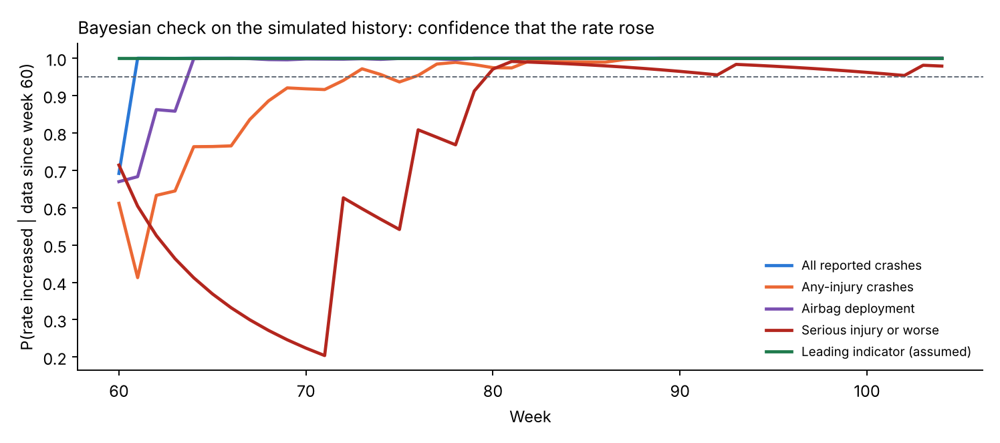{width=88%}

## 5.8 False alarms add up

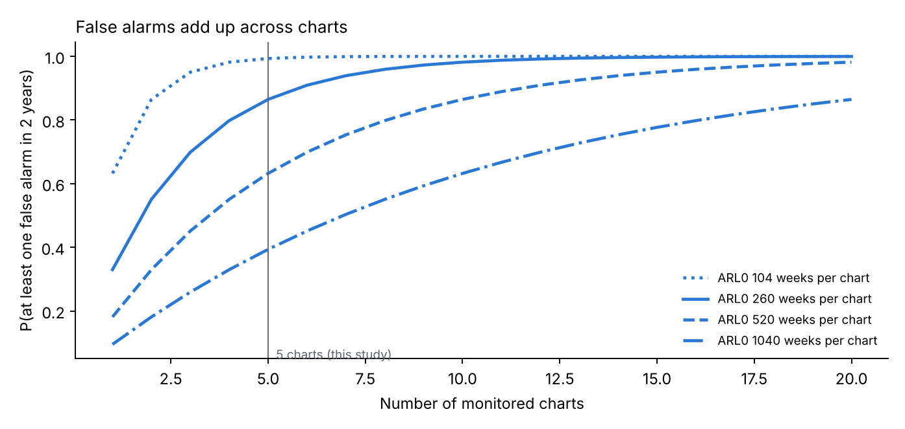{width=85%}

With five charts at ARL₀ = 260 weeks, the probability of at least one false alarm in two years is 86% by the approximation of Section 4.9 and 85% by direct simulation. A realistic program monitors many more metrics, by city, vehicle platform and scenario type; twenty charts at ARL₀ = 520 weeks give a 98% chance of a false alarm in two years. False alarms are therefore not a failure of the method but a certainty to plan for: each alarm needs a cheap, fast triage step (for example, checking the alarmed events, the city and weather mix, and the release notes) before any expensive response.

## 5.9 Overdispersion: the hidden risk for frequent metrics

: Table 12. In-control ARL (weeks between false alarms) of the Poisson-designed charts when the true weekly rate varies from week to week.

| Metric | Pure Poisson | CV 5% | CV 10% | CV 20% |
|---|---|---|---|---|
| All reported crashes (20.8 per week) | 263 | 210 | 134 | 49 |
| Any-injury crashes (1.79 per week) | 271 | 260 | 257 | 223 |
| Leading indicator (292 per week) | 276 | 47 | 11 | 5 |

: Table 13. Recalibrated thresholds for 10% week-to-week variation.

| Metric | h (Poisson) | h (recalibrated) | ARL₀ after recalibration | ARL at +25% before / after |
|---|---|---|---|---|
| All reported crashes | 16.9 | 20.2 | 259 | 6.8 / 8.1 weeks |
| Leading indicator (assumed) | 11.4 | 73.8 | 269 | 1.1 / 2.7 weeks |

Rare metrics are almost unaffected, because Poisson noise dominates any rate variation. Frequent metrics are badly affected: a leading indicator with only 5% week-to-week variation would false-alarm about once a year instead of once every five years, and with 10% variation about every 11 weeks. The remedy is to estimate the dispersion from historical data and calibrate the threshold on it (or use a negative-binomial CUSUM). After recalibration the leading indicator still detects a +25% change in under 3 weeks.

## 5.10 Leading indicators must move with the outcome

: Table 14. Median weeks to alarm on the leading-indicator chart when serious injuries rise 50% and the indicator rises by a fraction of that.

| Indicator rise | 0% | 2.5% | 5% | 12.5% | 25% | 50% |
|---|---|---|---|---|---|---|
| Median weeks to alarm | 195 (false alarm only) | 56 | 20 | 2 | 1 | 1 |

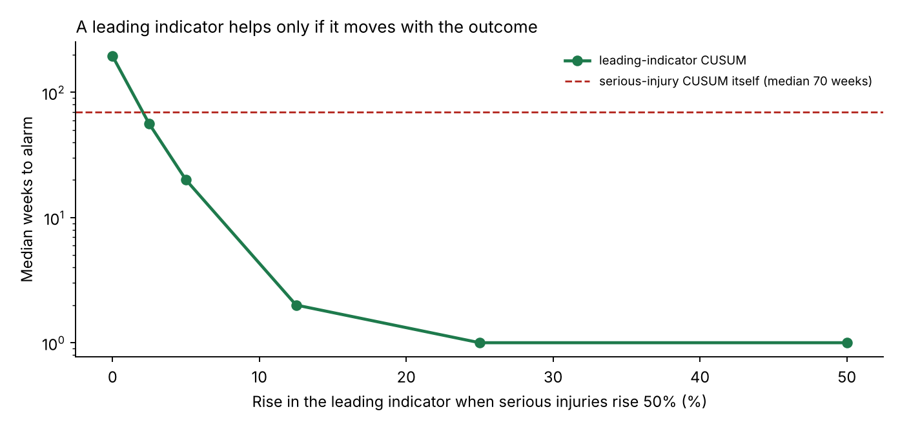{width=88%}

A leading indicator beats the serious-injury chart (median 70 weeks) as long as it rises by more than about 2.5% when serious injuries rise 50%. Rising by 5% gives a median of 20 weeks, and rising by 12.5% about 2 weeks. Establishing that coupling, for example from the conflict patterns that precede injury crashes, is therefore as important as building the chart.

## 5.11 Risk register

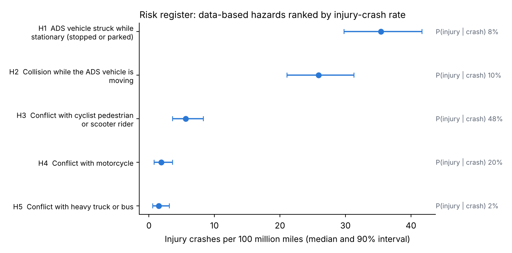{width=90%}

: Table 15. Scored risk register (ISO 31000 lifecycle). H1–H5 are data-based (companion analysis); H6–H8 have no public data.

| ID | Hazard | Crashes | Crash rate per M mi | P(injury given crash) | Injury crashes per 100M mi (90% interval) | Status | Owner |
|---|---|---|---|---|---|---|---|
| H1 | Struck while stationary | 1,194 | 4.40 | 8.1% | 35.4 (29.8–41.7) | Monitor | Behavior / Planning |
| H2 | Collision while moving | 740 | 2.73 | 9.5% | 25.9 (21.1–31.3) | Monitor | Behavior / Simulation |
| H3 | Cyclist, pedestrian or scooter rider | 31 | 0.11 | 48.4% | 5.6 (3.6–8.3) | Reduce | Perception / Behavior |
| H4 | Motorcycle | 25 | 0.09 | 20.4% | 1.9 (0.8–3.6) | Reduce | Perception |
| H5 | Heavy truck or bus | 224 | 0.83 | 1.9% | 1.5 (0.6–3.1) | Accept and monitor | Behavior |
| H6 | Sensor or compute degradation, in-lane stop | – | – | – | data gap | Data gap | Hardware / Systems |
| H7 | Delayed or incorrect remote assistance | – | – | – | data gap | Data gap | Operations |
| H8 | Behavior regression from a release | – | – | – | monitored (Section 5.5) | Monitor | Safety / Release |

: Table 16. Ranking probabilities from 20,000 posterior draws.

| ID | P(ranked first) | P(in top two) | Median rank |
|---|---|---|---|
| H1 | 97.8% | 100% | 1 |
| H2 | 2.2% | 100% | 2 |
| H3 | 0% | 0% | 3 |
| H4 | 0% | 0% | 4 |
| H5 | 0% | 0% | 5 |

The ranking is robust: H1 exceeds H2 with probability 97.8% and H3 exceeds H4 with probability 99.0%. H3 (vulnerable road users) is ranked third by rate but carries the highest severity, with nearly half of its crashes causing an injury; its treatment is therefore "reduce" rather than "monitor". The register also lists, for each hazard, its treatment, monitoring metric and owner team (`data/risk_register.csv`), so it can be reviewed with the teams that own the design.

## 5.12 Automated release health report

{width=62%}

The report is written by the same script that runs the analysis, so every number in it is computed. Its structure follows what a decision maker needs, in order: the bottom line and recommended action; the status of each monitored metric with the evidence behind it; what field data can and cannot catch; the top risks with uncertainty; the data gaps with owners; and the next actions. For a real program, the same structure would be fed from the fleet's event database at each release.

# 6. Discussion: what this means for release gating

## 6.1 A layered protection scheme

The results suggest matching each type of evidence to the outcomes it can actually protect:

: Table 17. Evidence matched to what it can protect.

| Layer | Protects against | Timescale | Evidence from this report |
|---|---|---|---|
| Risk-weighted scenario testing before release | Regressions in severe outcomes | Before release | 299 to 3,000 runs per scenario type (Tables 7–8) |
| Staged rollout | Limits exposure while a problem is found | Weeks | Statistical detection of crash outcomes is slow at 10% (Table 4) |
| Leading-indicator monitoring | Regressions that move frequent precursors | Days to weeks | Fast if coupled (Table 14); calibrate for dispersion (Table 13) |
| Crash-outcome monitoring (CUSUM) | Regressions in frequent outcomes; persistent drift | Weeks to months | Table 9 |
| Severe-outcome review | Individual serious events | Every event | Statistical charts are too slow; review each case |

## 6.2 Alarm design as a system

Three practical rules follow. First, tune each chart to the regression size that matters for its metric, and compute its run-length curve (Figure 6) so the team knows how fast it is. Second, budget false alarms across all charts (Figure 9), and plan a triage step that is cheap enough to run for every alarm. Third, calibrate thresholds on historical week-to-week variation, not on the Poisson assumption, especially for frequent metrics (Table 12).

## 6.3 Test coverage as a function of risk

The zero-failure arithmetic links test coverage directly to a risk target: a scenario type whose consequences are severe gets a tighter target, and therefore more runs, than one whose consequences are minor. Combined with the risk register, this gives a traceable chain from hazard (for example H3, vulnerable road users) to scenario types, to a target failure probability, to a number of runs per release.

## 6.4 The role of simulation credibility

If release protection for severe outcomes rests on thousands of simulated runs, the simulation becomes part of the safety argument. The companion project av-counterfactual-uq showed, for one class of rear-end conflicts, that a single deterministic replay can hide most of the uncertainty in a counterfactual result. The same discipline (uncertainty quantification, sensitivity analysis and validation against field events) should apply to the simulation used for release gating.

## 6.5 Analogies with nuclear practice

In nuclear power, plant changes are screened and evaluated before installation, and plant performance is tracked with indicators that have predefined thresholds and responses. The approach here is analogous: risk-informed testing before the release, monitored indicators with thresholds after it, and a documented response to each alarm. One difference is tempo: ADS releases are far more frequent than plant modifications, which is why automation of the analysis and the reporting matters.

# 7. Verification

: Table 18. Verification tests (`python tests/test_core.py`; all pass).

| Test | What it checks |
|---|---|
| Rule of three | 299 runs for 1% at 95%; n·p ≈ 3 for 0.1% |
| False-alarm control | The exact test never exceeds a 5% false-alarm rate |
| Power at the reported exposure | Power ≥ 80% at, and beyond, the reported exposure |
| Scaling | Two-sample exposure scales as 1/λ |
| CUSUM calibration | Simulated ARL₀ within 15% of the target |
| CUSUM sensitivity | A +50% shift cuts the run length by more than 60% |
| CUSUM reset | Alarms and resets are counted correctly |
| Bayesian check | P(rate increased) ≈ 0.5 at the baseline for large counts |
| Markov chain vs simulation | Brook–Evans ARL within 5% of simulated ARL |
| Shewhart limit | The limit meets the false-alarm target and is the smallest such limit |

: Table 19. Run-length verification: simulation (4,000 runs) against the Markov chain, in weeks.

| Metric | ARL₀ sim / Markov | +25% | +50% | +100% |
|---|---|---|---|---|
| All reported crashes | 260.8 / 257.0 | 6.7 / 6.8 | 2.8 / 2.8 | 1.5 / 1.4 |
| Any-injury crashes | 264.9 / 262.1 | 35.5 / 36.2 | 15.8 / 16.0 | 7.5 / 7.5 |
| Airbag deployment | 251.5 / 253.1 | 56.6 / 55.9 | 27.1 / 27.3 | 13.2 / 13.3 |
| Serious injury or worse | 257.5 / 261.9 | 139.1 / 139.8 | 91.9 / 90.6 | 51.2 / 51.5 |
| Leading indicator (assumed) | 273.6 / 274.9 | 1.1 / 1.1 | 1.0 / 1.0 | 1.0 / 1.0 |

The largest relative difference across all 25 comparisons is 2.2%, within the Monte Carlo error of 4,000 runs (about 1.6% for an ARL of 260). Two independent methods therefore agree on every run length used in this report.

One subtlety appears for the leading indicator: its threshold sits close to a jump in the discrete run-length distribution, so its ARL₀ is sensitive to the third digit of h (233 weeks in the design table, which used the unrounded threshold and 3,000 runs; 274 weeks with the rounded threshold). In practice this is another reason to calibrate thresholds on historical data.

# 8. Limitations

- **Public, self-reported data.** Rates come from NHTSA SGO reports, with the limitations described in the companion analysis (self-reporting, redactions, rule changes in 2025).
- **Whole-fleet, constant mileage.** Except in Section 5.2, every release is assumed to run on the whole fleet at constant weekly mileage. Real fleets grow, change their city mix and roll releases out in stages.
- **One rate per metric.** Rates are treated as fleet-wide constants. Real rates differ by city, time of day and weather, which is one source of the overdispersion studied in Section 5.9; stratified charts would be needed in practice.
- **Assumed leading indicator.** The leading-indicator rate and its coupling to severe outcomes are assumed. Section 5.10 shows how much the conclusions depend on that coupling.
- **Independent scenario runs.** The test-coverage arithmetic assumes runs are independent draws from the scenario type. Correlated runs (for example small variations of one logged event) carry less information.
- **Illustrative risk register.** The register shows the method; it does not describe any company's actual register, and H6–H8 have no data.
- **Synthetic history.** The two-year history is simulated and shows the method, not real performance.

# 9. Future work

1. **Stratified and risk-adjusted monitoring:** charts by city and conditions, with expected counts adjusted for exposure mix (risk-adjusted CUSUM).
2. **Negative-binomial CUSUM** with dispersion estimated from historical data, compared with the recalibration approach of Section 5.9.
3. **Leading-indicator validation:** estimating the coupling β from field data, for example from the sequence of events before injury crashes.
4. **Change-point estimation** after an alarm, to locate the responsible release, combined with release-to-release bisection on the scenario library.
5. **Test-plan optimization:** allocating a fixed simulation budget across scenario types to minimize residual risk, weighted by the risk register.
6. **Integration with simulation credibility:** carrying the uncertainty of the simulator (companion project 2) into the test-plan arithmetic.

# 10. Reproduce

```
pip install -r requirements.txt
python tests/test_core.py              # 10 tests
python scripts/run_all.py              # main tables, figures, release report (about 30 s)
python scripts/supplementary.py        # supplementary studies (about 2 minutes)
python scripts/workflow_figure.py      # Figure 1
python scripts/make_monitoring_video.py results/monitoring.mp4 results/monitoring_last_frame.png
python scripts/build_docs.py           # this report and the short note (needs pandoc)
```

# References

- Albati, M. (2026). How much evidence is enough? A Bayesian rare-event analysis of robotaxi crash data. Zenodo. doi:10.5281/zenodo.23732384
- Albati, M. (2026). How certain is a counterfactual crash simulation? Uncertainty quantification for reference-model benchmarking of automated driving systems. Zenodo. doi:10.5281/zenodo.23838254
- Atwood, C. L., LaChance, J. L., Martz, H. F., Anderson, D. J., Englehardt, M., Whitehead, D., Wheeler, T. (2003). *Handbook of Parameter Estimation for Probabilistic Risk Assessment*. NUREG/CR-6823. U.S. Nuclear Regulatory Commission.
- Brook, D., Evans, D. A. (1972). An approach to the probability distribution of CUSUM run length. *Biometrika* 59(3), 539–549.
- Clopper, C. J., Pearson, E. S. (1934). The use of confidence or fiducial limits illustrated in the case of the binomial. *Biometrika* 26(4), 404–413.
- Favarò, F., et al. (2023). Building a credible case for safety: Waymo's approach for the determination of absence of unreasonable risk. arXiv:2306.01917.
- Hanley, J. A., Lippman-Hand, A. (1983). If nothing goes wrong, is everything all right? Interpreting zero numerators. *JAMA* 249(13), 1743–1745.
- Hawkins, D. M., Olwell, D. H. (1998). *Cumulative Sum Charts and Charting for Quality Improvement*. Springer.
- International Organization for Standardization (2018). *ISO 26262:2018 Road vehicles: Functional safety*.
- International Organization for Standardization (2018). *ISO 31000:2018 Risk management: Guidelines*.
- International Organization for Standardization (2019). *IEC 31010:2019 Risk management: Risk assessment techniques*.
- International Organization for Standardization (2022). *ISO 21448:2022 Road vehicles: Safety of the intended functionality*.
- Jeffreys, H. (1946). An invariant form for the prior probability in estimation problems. *Proceedings of the Royal Society of London A* 186, 453–461.
- Kalra, N., Paddock, S. M. (2016). *Driving to Safety: How Many Miles of Driving Would It Take to Demonstrate Autonomous Vehicle Reliability?* RAND Corporation, RR-1478-RC.
- Kusano, K. D., et al. (2024). Comparison of Waymo rider-only crash data to human benchmarks at 7.1 million miles. *Traffic Injury Prevention* 25(sup1).
- Lucas, J. M. (1985). Counted data CUSUM's. *Technometrics* 27(2), 129–144.
- Montgomery, D. C. (2019). *Introduction to Statistical Quality Control*, 8th ed. Wiley.
- National Highway Traffic Safety Administration. Standing General Order 2021-01 on crash reporting for vehicles equipped with automated driving systems and Level 2 ADAS (as amended).
- Nuclear Energy Institute. *NEI 99-02: Regulatory Assessment Performance Indicator Guideline*.
- Page, E. S. (1954). Continuous inspection schemes. *Biometrika* 41(1/2), 100–115.
- UL Standards & Engagement (2023). *ANSI/UL 4600 Standard for Safety for the Evaluation of Autonomous Products*, 3rd ed.
- Woodall, W. H. (2006). The use of control charts in health-care and public-health surveillance. *Journal of Quality Technology* 38(2), 89–104.

# Appendix A. Equation register

: Table A1. Every equation used, where it is implemented and its source.

| No. | Equation | Purpose | Code | Source |
|---|---|---|---|---|
| A1 | W = 542 / (7.13 × 6) × 12/52 | Weekly fleet exposure | `rates.py` | Derived (Section 3.2) |
| A2 | c(M) = min{n : P(N ≥ n \| λ₀M) ≤ α} | Critical count | `power.py::_critical` | Exact Poisson test |
| A3 | power(M) = P(N ≥ c(M) \| λ₁M) | Power | `power.py::power_one_sample` | Exact Poisson test |
| A4 | M = (z₁₋α + z~power~)²(1/λ₀ + 1/λ₁) / ln²(1+r) | Release vs release | `power.py::miles_to_detect_two_sample` | Normal approximation |
| A5 | T_f = M / (fW) | Staged rollout | `supplementary.py` S1 | Derived |
| A6 | λ₀ \| k ~ Gamma(k + ½, 271.3) | Baseline uncertainty | `supplementary.py` S3 | Jeffreys (1946) |
| A7 | n = ⌈ln(1−C)/ln(1−p₀)⌉ | Zero-failure runs | `power.py::tests_for_zero_failures` | Hanley and Lippman-Hand (1983) |
| A8 | F~Bin~(c; n, p₀) ≤ 1 − C | Runs with c failures | `supplementary.py` S4 | Clopper and Pearson (1934) |
| A9 | P(p < p₀ \| Beta(½, n+½)) ≥ C | Bayesian runs | `supplementary.py` S4 | Jeffreys prior |
| A10 | k = (m₁ − m₀)/ln(m₁/m₀) | CUSUM reference value | `monitor.py::PoissonCUSUM` | Lucas (1985) |
| A11 | S~t~ = max(0, S~t−1~ + X~t~ − k) | CUSUM statistic | `monitor.py::PoissonCUSUM.path` | Page (1954) |
| A12 | ARL = (I − R)⁻¹ 1 | Markov-chain run length | `monitor.py::arl_markov` | Brook and Evans (1972) |
| A13 | c = min{c : P(X ≥ c \| m₀) ≤ 1/260} | Shewhart limit | `monitor.py::shewhart_limit` | Montgomery (2019) |
| A14 | 1 − exp(−mT/ARL₀) | Family-wise false alarms | `supplementary.py` S7 | Geometric run lengths |
| A15 | Var(X) = m₀ + v²m₀² | Overdispersion | `supplementary.py` S8 | Gamma–Poisson mixture |
| A16 | P(λ > λ₀) = 1 − F~Γ~(λ₀; N + ½, M) | Bayesian check | `monitor.py::bayes_prob_increase` | Jeffreys prior |
| A17 | Beta(k+½, n−k+½); Gamma(k+½, 271.3) | Register scores | `run_all.py` step 5 | Atwood et al. (2003) |

# Appendix B. Assumption register

: Table B1. Assumptions, their basis and their effect.

| No. | Assumption | Basis | Effect if wrong |
|---|---|---|---|
| B1 | Rates from public SGO data represent fleet-wide rates | Companion analysis; 99.5% match to Waymo's crash list | Detection times scale with 1/λ |
| B2 | Exposure 2.92M miles per week | Derived from 2026 crash counts | Detection times scale with 1/W |
| B3 | Leading indicator at 100 per million miles | Assumed for illustration | Its detection times only |
| B4 | Releases every 4 weeks to the whole fleet | Simplification | Section 5.2 shows staged rollout |
| B5 | Weekly counts are Poisson | Standard for rare events | Section 5.9: large effect for frequent metrics |
| B6 | Regression is a step change in rate | Simplification | Gradual drifts are detected later |
| B7 | Design shift +25%, ARL₀ 260 weeks | Choice | Table 9 and Figure 6 show the trade-off |
| B8 | Scenario runs are independent | Simplification | Correlated runs need more runs |
| B9 | Jeffreys prior | PRA default | Matters only for very small counts |
| B10 | Risk register hazards and owners are illustrative | Method demonstration | No effect on the method |

# Appendix C. Glossary

- **ARL (average run length):** mean number of weeks until a chart alarms. ARL₀ is in control (time between false alarms); ARL₁ after a real change.
- **CUSUM:** cumulative sum control chart; accumulates evidence of a shift over time.
- **Exact Poisson test:** a test that uses the Poisson distribution directly rather than a normal approximation.
- **Leading indicator:** a frequent event (for example hard braking) whose rate moves with rarer, severe outcomes.
- **Operating characteristic (OC):** probability that a test plan passes a release as a function of its true failure probability.
- **Overdispersion:** more week-to-week variation in counts than a Poisson model allows.
- **Power:** probability of detecting a real regression.
- **Regression:** a release whose event rate is higher than the previous release's.
- **SGO:** NHTSA Standing General Order 2021-01 on crash reporting.

# Appendix D. Code and output map

: Table D1. Where each result comes from.

| Output | Produced by | Report location |
|---|---|---|
| `table1_detectability.csv`, `fig1_detectability.png` | `run_all.py` step 1 | Table 2, Figure 2 |
| `table2_test_coverage.csv` | `run_all.py` step 2 | Table 7 |
| `table3_cusum_design.csv` | `run_all.py` step 3 | Table 9 |
| `fig2_release_timeline.png`, `timeline_demo.json` | `run_all.py` step 4 | Figure 7, Table 11 |
| `table4_risk_register_scored.csv`, `fig3_risk_register.png` | `run_all.py` step 5 | Table 15, Figure 11 |
| `release_health_report.html` | `run_all.py` step 6 | Figure 12 |
| `table5`–`table12`, `fig5`–`fig11` | `supplementary.py` S1–S11 | Sections 5.2–5.11 |
| `fig0_workflow.png` | `workflow_figure.py` | Figure 1 |
